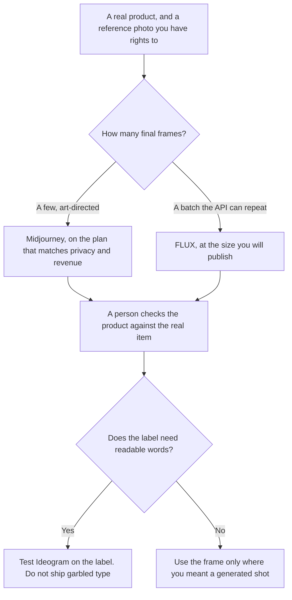

**Use Midjourney when a person is art-directing a product look in the app and can pay a plan. Use FLUX when a batch of product images should have a price per image and an API.** A hero image you will stare at for an hour is a different invoice from two hundred catalog frames. Neither subscription nor credit makes a generated product the real SKU. Match the shot to the item you sell.

The plan-versus-meter comparison, without the catalog job, is [Midjourney vs FLUX](/blog/midjourney-vs-flux-2026/). The clocks are [Midjourney pricing explained](/blog/midjourney-pricing-explained-2026/) and [FLUX pricing explained](/blog/flux-pricing-explained-2026/). The hands-on workflow for a single product image is [how to generate product photos with AI](/blog/how-to-generate-product-photos-with-ai-2026/).

Prices are US list prices from directory pages checked October 16, 2026. Published October 24, 2026. We did not score image quality.

## The product job

| The shot | Lean toward | Why, on the card |
|---|---|---|
| A person exploring lighting and style in a web app | [Midjourney](/tools/midjourney/) Basic at $10 a month, or $8 billed annually | Fast GPU time is the meter. Basic includes 3.3 Fast hours |
| Ongoing art direction, with Relax for extra stills | Midjourney Standard at $30 a month, or $24 billed annually | Unlimited Relax images start on Standard. Relax is not on Basic |
| Images that must stay private, or a company over $1M gross revenue | Midjourney Pro at $60 a month, or $48 billed annually | Stealth Mode is Pro and Mega only. The directory says companies over $1,000,000 gross annual revenue need Pro or Mega |
| A batch through an API, priced per frame | [FLUX](/tools/flux/) | FLUX 3 Klein is $0.008 at 768×768, $0.009 at 1K, $0.014 at 2K, $0.036 at 4K. One credit is $0.01. No subscription on the card |
| Readable text on a package or a label | [Ideogram](/tools/ideogram/), as the text case | Plus is $15 a month billed yearly. This page does not claim Midjourney or FLUX win at label text |

A generated bottle that changes the logo, the scent name, or the volume is a different product. Reject it. The check is the same one you would use on a bad photo from a shoot.

## What the frames cost

**Midjourney Basic** is $10 a month or $96 a year. **Standard** is $30 or $288 a year. **Pro** is $60 or $576 a year. **Mega** is $120 or $1,152 a year. Annual is the 20 percent discount the help center describes. Relax mode is unlimited for images on Standard and above. It is slower. It is not a promise about catalog consistency. Stealth is not on Basic or Standard. If the shot is unreleased, Pro is the first plan that lists privacy. Commercial use is allowed for subscribers under Midjourney's terms, on the directory card, with that revenue rule for larger companies. Read the terms before a campaign. The product page is [Midjourney review](/blog/midjourney-review-2026/).

**FLUX** has no seat. One hundred images at the 1K Klein rate are 100 × $0.009 = $0.90. One hundred at 4K are 100 × $0.036 = $3.60. That is the generation meter, not retouching, not a photographer, and not returns. The directory says the same price applies in the API and the playground. Other FLUX models have their own rates. Open-weight use is a license question. The card says to check those terms before commercial self-hosting. This page prices the hosted meter, not a self-hosted guess. The product page is [FLUX review](/blog/flux-review-2026/).

**Ideogram Plus** is $15 a month billed yearly, or $20 monthly, when the words on the label are the reason you are generating at all. The invoice is [Ideogram pricing explained](/blog/ideogram-pricing-explained-2026/).

**[Adobe Firefly](/tools/adobe-firefly/) Standard** is $9.99 a month when the shot has to stay inside an Adobe file and you want the commercially safe positioning on that card. It is a different pipeline. The invoice is [Adobe Firefly pricing explained](/blog/adobe-firefly-pricing-explained-2026/).

A Basic plan at $10 can cost more than a hundred API frames and still be the right buy, because a person is steering. An API at $0.90 is the right buy when the prompt is already frozen and the job is volume. Do not "save" the $10 by hand-running a hundred playground clicks you will not review.

## What this page will not pretend

It will not rank photorealism. It will not claim a generated pack shot replaces a compliance photo of the real product where the law or the marketplace requires the real item. It will not treat Relax unlimited as unlimited art direction. Your time is still finite. It will not invent a Midjourney per-image price. The meter is GPU time.

If the product shot is a video, that is a different card. Midjourney video resolution depends on the plan. FLUX video is billed per second, and this page does not print a per-second rate the directory did not isolate as one number.

## FAQ

### Can I keep an unreleased product private on Basic?

Stealth Mode is listed on Pro and Mega only. Assume Basic and Standard images are not the private setting. If privacy matters, start at Pro, or use a pipeline whose terms you have read for private generation.

### Is FLUX cheaper for a brand campaign?

For a handful of hero frames, often no, once you count the hours a person spends prompting. For a large batch at a frozen prompt, the per-image math above is the reason to look at FLUX. Run ten frames before you run a thousand. Reject the batch if the product drifts.

### What about the logo on the product?

If the letters must be correct, test that crop on purpose. Ideogram is the directory's text-oriented option. A pretty bottle with a misspelled brand is not a product shot. It is a defect.

### Do I need a reference photo?

Yes, if the result should be your product and not a generic one. Use a photo you have rights to. Say what must not change: color, label, shape, count. Review those four. A model will improvise anything you leave unnamed.

## Last verified

October 16, 2026 for Midjourney, FLUX, Ideogram, and Adobe Firefly. Published October 24, 2026.

**Sources:** [Midjourney plan comparison](https://docs.midjourney.com/hc/en-us/articles/27870484040333-Comparing-Midjourney-Plans), [FLUX API pricing](https://docs.bfl.ai/quick_start/pricing), [Ideogram plans](https://docs.ideogram.ai/plans-and-billing/available-plans).

*Published by Andrew for [AI Tools Optimizer](https://aitoolsoptimizer.com).*

[Midjourney](/tools/midjourney/) is in the [image generation directory](/tools/category/image-generation/). Directory pages may use affiliate links. A purchase through them may earn us a commission at no extra cost to you.
