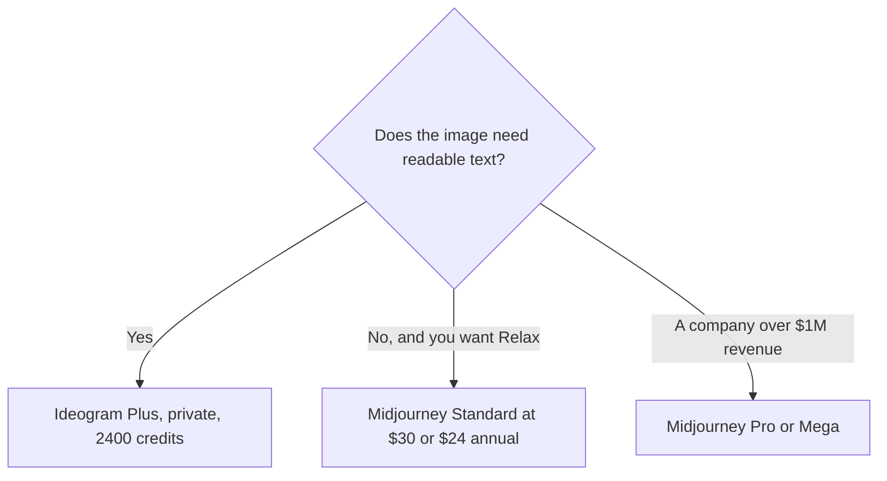

**Choose Midjourney when you want a stylized image generator priced in Fast GPU hours, with Relax on Standard and up. Choose Ideogram when the picture has to contain readable words, and you want a credit plan with a free weekly allotment.** This page is the pair. The three-way with Flux and Firefly is [Flux vs Ideogram vs Firefly](/blog/flux-vs-ideogram-vs-firefly-2026/). The other Ideogram pair is [Leonardo vs Ideogram](/blog/leonardo-vs-ideogram-2026/). We did not score which pictures look better.

Prices are US list prices excluding tax from directory pages checked October 16, 2026. Published October 24, 2026.

## The meters

| | [Midjourney](/tools/midjourney/) | [Ideogram](/tools/ideogram/) |
|---|---|---|
| Free | No free plan | 30 credits a week |
| Entry paid | Basic $10 a month, or $8 billed annually. 3.3 Fast hours | Plus $20 a month, or $15 billed yearly ($180), 2,400 credits |
| The step most people mean | Standard $30, or $24 annually. 15 Fast hours. Unlimited Relax images | Plus, if text and private generation are the point. Pro if you need batch |
| Next | Pro $60, or $48 annually, 30 Fast hours. Mega $120, or $96, 60 Fast hours | Pro $60 a month, or $42 yearly ($504), 7,500 credits. Team $30 a user a month, or $20 yearly, 3,600 credits a user, minimum 2 users |
| Privacy | Stealth Mode on Pro and Mega only | Plus and higher keep generations private. Free images are not private |
| A documented strength | Stylized image and short video, on the web or in Discord | Legible text in images, on Ideogram's own description and docs |
| A rule that changes the plan | Companies with over $1,000,000 gross annual revenue need Pro or Mega for commercial use | Paid plans can keep generating on Ideogram models in a slower queue after credits run out |

Midjourney annual prices are 20% off: Basic $96 a year, Standard $288, Pro $576, Mega $1,152. Extra Fast time is $4 an hour. Unlimited Relax image generation starts on Standard. Unlimited Relax SD video is on Pro and Mega. V8 entered alpha in March 2026 with a 2K mode, and Relax is not yet supported for V8, on the directory card. Subscribers can use images and videos broadly under Midjourney's terms, with that revenue rule on Pro or Mega. The ladder is [Midjourney pricing explained](/blog/midjourney-pricing-explained-2026/). The product page is [Midjourney review](/blog/midjourney-review-2026/).

Ideogram Plus at the yearly rate is $180 a year. Pro yearly is $504. Two Team seats on the yearly rate are 2 × $20 × 12 = $480 a year, before you confirm tax. A week of the free plan is 30 credits, which is a real test and a public gallery. The card is [Ideogram pricing explained](/blog/ideogram-pricing-explained-2026/). The product page is [Ideogram review](/blog/ideogram-review-2026/).

## How to pick without a taste ranking

**Posters, thumbnails, and ads where the words are the design.** Start on Ideogram Free. Move to Plus when you need privacy and the weekly 30 credits are the blocker. Keep the on-image text short. The directory's own guidance is that fewer words render more reliably. That is a product note, not a score from us.

**A look, a moodboard, a style reference.** Midjourney Standard is the first plan with unlimited Relax images. Basic is the paid trial of Fast hours only. If the work must stay private, Stealth starts at Pro, which is $60 or $48 annually. Do not plan a confidential campaign on Basic.

**A company above the revenue line.** Read Midjourney's commercial rule before you ship. Over $1,000,000 in gross annual revenue means Pro or Mega, on the help-center answer recorded in the directory. Ideogram's directory page does not restate an equivalent revenue line. Check Ideogram's current terms before you treat a Plus seat as the company license.

**You already pay for a design suite.** [Adobe Firefly](/tools/adobe-firefly/) Standard is $9.99 a month with 2,000 credits, and paid plans include unlimited standard image generations. [Canva](/tools/canva/) Pro is $18 a month or $180 a year for one person. Use those when the file has to stay in that suite. The brand stack is [best AI tools for brand teams](/blog/best-ai-tools-for-brand-teams-2026/).

## FAQ

### Is Ideogram cheaper than Midjourney?

Ideogram has a free weekly allotment. Midjourney does not. Ideogram Plus yearly is $15 a month. Midjourney Basic annual is $8, and Standard annual is $24. Compare the meter you will hit: credits and privacy, or Fast hours and Relax. The lower sticker can be the wrong unit.

### Can I keep client work private on the cheap plan?

On Midjourney, Stealth is Pro or Mega. On Ideogram, private generation starts at Plus. Free Ideogram images are not private. Budget the privacy tier before the campaign, not after the first export.

### Which one is better at hands?

We did not run that test, and this page will not borrow a score from a demo reel. Pick from the meter, the privacy rule, and whether the layout needs words.

### Do I need the Team plan on Ideogram?

Team is a per-user credit pool with a two-user minimum. A solo designer stays on Plus or Pro. Two people on Team yearly are $480 a year at the $20 rate. Confirm the seat count before you leave Plus.

## Last verified

October 16, 2026 for Midjourney, Ideogram, Adobe Firefly, and Canva prices named above. Published October 24, 2026.

**Sources:** [Midjourney plans](https://docs.midjourney.com/hc/en-us/articles/27870484040333-Comparing-Midjourney-Plans), [Ideogram](https://ideogram.ai), [Canva pricing](https://www.canva.com).

*Published by Andrew for [AI Tools Optimizer](https://aitoolsoptimizer.com).*

[Ideogram](/tools/ideogram/) is in the [image generation directory](/tools/category/image-generation/). Directory pages may use affiliate links. A purchase through them may earn us a commission at no extra cost to you.
