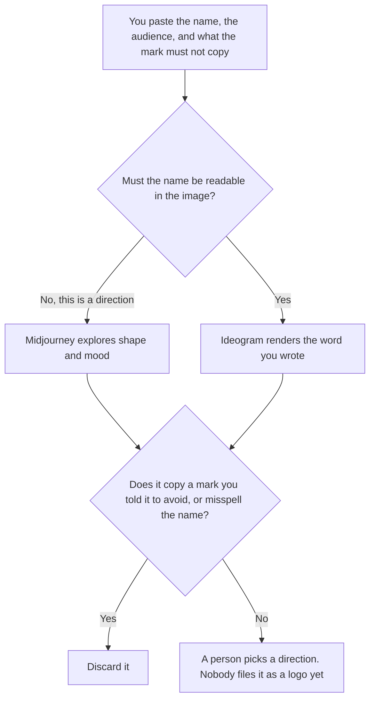

**Use Midjourney when you are exploring a visual direction and the words in the mark can be wrong. Use Ideogram when the concept has to render a name or a short word you can read.** Either tool may produce options from a brief you wrote. Neither produces a trademark, a final logo system, or a guarantee that the mark is unused. A thumbnail, which is a different frame, is [Midjourney vs Ideogram for thumbnails](/blog/midjourney-vs-ideogram-for-thumbnails-2026/). A social ad is [Midjourney vs Ideogram for social ads](/blog/midjourney-vs-ideogram-for-social-ads-2026/).

Prices are from directory pages checked October 16, 2026. Ideogram's card cites Ideogram's docs last verified by Ideogram on October 15, 2026. Claude's prices are from claude.com/pricing on October 24, 2026. Canva's starting price is from the October 16 card only where this page states it. Published October 24, 2026. We did not score likeness or legibility.

## Which concept you are making

| The board in front of you | Start here | First paid step | The limit |
|---|---|---|---|
| Mood, shape, and a direction, words optional | [Midjourney](/tools/midjourney/) | Basic is $10 a month, or $8 billed annually | The wordmark may be illegible. Treat it as a sketch |
| A name or a short word that must be readable | [Ideogram](/tools/ideogram/) | Plus is $20 a month, or $15 a month billed yearly | A readable word is still not a cleared trademark |
| The brief before either tool | [Claude](/tools/claude/) | Pro is $17 a month billed annually, or $20 monthly | The brief does not draw the mark |
| A later layout around a concept you kept | [Canva](/tools/canva/) | Pro is $18 a month, or $180 a year, on the October 16 card | The concept is an input. Canva does not clear it |

Midjourney Standard is $30 a month, or $24 billed annually, with 15 hours of Fast GPU time, on the October 16 card. Basic is 3.3 hours. Extra Fast time is $4 an hour on every plan. Stealth Mode, which keeps work private, starts on Pro at $60 a month, or $48 billed annually. A logo exploration you do not want in a public feed is a Pro conversation, not a Basic one. Confirm the current privacy default before you paste an unreleased name.

Ideogram Free is 30 credits a week. Plus is private generation, on that card. Pro is $60 a month, or $42 billed yearly, with batch generation. Team is $30 a user a month, or $20 billed yearly, with a two-user minimum. A concept that includes the company name should not sit on a plan that publishes it. Read the privacy line on the plan you actually buy.

## What the concept is allowed to be

A direction: a shape, a palette you named, a word you spelled. It is not a logo you ship. It is not proof the name is available. If the brief says "do not resemble these marks," and the image does, you discard it. You do not ask the model whether it is "close enough."

**Midjourney Basic** is the cheap direction pass when privacy is not the issue and you can tolerate broken lettering. Move to Pro when Stealth Mode is the requirement.

**Ideogram Plus** is the pass when the name has to be read. Put the exact spelling in quotes, the way the directory's own getting-started note describes. If a letter is wrong, it is the wrong concept.

**Claude Pro** writes the brief: the audience, the words that must appear, the marks to avoid. It does not pick the winner. The review is [Claude review](/blog/claude-review-2026/).

**Canva Pro**, at $18 a month or $180 a year for one person on the October 16 card, is where a chosen direction might later sit in a deck. It is not the clearance step.

A prompt that holds the line:

"Generate logo concepts from the name spelling, the audience, and the avoid-list I pasted. Do not add a tagline I did not write. If the spelling is missing, stop and write Name not set."

## What not to delegate

Do not ask which concept is legally safe. Do not put a client's unreleased name on a public plan. Do not present a concept board as the identity. A designer, and counsel if you file anything, come after the board. This page does not replace them.

## FAQ

### Which one designs a better logo?

We did not measure that. Midjourney fits a visual direction. Ideogram fits a readable word. Neither is a trademark search. The useful board is the one a person can reject.

### Do I need both?

You need the constraint that matters. If the name must be spelled correctly, start with Ideogram. If you are exploring shape and the letters can be fake, Midjourney is enough. Running both and calling the prettiest one the logo skips the brief.

### What about a real wordmark later?

Export the direction you kept and hand it to a person who draws vector marks. An upscale is not a logo system. A style reference is not a brand guideline.

### Who may show the concepts to a client?

The owner of the project, after they have checked the avoid-list themselves. A gallery link is a distribution decision. Generating the images does not make it.

## Last verified

October 16, 2026 for Midjourney, Ideogram, and Canva. Ideogram's card cites docs last verified by Ideogram on October 15, 2026. October 24, 2026 for Claude. Published October 24, 2026.

**Sources:** [Midjourney](https://docs.midjourney.com/), [Ideogram](https://ideogram.ai/), [Canva](https://www.canva.com/), [Claude pricing](https://claude.com/pricing).

*Published by Andrew for [AI Tools Optimizer](https://aitoolsoptimizer.com).*

[Ideogram](/tools/ideogram/) is in the [image generation directory](/tools/category/image-generation/). Directory pages may use affiliate links. A purchase through them may earn us a commission at no extra cost to you.
