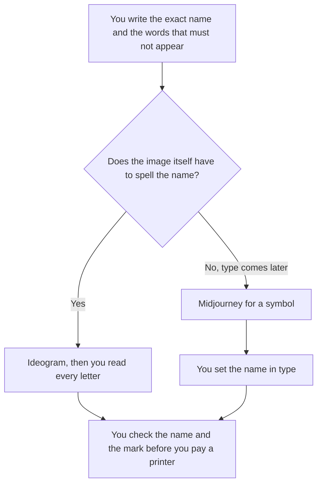

**Choose Ideogram when the logo has to spell a name. Choose Midjourney when you want a stylized symbol and you will set the name in type yourself.** A generated picture is a draft. It is not a trademark clearance, and it is not a brand system. We did not score which marks look better. The general pair, without this logo constraint, is [Midjourney vs Ideogram](/blog/midjourney-vs-ideogram-2026/).

The invoices are [Ideogram pricing explained](/blog/ideogram-pricing-explained-2026/) and [Midjourney pricing explained](/blog/midjourney-pricing-explained-2026/). A product that sells a logo file rather than an art subscription is [Looka pricing explained](/blog/looka-pricing-explained-2026/).

Prices are US list prices excluding tax from directory pages checked October 16, 2026. Published October 24, 2026. A generated mark can collide with someone else's. This page does not clear that.

## The logo job, then the meter

| The mark you need | Start here | First price | What you still do |
|---|---|---|---|
| A wordmark, and the letters have to be the letters | [Ideogram](/tools/ideogram/) | Free is 30 credits a week. Plus is $20 a month, or $15 billed yearly | Read every letter. Reject a name that is almost yours |
| A symbol or a texture, and you will add the name in a layout tool | [Midjourney](/tools/midjourney/) | Basic is $10 a month, or $8 billed annually. No free plan | Set the type yourself. Do not trust spelled text in the image |
| A downloadable logo package with stated file types | [Looka](/tools/looka/) | Design is free. Basic is $35 once. Premium is $72 once | You still clear the name. The package is files, not a legal opinion |
| Social templates after the mark exists | [Canva](/tools/canva/) Pro at $18 a month, or $180 a year | The mark is already chosen. Canva is the layout |

Ideogram's directory card describes it as the tool for graphics that need clean, readable text. That is the vendor's positioning. It is not a score from us. Midjourney's card describes stylized images and prices them in Fast GPU time. Basic includes 3.3 hours of Fast time. Standard is $30 a month, or $24 billed annually, and adds Relax. Pro is $60, or $48 annually, and adds Stealth Mode. Stealth is a privacy toggle on that card. It is not a trademark.

## What you are not buying

**A vector brand system.** Midjourney and Ideogram give you images under their plan rules. A printer or a developer will ask for SVG. Looka Premium at $72 once includes PNG, EPS, SVG, and PDF, on the pricing explainer. Ideogram Plus at 2,400 credits a month is a generation budget, not that file list. Read the download you actually get before you promise a printer a vector.

**A free Midjourney trial.** The directory records no free plan. If you need a no-cost first look at letterforms, Ideogram's weekly 30 credits are the row that exists. Spending $10 to discover you needed readable type is a small mistake. It is still a mistake you can skip.

**Canva as the inventor of the name.** Canva Pro is the place the mark goes after it exists. Magic Studio pricing is [Canva Magic Studio pricing explained](/blog/canva-magic-studio-pricing-explained-2026/). The designer's wider shelf is [best AI tools for designers](/blog/best-ai-tools-for-designers-2026/).

A prompt that holds the line:

"A flat logo mark for the exact name I typed. No extra words. No slogan. No photorealistic scene. Simple shapes on a plain background. If you cannot spell the name, do not approximate it."

Then you zoom in. A letter that is wrong is a failed draft, even if the shape is handsome. The person who accepts it is [what human-in-the-loop AI is](/blog/what-is-human-in-the-loop-ai-2026/).

## What not to delegate

Do not ship a mark you have not searched. Do not paste someone else's logo and ask for "the same, but ours." Do not treat Stealth Mode, a paid tier, or a credit balance as clearance to use the image in commerce. The plan's commercial terms are on the vendor's page. Read them for the plan you bought.

The voice that should match the mark is [how to create a brand voice with AI](/blog/how-to-create-a-brand-voice-with-ai-2026/). The voice doc does not design the logo. It keeps the words consistent after the mark exists.

## FAQ

### Which one makes better logos?

We did not score that. If the name must be readable inside the image, start with Ideogram and still proof the letters. If you will typeset the name, Midjourney is a symbol generator with an hour meter.

### Is Ideogram's free plan enough?

It is 30 credits a week. Enough to see if the letters survive. A real exploration of many directions will hit Plus. Plus is $20 a month or $15 billed yearly, with 2,400 credits a month.

### Do I still need Looka?

Buy Looka when you want the stated file package, not when you want another art style. The two image tools and Looka answer different purchases. Owning a PNG is not the same as owning a vector set.

### Can I trademark what the model drew?

This page cannot tell you. A generation can resemble an existing mark, or include a style you do not have rights to commercialize. Clear it before you print, register, or put it on a product.

## Last verified

October 16, 2026 for Ideogram, Midjourney, Looka, and Canva. Published October 24, 2026.

**Sources:** [Ideogram pricing](https://ideogram.ai/pricing), [Midjourney plans](https://docs.midjourney.com/docs/plans), [Canva pricing](https://www.canva.com/pricing/).

*Published by Andrew for [AI Tools Optimizer](https://aitoolsoptimizer.com).*

[Ideogram](/tools/ideogram/) is in the [image generation directory](/tools/category/image-generation/). Directory pages may use affiliate links. A purchase through them may earn us a commission at no extra cost to you.
