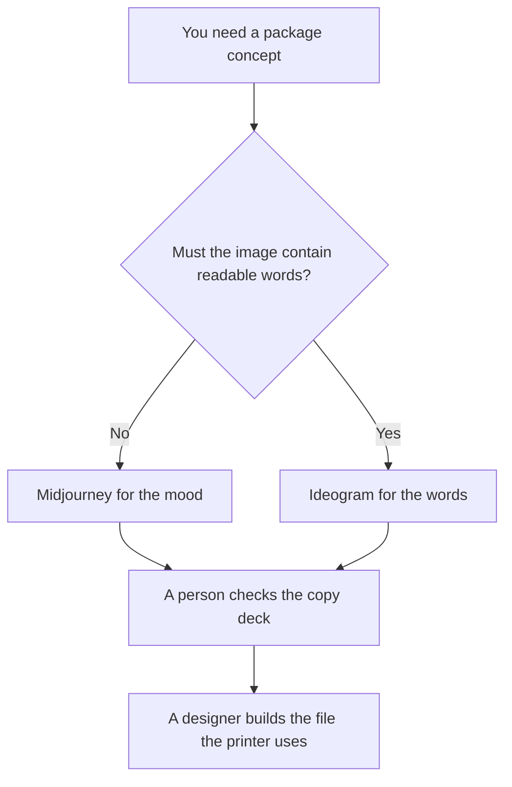

**Use Midjourney when the packaging job is a mood: color, material, and a shelf feeling you will throw away if it is wrong. Use Ideogram when the concept has to show words a person can read, such as a flavor name or a net-weight line.** Neither file is a dieline, a print-ready PDF, or a trademark search. The concept-then-dieline comparison against Flux is [Midjourney vs Flux for packaging](/blog/midjourney-vs-flux-for-packaging-2026/).

Prices are US list prices excluding tax from directory pages checked October 16, 2026. Published October 24, 2026. We did not score text accuracy or print quality.

## Which picture you actually need

| The picture | Start here | First paid step | What you still do |
|---|---|---|---|
| A shelf mood, words not required | [Midjourney](/tools/midjourney/) | Basic is $10 a month, or $8 billed annually. Standard is $30, or $24 annually | Hand the direction to a designer |
| A panel where the words must be legible | [Ideogram](/tools/ideogram/) Free, 30 credits a week | Plus is $20 a month, or $15 a month billed yearly | Proof every word against the copy deck |
| A product shot that is not a package | [Flux](/tools/flux/) | See the Flux pricing article | A different job |
| The layout a printer will receive | [Canva](/tools/canva/) | A design seat you already have | The dieline stays with the printer's spec |

Midjourney has no free plan on the directory card. Images are public unless you are on Pro at $60 a month, or $48 billed annually, or Mega at $120, or $96 annually. Stealth Mode is on Pro and Mega. Companies with over $1 million in gross revenue need Pro or Mega, on that card. A confidential package concept does not belong on Basic or Standard if the images are public. The ladder is [Midjourney pricing explained](/blog/midjourney-pricing-explained-2026/).

Ideogram Free images are not private, on the directory card. Plus adds private generation. If the flavor name is unannounced, start on Plus, not on the weekly free credits. The invoice is [Ideogram pricing explained](/blog/ideogram-pricing-explained-2026/).

## What you are paying for

**Midjourney Standard** is the practical mood plan because it adds unlimited Relax image generation, on the directory card. Basic's Fast hours run out. A package exploration that exists to be rejected does not need Mega. It does need a plan whose privacy matches the brief. If the brief is public-safe, Standard is the seat. If the brief is confidential, Pro is the first seat that matches the Stealth line on the card.

**Ideogram Plus** is the first paid step when the words are the point. Pro is $60 a month, or $42 a month billed yearly, with a larger credit pool and batch generation. Edits and upscales still spend credits after the slow queue, on the directory card. Proof the spelling. A beautiful misspelling is a failed concept.

**Flux** is the other packaging article. Use it when you already know you want that model's look. Do not run all three and call the prettiest file the winner. Pretty is not the copy deck.

**Canva** is the layout tool if that is where the brand already builds. An AI render pasted over a dieline is still a render.

A prompt that holds the line:

"Generate a package concept using only the product name, the flavor words, and the colors I pasted. Do not add a claim, a badge, or a net-weight number I did not paste. If a word would have to be invented, leave that area blank."

## What not to delegate

Do not ship a generated panel to a printer. Do not put an unannounced name on a public Midjourney plan. Do not treat legible text in one image as proof the next image will spell it the same way. Check each export against the copy deck. A claim that was not in the deck is [what an AI hallucination is](/blog/what-is-ai-hallucination-2026/), in picture form.

## FAQ

### Which one renders better packages?

We did not score that. Midjourney is the mood when words are optional. Ideogram is the panel when a person must read the words. The printer's file is a person's job after both.

### Do I need Midjourney Pro?

You need Pro or Mega when you need Stealth, or when the revenue rule on the directory card applies. You do not need Pro merely because the concept is a box. Standard is the mood plan when public images are acceptable.

### Are Ideogram's free credits enough?

Thirty credits a week can test a spelling. They are a poor place for an unannounced name, because free images are not private on the directory card. Move to Plus when the concept is real.

### What about the Flux article?

Read it when the next step is a dieline conversation. This page stops at the concept: mood, or readable words.

## Last verified

October 16, 2026 for Midjourney, Ideogram, Flux, and Canva. Published October 24, 2026. Plan privacy rules are the vendor's, from the directory record. Confirm them at checkout if the brief is confidential.

**Sources:** [Midjourney](https://www.midjourney.com), [Ideogram plans](https://docs.ideogram.ai/plans-and-billing/available-plans), [Ideogram](https://ideogram.ai).

*Published by Andrew for [AI Tools Optimizer](https://aitoolsoptimizer.com).*

[Ideogram](/tools/ideogram/) is in the [image generation directory](/tools/category/image-generation/). Directory pages may use affiliate links. A purchase through them may earn us a commission at no extra cost to you.
