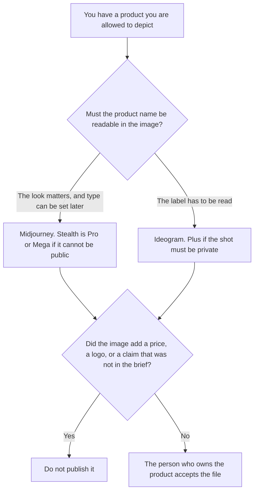

**Use Midjourney when you want a stylized product shot and you can spend Fast GPU time, with Stealth on Pro or Mega if the product is not public yet. Use Ideogram when the shot has to show a product name or a label a person can read.** Neither tool may invent a price, a claim, or a logo you did not supply. A generated frame is not a photograph of the unit you ship.

A product still against Leonardo is [Midjourney vs Leonardo for product shots](/blog/midjourney-vs-leonardo-for-product-shots-2026/). Packaging, which is a different layout problem, is [Midjourney vs Ideogram for packaging](/blog/midjourney-vs-ideogram-for-packaging-2026/). The bills are [Midjourney pricing explained](/blog/midjourney-pricing-explained-2026/) and [Ideogram pricing explained](/blog/ideogram-pricing-explained-2026/).

Prices are US list prices from directory pages checked October 16, 2026, as those pricing articles record them. Ideogram's article also records Enterprise as custom. Published October 24, 2026. We did not score images. We did not run a shoot.

## Which shot you need

| The shot | Start here | First paid step | The limit |
|---|---|---|---|
| A stylized product look, and the label can be added later | [Midjourney](/tools/midjourney/) | Basic is $10 a month, or $8 billed annually | Images are public unless you use Stealth, which is Pro or Mega |
| A product name or label that has to be readable | [Ideogram](/tools/ideogram/) | Plus is $20 a month, or $15 billed yearly, with private generation | Free images are not private. Enterprise is custom |
| The claim and the price, in words | [Notion AI](/tools/notion-ai/) | Business is $20 a seat a month | The image does not invent the offer |
| A commercially licensed model path you still have to read | [Adobe Firefly](/tools/adobe-firefly/) | Standard is $9.99 on the October 16 card | This page does not restate the credit ladder |

Midjourney's October 16 card lists Basic at $10 a month or $8 billed annually, Standard at $30 or $24, Pro at $60 or $48, and Mega at $120 or $96. Fast GPU time on that card is 3.3 hours on Basic, 15 on Standard, 30 on Pro, and 60 on Mega. Stealth Mode is only on Pro and Mega. The card also says companies with over $1 million in gross revenue need Pro or Mega. An unreleased product is public on Basic and Standard. If the shot cannot be public, the card's answer is Stealth.

Ideogram's October 16 card lists a free plan at 30 credits a week, Plus at $20 or $15 a month billed yearly for 2,400 credits and private generation, Pro at $60 or $42 yearly for 7,500 credits and batch generation, and Team at $30 a user a month or $20 yearly, minimum two users. The pricing article records Enterprise as custom. Free images are not private. A label for an unreleased product belongs on Plus or above, not on the free plan. Edits and reference images spend credits on that card, including after the slow queue starts.

The words on the label live in Notion. If the legal line is missing, the line says Claim not approved. It does not get shortened so it fits the frame.

## What the file is allowed to show

The product, the lighting direction, and the words you already approved. A discount that was not in the brief stays out. A logo you did not supply stays out. Style is not a claim.

**Midjourney Basic** is the cheapest paid GPU clock for a look. Pro is the first Stealth step on that card. The review path is the pricing article above.

**Ideogram Plus** is the first paid private card, and the card people use when type has to be legible. The review is [Ideogram review](/blog/ideogram-review-2026/).

**Firefly Standard** at $9.99 is the individual image seat on the October 16 card, with a different rights story. Read [Adobe Firefly pricing explained](/blog/adobe-firefly-pricing-explained-2026/) before you treat it as the same job. The enterprise contract, which has no dollar on the sources we could read, is [Adobe Firefly Enterprise pricing explained](/blog/adobe-firefly-enterprise-pricing-explained-2026/).

A prompt that holds the line:

"Make a product shot from the product description and the label text I pasted. If I did not paste label text, do not invent a word. Do not add a price. Do not add a logo I did not supply."

## What not to delegate

Do not ask which image "looks more premium." Do not ship a generated bottle as if it were the photographed SKU. Do not put an unreleased product on a public plan. The product owner accepts the file.

## FAQ

### How is this different from the Leonardo product-shot page?

That page is a stylized GPU clock against a token plan and a trained look. This page is a stylized look against readable type. Ideogram is here because the label is the job. Leonardo is not the label tool on this cut.

### How is this different from the packaging comparison?

Packaging is the dieline and the panel. A product shot is the object in a frame. A readable name can matter in both. Use the packaging page when the file is a package. Use this page when the file is a shot.

### Does Plus Ideogram include a private shot?

On the October 16 card, private generation starts on Plus. The free plan's images are not private. Enterprise is custom on the pricing article. This page does not invent an Enterprise dollar.

### Who may publish the file?

The person who owns the product, after they check the label and the claim. A generated image is not approval to sell, and it is not a photo of the unit in the warehouse.

## Last verified

October 16, 2026 for Midjourney, Ideogram, Firefly, and Notion prices, via the posts cited above. Published October 24, 2026. Ideogram Enterprise remains custom on that record. We did not score images.

**Sources:** [Midjourney plans](https://docs.midjourney.com/docs/plans), [Ideogram plans](https://docs.ideogram.ai/plans-and-billing/available-plans), [Adobe Firefly plans](https://www.adobe.com/products/firefly/plans.html), [Notion pricing](https://www.notion.com/pricing).

*Published by Andrew for [AI Tools Optimizer](https://aitoolsoptimizer.com).*

[Ideogram](/tools/ideogram/) is in the [image generation directory](/tools/category/image-generation/). Directory pages may use affiliate links. A purchase through them may earn us a commission at no extra cost to you.
