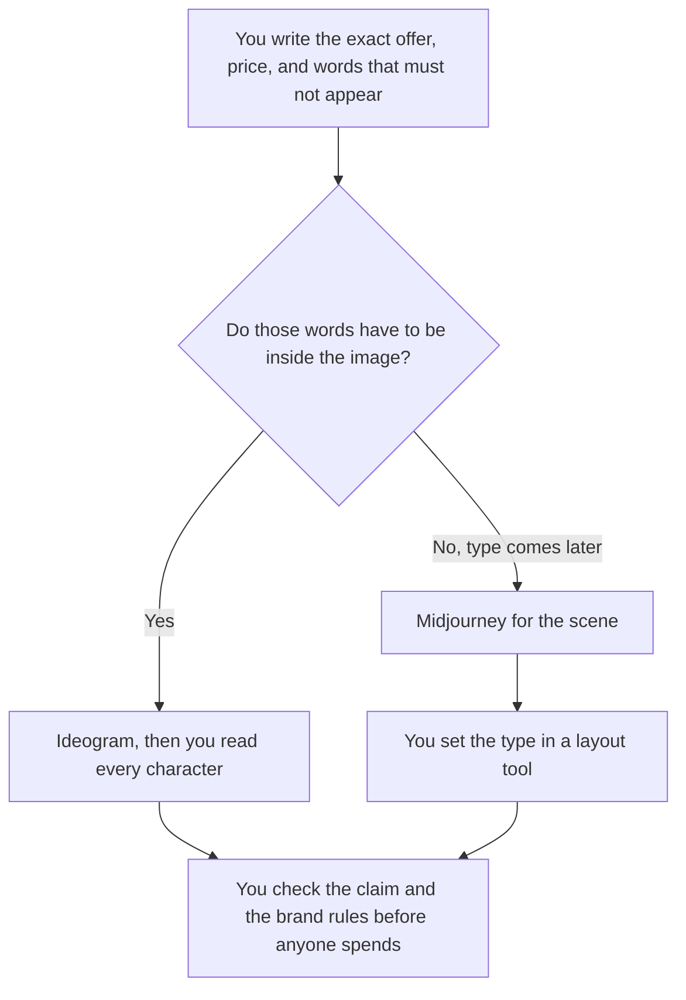

**Choose Ideogram when the ad has to spell an offer, a price, or a short headline. Choose Midjourney when you want a stylized scene and you will set the type in a layout tool.** A generated image is a draft creative. It is not a media buy, and it is not a claim your review process has cleared. We did not score which ads convert.

The pair without this text constraint is [Midjourney vs Ideogram](/blog/midjourney-vs-ideogram-2026/). A wordmark, which is a stricter spelling job, is [Midjourney vs Ideogram for logos](/blog/midjourney-vs-ideogram-for-logos-2026/). The invoices are [Ideogram pricing explained](/blog/ideogram-pricing-explained-2026/) and [Midjourney pricing explained](/blog/midjourney-pricing-explained-2026/).

Prices are US list prices excluding tax from directory pages checked October 16, 2026. Published October 24, 2026. A generated ad can include a claim you are not allowed to make. This page does not clear that.

## The ad job, then the meter

| The creative you need | Start here | First price | What you still do |
|---|---|---|---|
| A headline, a price, or an offer rendered in the image | [Ideogram](/tools/ideogram/) | Free is 30 credits a week. Plus is $20 a month, or $15 billed yearly | Read every character. Reject a price that is not yours |
| A scene or a product mood, and the type goes on later | [Midjourney](/tools/midjourney/) | Basic is $10 a month, or $8 billed annually. No free plan | Set the words in a layout tool. Do not trust spelled text in the image |
| Many sized variants from a product shot you already have | [AdCreative.ai](/tools/adcreative-ai/) | Starter is $39 a month, $29 quarterly, or $20 billed yearly, on the October 16 card | Credits there are downloads. The offer is still one you wrote |
| The resize and the caption after a still exists | [Canva](/tools/canva/) Pro at $18 a month, or $180 a year | The still is chosen. Canva is the layout | Magic Studio pricing is [Canva Magic Studio pricing explained](/blog/canva-magic-studio-pricing-explained-2026/) |

Ideogram's directory card describes it as the tool for graphics that need clean, readable text. That is the vendor's positioning, not a score from us. Plus is 2,400 credits a month and includes private generation, on that card. Pro is $60 a month, or $42 billed yearly. Team is $30 per user a month, or $20 yearly, with a two-user minimum. Monthly credits do not roll over, on the card.

Midjourney Basic includes 3.3 hours of Fast GPU time. Standard is $30 a month, or $24 billed annually, and adds unlimited Relax image generation. Pro is $60, or $48 annually, and adds Stealth Mode. The card says companies with over $1 million in gross revenue need Pro or Mega. Stealth is a privacy toggle on that card. It is not a clearance to run an ad. Images are public unless you are on Pro or Mega.

## What you are not buying

**A media plan.** Neither subscription places the ad or picks the audience. The image is the draft. Spend is a different system, with a person on the budget.

**A free Midjourney test.** The directory records no free plan. If the ad's job is readable type, Ideogram's weekly 30 credits are the row that exists. Spending $10 to discover you needed letters you can read is a small, skippable mistake.

**A price the image invented.** If the offer is "$20 off," you typed "$20 off." A digit the model changed is a false ad. Read it at the size the placement will use. Small type hides a wrong character.

The designer's wider shelf is [best AI tools for designers](/blog/best-ai-tools-for-designers-2026/). The ops shelf that keeps the file and the brand kit honest is [best AI tools for design ops](/blog/best-ai-tools-for-design-ops-2026/).

A prompt that holds the line:

"A square social ad. Use only the headline I typed. No extra words. No slogan I did not write. No fake price. Plain background. If you cannot spell the headline, do not approximate it."

## FAQ

### Which one makes ads that perform?

We did not measure spend or conversion. Pick Ideogram when the image must contain the words. Pick Midjourney when the words will be set later in type. Performance is the offer, the audience, and the test you run. It is not the subscription.

### Can Midjourney do the headline?

It can try. The directory's own contrast is that Ideogram is the text-in-image tool and Midjourney is the stylized one. If a wrong letter would ship a wrong price, do not leave the letters inside a Midjourney image.

### Do we need AdCreative.ai as well?

Only if the job is many export sizes from a product you already shot, and you will spend the download credits on purpose. It does not replace reading the offer. One hero still does not need that meter.

### Are the images private?

Ideogram's free images are not private, on the directory card. Paid Ideogram plans include private generation. Midjourney images are public unless you pay for Pro or Mega and use Stealth. A campaign that is not public yet does not belong on a public gallery.

## Last verified

October 16, 2026 for Ideogram, Midjourney, AdCreative.ai, and Canva. Published October 24, 2026.

**Sources:** [Ideogram](https://ideogram.ai), [Midjourney](https://www.midjourney.com), [AdCreative.ai](https://www.adcreative.ai), [Canva pricing](https://www.canva.com/pricing/).

*Published by Andrew for [AI Tools Optimizer](https://aitoolsoptimizer.com).*

[Ideogram](/tools/ideogram/) is in the [image generation directory](/tools/category/image-generation/). Directory pages may use affiliate links. A purchase through them may earn us a commission at no extra cost to you.
