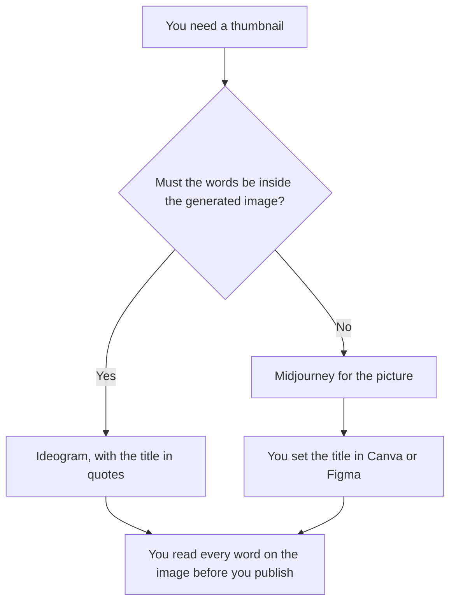

**Use Ideogram when the thumbnail has to show words a person can read. Use Midjourney when you want the picture, and the title will be set in another tool afterward.** The model may generate from the prompt you wrote. It may not invent a claim, a price, or a logo you did not supply. We did not score which picture looks better.

A mood study, which is a different frame, is [Midjourney vs Leonardo for moodboards](/blog/midjourney-vs-leonardo-for-moodboards-2026/). A mark a vendor embeds in an output is [what an AI output watermark is](/blog/what-is-ai-output-watermark-2026/).

Prices are US list prices from directory pages checked October 16, 2026. Ideogram's docs were last verified by Ideogram on October 15, 2026, on that card. Published October 24, 2026. We did not generate a scored set for this article.

## Which plan matches the thumbnail

| The frame in front of you | Start here | First paid step | The limit |
|---|---|---|---|
| The title is part of the image | [Ideogram](/tools/ideogram/) | Plus is $20 a month, or $15 a month billed yearly ($180 a year) | Put the exact words in quotes. Short text renders more reliably, on that card |
| The title will be typeset later | [Midjourney](/tools/midjourney/) | Basic is $10 a month, or $8 a month billed annually ($96 a year) | There is no free plan on that card |
| A layout pass after the still | [Canva](/tools/canva/) | See the directory card before you quote a seat | The still is an input. The title layer is yours |
| A frame in a design file | [Figma](/tools/figma/) | See the directory card before you quote a seat | You place the image. The file does not approve the claim |

Ideogram Free is 30 credits a week on the October 16 card. Plus is 2,400 credits a month. Pro is $60 a month or $42 a month yearly. The legacy Basic plan is no longer sold, on that card. The invoice is [Ideogram pricing explained](/blog/ideogram-pricing-explained-2026/).

Midjourney Basic is the entry paid plan. Standard is $30 a month or $24 a month on annual billing. Extra Fast GPU time is $4 an hour on every plan, on that card. Relax mode and Stealth are not on Basic. The invoice is [Midjourney pricing explained](/blog/midjourney-pricing-explained-2026/).

## What the thumbnail is allowed to say

The words you typed, and the picture you described. A thumbnail that adds "50% off" because the prompt said "bold offer" is a false claim. If the title is in the image, read it character by character. A letter that looks right at a distance and says the wrong word is a failed thumbnail, even if the picture is the one you wanted.

**Ideogram Plus** is the words-in-image path. Keep the title short. The card says fewer words render more reliably. Private generations start at Plus, on that same card.

**Midjourney Basic** is the picture path when you will add type later. Do not spend the prompt trying to render a sentence the layout tool should set. Standard is the plan if you need Relax or HD video, which a still thumbnail does not require.

**Canva or Figma** is where the title lands if you chose Midjourney. The directory cards for those products were not re-fetched for this article. Quote a price from their own pages, or from [the Canva card](/tools/canva/) and [the Figma card](/tools/figma/), on the date you buy.

A prompt that holds the line:

"Generate a thumbnail with only this title, in quotes, and the scene I described. Do not add a second line of text, a price, or a logo."

## What not to delegate

Do not ask which variant will get more clicks. Do not put a real customer's face in the prompt. Do not ship an image whose letters you have not read. The short motion cut, if the thumbnail becomes a teaser, is [Runway vs Kling for product teasers](/blog/runway-vs-kling-for-product-teasers-2026/).

## FAQ

### Which one makes a better thumbnail?

We did not measure that. Ideogram fits words that have to be in the image. Midjourney fits a picture whose title you will set yourself. The thumbnail is ready when the words match the title you approved.

### Do I need both?

You need the tool that matches where the words live. Paying both for one frame is optional. Do not composite text from one model onto a picture from the other unless a person checks the join.

### What aspect ratio should I use?

The ratio your surface requires. Name it in the prompt. This article does not pick a ratio, because a post, a video end card, and a page header are different frames.

### Who may publish it?

The person who owns the title. A generated image is a draft until someone reads the words and confirms the claim.

## Last verified

October 16, 2026 for Midjourney and Ideogram directory cards. Ideogram's card cites docs last verified by Ideogram on October 15, 2026. Published October 24, 2026.

**Sources:** [Ideogram](https://ideogram.ai), [Midjourney](https://www.midjourney.com), [Canva](https://www.canva.com), [Figma](https://www.figma.com).

*Published by Andrew for [AI Tools Optimizer](https://aitoolsoptimizer.com).*

[Ideogram](/tools/ideogram/) is in the [image generation directory](/tools/category/image-generation/). Directory pages may use affiliate links. A purchase through them may earn us a commission at no extra cost to you.
