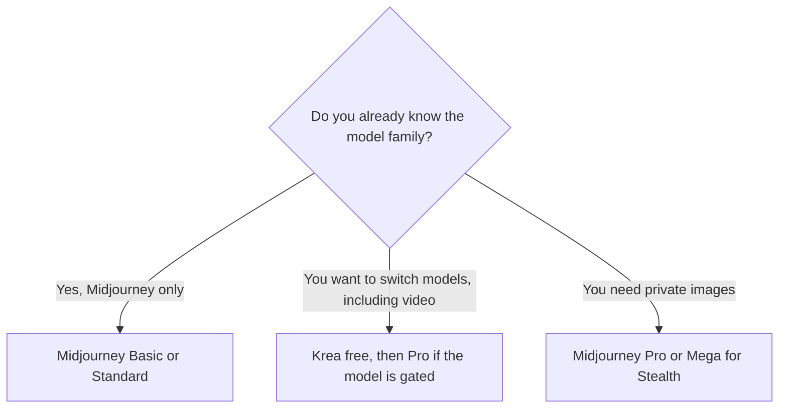

**Choose Midjourney when you want one image family and you will live on a Fast GPU clock. Choose Krea when you want a browser switchboard across models, including video, and you want a free daily grant before you pay.** They do not sell the same meter. A pretty demo is not a plan.

We did not rank pictures. The wider shelf is [best AI image generators](/blog/best-ai-image-generators-2026/). Midjourney's clock is [Midjourney pricing explained](/blog/midjourney-pricing-explained-2026/). Krea's units are [Krea pricing explained](/blog/krea-pricing-explained-2026/) and [Krea review](/blog/krea-review-2026/).

Midjourney figures are from the plan comparison recorded October 16, 2026. Krea figures are from the pricing page read October 24, 2026. A fresh fetch of both vendor pages for this article returned 401, so the tables stay on those recorded checks. Published October 24, 2026.

## The meters

| | Midjourney | Krea |
|---|---|---|
| Free | No | 100 compute units a day, no card |
| Entry paid | Basic $10/month, or $8 billed annually ($96/year) | Basic $9/month, or $5 billed yearly |
| The plan people actually outgrow into | Standard $30/month, or $24 annually, for Relax | Pro $35/month, or $21 yearly, for all video models on the card |
| Top self-serve step we quote | Mega $120/month, or $96 annually | Max $105/month, or $63 yearly, for 60,000 units. A higher slider exists |
| What runs out | Fast GPU hours | Compute units |
| Commercial line | On the plans, with a revenue rule for Pro and Mega | Printed on the plans read October 24, including free. Third-party models can have their own terms |

## Midjourney, in the numbers you can budget

| Plan | Monthly | Annual per month | Fast GPU time | The feature you crossed up for |
|---|---|---|---|---|
| Basic | $10 | $8 | 3.3 hours | A subscription. No Relax |
| Standard | $30 | $24 | 15 hours | Unlimited Relax images |
| Pro | $60 | $48 | 30 hours | Stealth. Unlimited Relax SD video. Required, with Mega, above $1,000,000 gross revenue a year |
| Mega | $120 | $96 | 60 hours | The larger Fast clock |

Extra Fast time is $4 an hour. Annual billing on these cards is 20% off the monthly list. There is no free plan.

Relax is why Standard exists. Basic is a short Fast clock. V8, in alpha as recorded on the pricing explainer, does not support Relax yet. If the look you want is V8, Standard is not an unlimited plan for that model. You are on the Fast clock. Stealth, which keeps images private, starts at Pro. If the work cannot be public, Basic and Standard are the wrong savings.

The other stills comparison in this directory is [Midjourney vs Leonardo vs Flux](/blog/midjourney-vs-leonardo-vs-flux-2026/). Adobe's plan, which is a different license conversation, is [Midjourney vs Adobe Firefly](/blog/midjourney-vs-adobe-firefly-2026/).

## Krea, in the numbers you can budget

| Plan | Monthly | Yearly per month | Units | Video, on the card read October 24 |
|---|---|---|---|---|
| Free | $0 | $0 | 100 a day | Listed on the free feature set that day |
| Basic | $9 | $5 | 5,000 a month | Selected models. Pro is the card that says all video models |
| Pro | $35 | $21 | 20,000 a month | All video models named on that card |
| Max | $105 | $63 | 60,000 a month | All video models. A higher slider showed $200, or $160 yearly |

The yearly toggle is labeled 40% off. Basic's yearly cell prints $5, which is the number to quote, even though 40% off $9 is $5.40. A Basic year at $5 is $60. A Pro year at $21 is $252. A Max year at $63 is $756.

Krea prints rough translations of units into stills and short videos for named models. Those are Krea's estimates for that day. A different model spends units at a different rate. Do not put "15 videos" in a client quote as a quota. The commercial-use line on the pricing page, including free, still sits under Krea's terms and under any third-party model in the chain.

Paid plans describe unlimited relaxed generations on supported in-house image models. Video was not described as unlimited. Assume a video render still spends units.

## Which bill matches the week

**Buy Midjourney Standard** when you will explore one family for hours and the images can be public. Basic is a trial month with a short clock, not a production plan. Pro is the privacy and the high-revenue rule, not a sharper default.

**Buy Krea Free** while 100 units a day teach the interface. **Buy Basic yearly** only if the video model you need is on the selected list. **Buy Pro** when the card says the model you clicked is behind "all video models," or when 5,000 units are gone. **Skip the second subscription** when you already know you only want Midjourney. A switchboard you do not switch is a second meter.

[Leonardo](/tools/leonardo-ai/) Essential is $12 a month for 8,500 tokens on the October 16 card. [Flux](/tools/flux/) is pay as you go, from about $0.008 an image on the model named in the directory, with no subscription. [Adobe Firefly](/tools/adobe-firefly/) Standard is $9.99 for 2,000 credits. They belong in the decision only when the license or the model, not the demo, is the requirement.

## FAQ

### Is Krea a free Midjourney?

No. Free Krea is 100 compute units a day on Krea's switchboard. Midjourney has no free plan. The pictures are different products. Use free Krea to learn Krea.

### Which is cheaper per month?

Krea Basic yearly prints at $5. Midjourney Basic annual is $8. Those entry prices are not the same product. The first serious Midjourney step is Standard at $24 annual. The first Krea step that unlocks every video model on the October 24 card is Pro at $21 yearly. Compare those two if video-or-not is the question. Compare Standard with Basic only if you will not touch Krea's video gate.

### Can I keep images private?

Midjourney Stealth starts on Pro at $60, or $48 billed annually. Krea's recorded cards discuss commercial use, not a Stealth equivalent we should rename. Read Krea's current privacy note if a client contract forbids a public gallery.

### Does either plan include commercial use automatically for every model?

Midjourney's plans include a commercial-use line, and companies over $1,000,000 gross revenue a year are pointed at Pro or Mega. Krea prints commercial use on the plans, including free, and third-party models can differ. Read the model terms for a paid ad. This article is not a license.

## Last verified

October 16, 2026 for Midjourney, Leonardo, Flux, and Firefly figures. October 24, 2026 for Krea, from the pricing page read for the Krea review. Vendor pages fetched again for this article returned 401. Published October 24, 2026.

**Sources:** [Midjourney plans](https://docs.midjourney.com/hc/en-us/articles/27870484040333-Comparing-Midjourney-Plans), [Krea pricing](https://www.krea.ai/pricing).

*Published by Andrew for [AI Tools Optimizer](https://aitoolsoptimizer.com).*

[Midjourney](/tools/midjourney/) and [Krea](/tools/krea/) are in the [image generation directory](/tools/category/image-generation/). Directory pages may use affiliate links. A purchase through them may earn us a commission at no extra cost to you.
