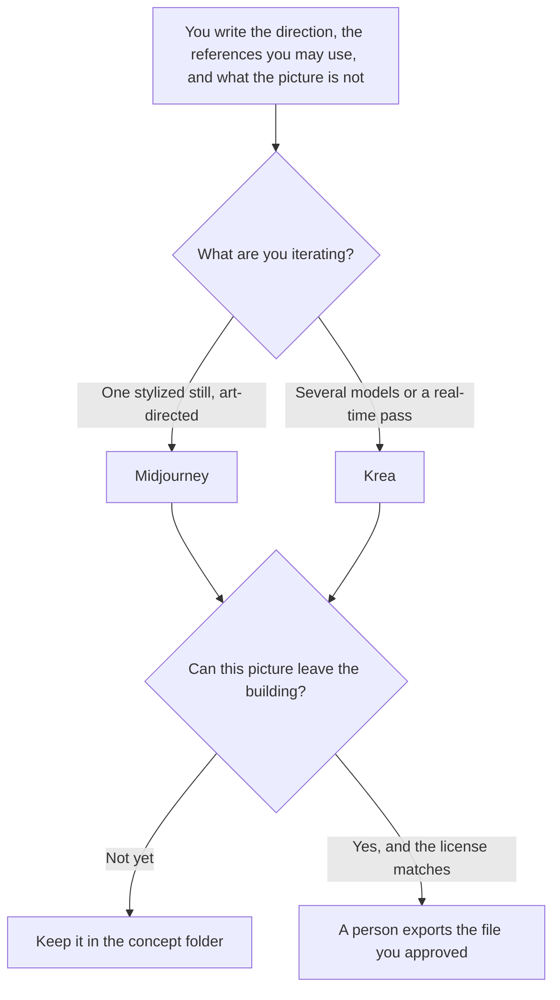

**Use Midjourney when you want a stylized still and you will spend the GPU time art-directing it. Use Krea when the concept needs several models, real-time iteration, or an upscale inside one subscription.** Concept art here is an internal direction: mood, shape, and a note about what the picture is not. It is not a final brand asset, and it is not a customer-facing pack shot with legal type.

The brand-asset split, when the picture must be safe to ship, is [Midjourney vs Firefly for brand assets](/blog/midjourney-vs-firefly-for-brand-assets-2026/). The packaging split is [Midjourney vs Flux for packaging](/blog/midjourney-vs-flux-for-packaging-2026/). The invoices are [Midjourney pricing explained](/blog/midjourney-pricing-explained-2026/) and [Krea pricing explained](/blog/krea-pricing-explained-2026/).

Prices are US list prices excluding tax from directory pages checked October 16, 2026. A live fetch of vendor pricing pages returned HTTP 401 on October 24, 2026, so this page stays on the directory record. Published October 24, 2026. We did not score taste, prompt adherence, or which gallery "looks more professional."

## Which seat matches the still

| The picture you actually need | Start here | What you still do |
|---|---|---|
| Try a real-time direction before you pay | [Krea](/tools/krea/) Free, 100 compute units a day | No credit card on that card. Read three stills |
| A paid Midjourney still | [Midjourney](/tools/midjourney/) Basic at $10 a month, or $8 billed annually | There is no free plan. Images are public unless you buy Stealth |
| Unlimited Relax image generation | Midjourney Standard at $30, or $24 a month billed annually | 15 hours of Fast GPU time. Extra Fast time is $4 an hour |
| All of Krea's video models and a commercial license | Krea Pro at $35 a month, or $21 billed yearly | 20,000 compute units on that card |
| Private Midjourney images | Pro at $60, or $48 annual, or Mega at $120, or $96 annual | Stealth is only on Pro and Mega |
| A heavier Krea unit pool | Max at $105, or $63 yearly, with 60,000 units | Units go quickly on premium video |

Companies with more than $1,000,000 in gross annual revenue must use Midjourney Pro or Mega, on the plan comparison the directory recorded. Krea's paid plans include a commercial license on that card. Basic Krea is $9 a month or $5 billed yearly, with 5,000 units, and it limits video model access. Do not buy Basic and expect every video model. Midjourney Fast time is 3.3 hours on Basic, 15 on Standard, 30 on Pro, and 60 on Mega.

## What the still may be

A direction you can point at: palette, subject, and the references you have rights to use. It may not copy a living artist's name as a style instruction you do not have a policy for, and it may not put real product type or a trademark into the image and call it finished. Concept art is allowed to be wrong about the product. A deck that presents it as the product is not.

**Midjourney Standard** is the practical paid path when you want Relax image generation and you do not need Stealth. The review is [Midjourney review](/blog/midjourney-review-2026/).

**Krea Pro** is the practical paid path when one subscription should cover the model list and the upscale, and the work is commercial. The yearly price is the one to compare. The review is [Krea review](/blog/krea-review-2026/).

**[Adobe Firefly](/tools/adobe-firefly/)** Standard is $9.99 a month when the next step is a brand-safe asset inside Adobe, not a concept still. The invoice is [Adobe Firefly pricing explained](/blog/adobe-firefly-pricing-explained-2026/). [Leonardo](/tools/leonardo-ai/) Essential is $12 a month when you want that token plan instead. The invoice is [Leonardo pricing explained](/blog/leonardo-ai-pricing-explained-2026/).

A prompt that holds the line:

"Generate concept stills from the direction I pasted. Do not add logos, UI text, or a claim. Label each result Concept. If I did not provide a reference I have rights to, do not imitate a named living artist."

## What not to delegate

Do not ship a concept frame as the brand asset. Do not assume public Midjourney images are private. Do not spend Fast hours on a direction you have not written down. V8 was in alpha on the directory note from March 2026, and Relax was not supported for V8 yet. If you need Relax, confirm the model still offers it before you plan the month around it.

## FAQ

### Which one makes better concept art?

We did not measure that. Pick Midjourney when the job is a stylized still and you will curate GPU time. Pick Krea when you want many models and real-time passes on one bill. The direction is yours. The still is a candidate until a person files it as a concept, not as a product photo.

### Is there a free way to start?

Krea's free plan includes 100 compute units a day. Midjourney has no free plan on the card. Basic at $10, or $8 annual, is the smallest Midjourney seat. A free still from another product is a different license. Read it before the image enters a client folder.

### What is Stealth for?

Stealth keeps Midjourney images private, and it is only on Pro and Mega. If the concept includes an unannounced product, public-by-default is the wrong plan. Krea's commercial license is a separate sentence on the paid cards. Privacy and commercial use are not the same checkbox.

### Can we use the image in an ad?

Only when the plan you bought allows that use and a person has approved the frame. Midjourney's revenue rule and Krea's commercial license are the lines to read. An ad with invented packaging type is the brand-asset article, not this one.

## Last verified

October 16, 2026 for Midjourney, Krea, Adobe Firefly, and Leonardo. Published October 24, 2026. Live pricing fetches returned HTTP 401 that day.

**Sources:** [Midjourney plans](https://docs.midjourney.com/hc/en-us/articles/27870484040333-Comparing-Midjourney-Plans), [Krea pricing](https://www.krea.ai/pricing), [Adobe Firefly](https://www.adobe.com/products/firefly.html), [Leonardo](https://leonardo.ai/).

*Published by Andrew for [AI Tools Optimizer](https://aitoolsoptimizer.com).*

[Krea](/tools/krea/) is in the [image generation directory](/tools/category/image-generation/). Directory pages may use affiliate links. A purchase through them may earn us a commission at no extra cost to you.
