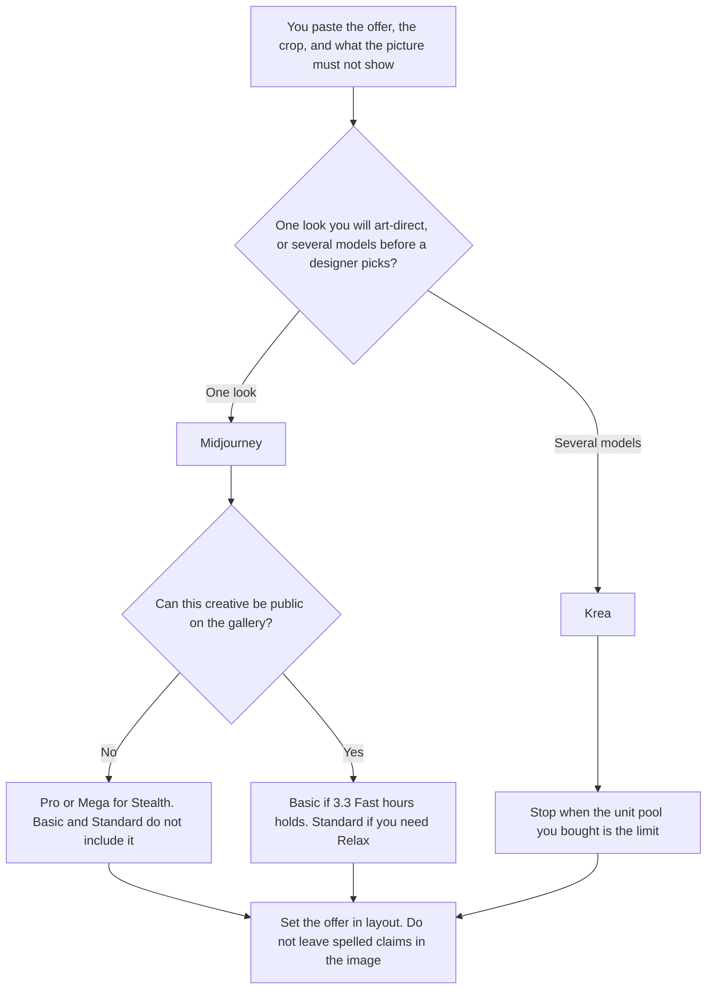

**Use Midjourney when you want one stylized scene for a social ad and you will set the type in a layout tool. Use Krea when the same approved brief has to be tried on more than one model before a designer picks a still.** A generated image is a draft creative. It is not a media buy, and it is not a claim your review process has cleared. Words that must be spelled inside the image are [Midjourney vs Ideogram for social ads](/blog/midjourney-vs-ideogram-for-social-ads-2026/). This page assumes the offer is set in layout, and the choice is one model family or a switchboard. If the still has to be generated inside an Adobe file, that path is [Adobe Firefly](/tools/adobe-firefly/).

The pair without this ad constraint is [Midjourney vs Krea](/blog/midjourney-vs-krea-2026/). An internal direction, not a placement, is [Midjourney vs Krea for concept art](/blog/midjourney-vs-krea-for-concept-art-2026/). A sequence of frames is [Midjourney vs Krea for storyboards](/blog/midjourney-vs-krea-for-storyboards-2026/).

Midjourney's prices are the October 24, 2026 plan comparison recorded in [Midjourney pricing explained](/blog/midjourney-pricing-explained-2026/) and [Midjourney Stealth pricing explained](/blog/midjourney-stealth-pricing-explained-2026/). Krea's prices are the October 24 read recorded in [Krea pricing explained](/blog/krea-pricing-explained-2026/). A later fetch of vendor pricing pages returned HTTP 401, so this page does not add a new dollar. Published October 24, 2026. We did not score ads, taste, or which creative "looks more professional."

## Which seat matches the placement

| The job | Start here | First paid step | The limit |
|---|---|---|---|
| One stylized scene, type set later | [Midjourney](/tools/midjourney/) | Basic is $10 a month, or $8 billed annually | Images are public on Basic and Standard |
| The same brief on more than one model | [Krea](/tools/krea/) | Basic is $9 a month, or $5 billed yearly, for 5,000 units | The unit pool is not a Fast-hour clock |
| The scene cannot be public | [Midjourney](/tools/midjourney/) Stealth | Pro is $60 a month, or $48 billed annually | Stealth starts on Pro. There is no Stealth add-on on the plan comparison |
| A layout pass after the still exists | [Canva](/tools/canva/) | Confirm the seat in your account | The offer text is yours. The image tool does not write it |

Krea Free is 100 compute units a day and does not ask for a card, on the October 24 record. Pro is $35 a month, or $21 billed yearly, for 20,000 units, and it is the first card that says all video models. A still ad does not require the video row. Move to Pro when the model you need is listed there, not because a campaign feels large. The review is [Krea review](/blog/krea-review-2026/).

Midjourney has no free plan. Standard is $30 a month, or $24 billed annually, with 15 Fast hours and unlimited Relax for images. Pro is where Stealth starts. If the company is over the revenue line that Midjourney's plan comparison requires for Pro, read that line before you stay on Standard. This page does not restate a revenue threshold as advice. The pricing article has the figure from the plan comparison.

## What the creative is allowed to contain

The scene you described and the exclusions you wrote. The offer, the price, and the disclaimer stay in the layout file a person edits. A word the model paints into the scene is a word you did not approve. Crop to the placement you named. Do not ask either tool to "make it convert."

**Midjourney** is the single-look path. You spend the GPU clock art-directing one scene. If the images cannot be public, the bill is Pro or Mega, not Basic. The Stealth invoice is the article linked above.

**Krea** is the switchboard. The same brief runs on the models your plan includes. You pick one still. You do not ship a grid. Basic at $5 yearly is 5,000 units on the October 24 record. A second batch spends units again.

**Canva** is where the offer goes, after the still is chosen. Confirm the current seat price in the product. This page does not invent one. The directory card is the place to start.

A prompt that holds the line:

"Generate a social still from the scene and the exclusions I pasted. Do not render the offer, the price, or a logo. Do not add people I did not describe. Stop after the still. I will set type in layout."

## What not to delegate

Do not ask which image will "perform." Do not leave a price in the picture because the layout step feels slow. Do not use a public gallery plan for a creative that is still confidential. The marketer who owns the offer accepts the still. A grid of models is not a campaign.

## FAQ

### How is this different from Midjourney vs Ideogram for social ads?

That page chooses Ideogram when the ad has to spell an offer or a price, and Midjourney when the type will be set in layout. This page starts after that choice: the type is in layout, and you are choosing Midjourney's single look or Krea's model switchboard. If the words must be correct inside the image, use the Ideogram page. Do not expect Krea's unit pool to fix spelling.

### How is this different from concept art or storyboards?

Concept art is an internal direction: mood and shape, not a placement. Storyboards are a sequence of frames. This page is one still for a social placement, with a crop and an offer that lives in layout. A storyboard frame is not an ad. A concept still is not approved copy.

### When is Stealth required?

When the creative cannot be public. On the October 24 plan comparison, Stealth is included on Pro and Mega only. Basic at $10 and Standard at $30 do not include it, and there is no separate Stealth add-on on that comparison. Private work is a plan change, not a setting on Basic.

### Who may publish the ad?

The person who owns the offer and the placement. A generated still is a draft. We did not score conversion. The offer text is whatever legal and brand already approved, set in layout, not painted by the model.

## Last verified

October 24, 2026 for Midjourney's plan comparison and for Krea, via the posts cited above. Later vendor fetches returned HTTP 401. Published October 24, 2026.

**Sources:** [Midjourney plans](https://docs.midjourney.com/docs/plans), [Krea pricing](https://www.krea.ai/pricing).

*Published by Andrew for [AI Tools Optimizer](https://aitoolsoptimizer.com).*

[Krea](/tools/krea/) is in the [image generation directory](/tools/category/image-generation/). Directory pages may use affiliate links. A purchase through them may earn us a commission at no extra cost to you.
