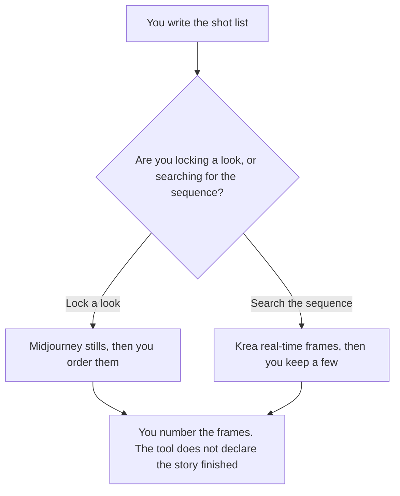

**Use Midjourney when the storyboard is a set of still frames and you need one look held across them. Use Krea when you are finding the sequence in real time and you will throw most frames away.** You still arrange the order. A model does not decide the shot list. A single hero image is a different job: [Midjourney vs Flux for hero images](/blog/midjourney-vs-flux-for-hero-images-2026/). A moodboard, which is a pile of references rather than an ordered sequence, is [Midjourney vs Leonardo for moodboards](/blog/midjourney-vs-leonardo-for-moodboards-2026/).

Midjourney and Krea prices are from directory pages checked October 16, 2026. Claude's prices are from claude.com/pricing on October 24, 2026. Notion's price is from the October 16 card. Published October 24, 2026. We did not score images.

## Which board you are making

| The frames in front of you | Start here | First paid step | The limit |
|---|---|---|---|
| Stills that must share a look | [Midjourney](/tools/midjourney/) | Basic is $10 a month, or $8 billed annually | No free plan on the October 16 card |
| A sequence you adjust as you watch | [Krea](/tools/krea/) | Basic is $9 a month, or $5 a month billed yearly | Free is 100 compute units a day on that card |
| The shot list, in words | [Claude](/tools/claude/) | Pro is $17 a month billed annually, or $20 monthly | The list comes from you |
| The page that holds the order | [Notion AI](/tools/notion-ai/) | Business is $20 a seat a month | The page does not generate the frames |

A storyboard is an order: frame 1, frame 2, frame 3, with the action you wrote. A grid of pretty pictures is a contact sheet. If the frames must stay private, Midjourney's October 16 card puts Stealth Mode on Pro and Mega, not on Basic or Standard. Krea's card says paid plans add a commercial license. Read the plan you are about to buy before you put a client's product in the prompt.

## What each seat keeps

**Midjourney Basic** is $10 a month, or $96 a year, which the card lists as $8 a month. The card lists 3.3 hours of Fast GPU time. Standard is $30 a month, or $24 a month billed annually, with 15 hours Fast and unlimited Relax images. Pro is $60 a month, or $48 billed annually, and Mega is $120 a month, or $96 billed annually. Stealth is on Pro and Mega. Extra Fast GPU time is $4 an hour on every plan, on that card. The invoice is [Midjourney pricing explained](/blog/midjourney-pricing-explained-2026/).

**Krea Free** is 100 compute units a day, no card required, on the October 16 card. Basic is $9 monthly or $5 a month billed yearly, with 5,000 units a month. Pro is $35 monthly or $21 yearly, with 20,000 units. Paid plans add a commercial license on that card. Business is contact sales. The invoice is [Krea pricing explained](/blog/krea-pricing-explained-2026/).

**Claude Pro** can turn a paragraph into a shot list you then edit. It should not invent a scene you did not describe, and it does not render the frame. The review is [Claude review](/blog/claude-review-2026/).

**Notion Business** is a fine place to number the frames and paste the links. The order on the page is the order you set. The invoice is [Notion AI pricing explained](/blog/notion-ai-pricing-explained-2026/).

A prompt that holds the line:

"Make one frame for the shot I numbered. Use only the subject, the action, and the setting I wrote. Do not add a caption that states a plot point I did not write. Do not renumber the sequence."

## What not to delegate

Do not ask the model which frame "should" be the ending. Do not upload a client's unreleased product into a plan that does not match your privacy terms. Do not describe a contact sheet as a storyboard until you have ordered it.

## FAQ

### Which one looks more cinematic?

We did not measure that. Midjourney fits stills with a shared look. Krea fits real-time iteration. The board is usable when a reader can follow the shots in the order you numbered.

### Is there a free way to start?

Krea's October 16 card includes a free daily unit grant. Midjourney's card says all plans are paid. A free Krea frame is still subject to the license on that plan. The card puts the commercial license on paid plans.

### Can I move frames from one tool to the other?

You can use an exported still as a reference if the plan you used allows that use. The order still lives in your shot list. A new tool does not inherit the story by receiving one image.

### Who approves the board?

The person who owns the piece. A full set of frames is not an approval. The hero you later pick from frame 3 is the hero-image decision, on the article linked above.

## Last verified

October 16, 2026 for Midjourney, Krea, and Notion. October 24, 2026 for Claude. Published October 24, 2026.

**Sources:** [Midjourney](https://www.midjourney.com), [Krea pricing](https://www.krea.ai/pricing), [Claude pricing](https://claude.com/pricing), [Notion pricing](https://www.notion.com/pricing).

*Published by Andrew for [AI Tools Optimizer](https://aitoolsoptimizer.com).*

[Krea](/tools/krea/) is in the [image generation directory](/tools/category/image-generation/). Directory pages may use affiliate links. A purchase through them may earn us a commission at no extra cost to you.
