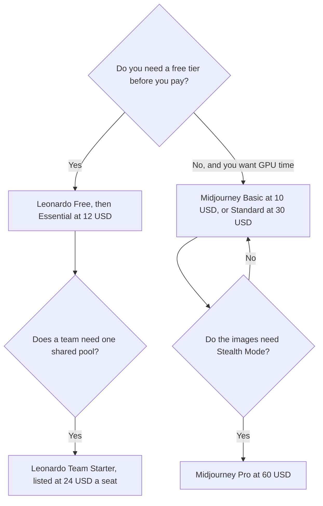

**Choose Midjourney when you will pay for a subscription and you think in GPU time. Choose Leonardo when you want a free tier, a token balance you can bank, or a team seat with a shared pool.** They are both image studios. They do not sell the same meter, and a three-way that also includes FLUX is a different page: [Midjourney vs Leonardo vs FLUX](/blog/midjourney-vs-leonardo-vs-flux-2026/).

The Midjourney invoice is [Midjourney pricing explained](/blog/midjourney-pricing-explained-2026/). The Leonardo invoice is [Leonardo.Ai pricing explained](/blog/leonardo-ai-pricing-explained-2026/). The product pages are [Midjourney review](/blog/midjourney-review-2026/) and [Leonardo.Ai review](/blog/leonardo-ai-review-2026/).

Prices are US list prices excluding tax from directory pages checked October 16, 2026. Published October 24, 2026. We did not score images.

## The meter, then the plan

| Your week | Start here | First paid step | The limit |
|---|---|---|---|
| You want a paid studio and you will generate often | [Midjourney](/tools/midjourney/) Standard | $30 a month, or $24 a month billed annually ($288 a year), with 15 hours of Fast GPU time | No free plan. Basic is the trial-sized paid plan |
| You want to try before a subscription | [Leonardo.Ai](/tools/leonardo-ai/) Free, then Essential | Essential is $12 a month for 8,500 fast tokens | Tokens, not GPU hours. The directory lists monthly prices |
| You need private generations on the higher Midjourney plans | Midjourney Pro | $60 a month, or $48 billed annually. Stealth Mode starts on Pro | Standard does not list Stealth |
| You need a shared team pool | Leonardo Team Starter | The directory lists $24 a seat and $72 a month, with 25,000 fast tokens a seat, shared | A Midjourney plan is an individual GPU pool unless you buy more seats yourself |
| You want pay per image and no subscription | [FLUX](/tools/flux/) | From $0.008 per image for FLUX 3 Klein at 768×768 on the directory card | A different product. The review is [FLUX review](/blog/flux-review-2026/) |

## What each plan is selling

**Midjourney.** There is no free plan. Basic is $10 a month, or $96 a year ($8 a month), with about 3.3 hours of Fast GPU time. Standard is $30, or $288 a year, with 15 Fast hours and unlimited Relax images. Pro is $60, or $576 a year, with 30 Fast hours, Stealth Mode, and 12 concurrent Fast jobs. Mega is $120, or $1,152 a year, with 60 Fast hours. Extra Fast time is $4 an hour on every plan. Relax is not on Basic. In the V8 alpha note on the directory card, Relax is not supported yet, and some jobs run slower. The beginners path is [Midjourney for beginners](/blog/midjourney-for-beginners-2026/).

**Leonardo.** Free exists for casual use. Essential is $12 a month with 8,500 fast tokens, and the directory says you can bank up to 25,500. Premium is $30 a month with 25,000 fast tokens and unlimited relaxed images on select models. Ultimate is $60 a month with 60,000 fast tokens. Team Starter is listed at $24 a seat and $72 a month, with a shared pool. Those are monthly figures on the card. This page does not invent an annual Leonardo discount the directory did not print. The nearby image tool, if text in the image is the job, is [Ideogram](/tools/ideogram/), compared in [Leonardo vs Ideogram](/blog/leonardo-vs-ideogram-2026/).

Do not convert Leonardo tokens into Midjourney hours. They are different meters. A light month on Leonardo can bank tokens. A light month on Midjourney Standard still uses the subscription, and Relax is how you stop spending Fast hours.

## How to choose

If you already know you will generate every week and you want one aesthetic studio, start on Midjourney Standard. Basic's 3.3 Fast hours is a small bucket. If you might cancel after a week of tests, Leonardo Free then Essential at $12 is the smaller commitment, and you can see the product before a card is required for the paid tier.

Buy Midjourney Pro when Stealth Mode is a requirement, not because the next tier "sounds professional." Buy Leonardo's team line when several people should draw from one pool and the generations should stay in that team. The directory lists private team generations on that plan.

If the real constraint is commercial training data and you already live in Adobe, that is [Firefly](/tools/adobe-firefly/), not this pair. The card is [Adobe Firefly pricing explained](/blog/adobe-firefly-pricing-explained-2026/). If you want a chat app to draw one picture, that is a third workflow: [Midjourney vs ChatGPT Images](/blog/midjourney-vs-chatgpt-images-2026/).

## FAQ

### Is Leonardo the free Midjourney?

No. Leonardo Free is Leonardo's casual tier. Midjourney does not list a free plan. The images, the editor, and the meter are different. Use Free to see whether Leonardo's canvas fits the work. Do not expect it to be a Midjourney login.

### Which one is better at photorealism?

This page did not run a shootout. Run the same prompt you actually need in the plan you can afford. Keep the ones you would ship. A forum thread is not a score.

### Can a company share one Midjourney login?

The directory prices Midjourney as a personal subscription with a GPU pool. Sharing a login is a bad idea for billing and for privacy. If you need a shared pool and private team generations, read Leonardo's team line and confirm the seat minimum at checkout. The directory shows Team Starter as $24 a seat and $72 a month.

### Does either plan include video?

Both directories mention video on higher tiers. Midjourney Standard and above list SD and HD video, with unlimited SD video on Pro and Mega in Relax. Leonardo Ultimate lists unlimited relaxed video. Read the current card before you buy a tier for video. A dedicated video tool is a different comparison: [Runway vs Luma](/blog/runway-vs-luma-2026/).

## Last verified

October 16, 2026 for Midjourney, Leonardo, and FLUX prices named above. Published October 24, 2026.

**Sources:** [Midjourney](https://www.midjourney.com), [Leonardo pricing](https://leonardo.ai/pricing), [Black Forest Labs](https://bfl.ai).

*Published by Andrew for [AI Tools Optimizer](https://aitoolsoptimizer.com).*

[Midjourney](/tools/midjourney/) is in the [image generation directory](/tools/category/image-generation/). Directory pages may use affiliate links. A purchase through them may earn us a commission at no extra cost to you.
