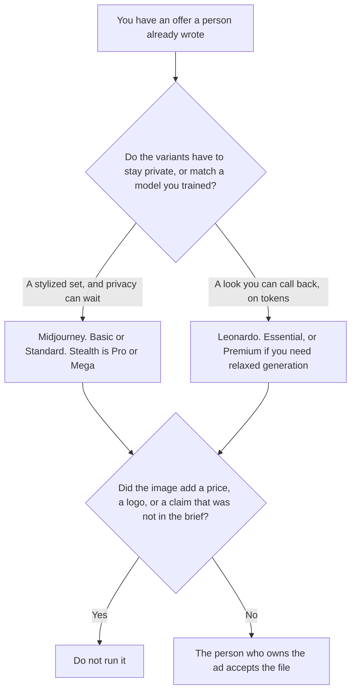

**Use Midjourney when you want a set of stylized ad variants and you can spend Fast GPU time, with Stealth on Pro or Mega if the ads are not public yet. Use Leonardo when the set should come from a token plan, including a free tier to test, or from a personal model you trained so the next variant can call the same look back.** Neither tool may invent a price, a claim, a logo, or a product feature. A social ad against Firefly, which is a different rights question, is [Midjourney vs Adobe Firefly for social ads](/blog/midjourney-vs-adobe-firefly-for-social-ads-2026/). The general bill comparison is [Midjourney vs Leonardo](/blog/midjourney-vs-leonardo-2026/).

A product still from a reference you have rights to use is [Midjourney vs Leonardo for product shots](/blog/midjourney-vs-leonardo-for-product-shots-2026/). The invoices are [Midjourney pricing explained](/blog/midjourney-pricing-explained-2026/) and [Leonardo AI pricing explained](/blog/leonardo-ai-pricing-explained-2026/).

Prices are US list prices from directory pages checked October 16, 2026. Published October 24, 2026. We did not score ads. A generated frame is not a photograph of the product you ship, and it is not approval to run the ad.

## Which variant set you need

| The set | Start here | First paid step | The limit |
|---|---|---|---|
| Stylized variants, and you can watch a GPU clock | [Midjourney](/tools/midjourney/) | Basic is $10 a month, or $8 billed annually | No free plan. Images are public unless you use Stealth |
| Many variants from tokens, or a look you trained | [Leonardo](/tools/leonardo-ai/) | Essential is $12 a month, with 8,500 fast tokens | The free plan is for a test, not a campaign |
| The claim and the price, in words | [Notion AI](/tools/notion-ai/) | Business is $20 a seat a month | The image does not invent the offer |
| A commercially licensed model path you still have to read | [Adobe Firefly](/tools/adobe-firefly/) | Read the Firefly comparison before you treat it as the same job | This page does not restate a Firefly dollar |

Midjourney's October 16 card lists Basic at $10 a month or $8 billed annually, Standard at $30 or $24 annual, Pro at $60 or $48, and Mega at $120 or $96. Fast GPU time on that card is 3.3 hours on Basic, 15 on Standard, 30 on Pro, and 60 on Mega. Extra Fast time is $4 an hour. Unlimited Relax image generation starts on Standard. Stealth Mode is only on Pro and Mega. The card also says companies with over $1 million in gross revenue need Pro or Mega. A variant set for an unreleased offer is public on Basic and Standard. If the ad cannot be public, the card's answer is Stealth, which is Pro or Mega, not a setting you invent on Basic.

Leonardo's October 16 card lists a free plan, Essential at $12 a month with 8,500 fast tokens, Premium at $30 with 25,000 fast tokens and unlimited relaxed image generation for select models, and Ultimate at $60. Team Starter is $24 a seat, shown as $72 a month, and Growth is $48 a seat, shown as $144 a month, with shared tokens. A team that needs private generations should read the team card before it pastes an unreleased offer into a personal workspace. This page does not treat a personal Essential seat as a shared team vault.

The offer text lives in Notion. The image tools do not get a blank where the price should be and then fill it.

## What the variant is allowed to show

The product, the layout direction, and the words you already approved. A discount that was not in the brief stays out of the image. A logo you did not supply stays out. Style is not a claim. If the legal line on the offer is missing, the line says Claim not approved. It does not get shorter so it fits the frame.

**Midjourney Basic** is the cheapest paid GPU clock. Standard is the Relax step. Pro is the first Stealth step on that card. The review path for the bill is the pricing article above.

**Leonardo Essential** is the first paid token card. Premium is the relaxed-generation step for select models. The review is [Leonardo AI review](/blog/leonardo-ai-review-2026/).

**Notion Business** holds the offer: price, claim, and the date a person approved them. The invoice is [Notion AI pricing explained](/blog/notion-ai-pricing-explained-2026/).

A prompt that holds the line:

"Make variants from the offer I pasted. If a price or a claim is missing, write Claim not approved and do not put one in the image. Do not add a logo. Do not add a discount."

## What not to delegate

Do not ask which variant will "convert." Do not run a public Basic image of an offer that is still confidential. Do not treat a trained look as permission to imitate a brand you do not own. The person who owns the ad accepts the file. A pretty frame is not a clearance.

## FAQ

### How is this different from Midjourney vs Firefly for social ads?

That page is the rights and brand path against Firefly. This page is Midjourney's GPU clock and Stealth rule against Leonardo's tokens and a model you can call back. Read that page before you assume a generated ad is cleared for a brand system. Use this page for the variant set and the plan that keeps it private.

### How is this different from a product shot?

The product-shot page starts from a reference you have rights to use, and the product stays that product. An ad variant also carries an offer: a price or a claim a person wrote. A shot with no offer can live on that page. A frame that invents 20% off belongs on neither page. It belongs in the trash.

### Do I need Stealth for every ad?

The October 16 Midjourney card puts Stealth on Pro and Mega only. Basic and Standard images are public on that card. If the variant can be public, Standard's Relax clock is the line the card describes. If it cannot, do not use Basic and hope. Leonardo's team cards are the other place to read privacy before you generate.

### Who may publish the variant?

The person who owns the ad and the claim. Claim not approved stays off the file. A generated image is not a media buy.

## Last verified

October 16, 2026, from the Midjourney, Leonardo, and Notion directory cards. Published October 24, 2026. No ad was scored. No Firefly dollar is restated on this page.

**Sources:** [Midjourney](https://www.midjourney.com), [Leonardo.Ai](https://leonardo.ai), [Notion pricing](https://www.notion.com/pricing).

*Published by Andrew for [AI Tools Optimizer](https://aitoolsoptimizer.com).*

[Leonardo](/tools/leonardo-ai/) is in the [image generation directory](/tools/category/image-generation/). Directory pages may use affiliate links. A purchase through them may earn us a commission at no extra cost to you.
