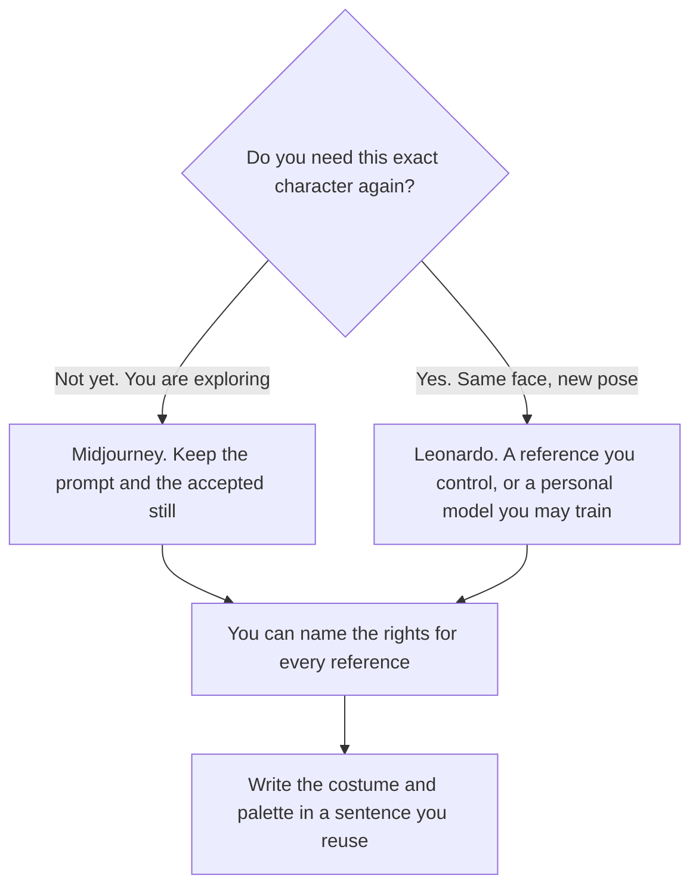

**Use Midjourney when you are exploring a character's look from a description. Use Leonardo when you need that character again, including a personal model trained on images you have the right to use.** The general product split is a different page. This one is the character sheet: the same face, the same costume rules, a new pose. We did not score which gallery looks better.

The wider comparison is [Midjourney vs Leonardo](/blog/midjourney-vs-leonardo-2026/). Product shots of objects, which are a different job, are [Midjourney vs Flux for product shots](/blog/midjourney-vs-flux-for-product-shots-2026/). The three-way overview is [Midjourney vs Leonardo vs Flux](/blog/midjourney-vs-leonardo-vs-flux-2026/).

Prices are US list prices excluding tax from directory pages checked October 16, 2026. Published October 24, 2026. We did not run a blind test of likeness. A character that copies a living person's face, or a design you do not own, is a rights question this page does not settle for you.

## What the character job actually is

| The job | Start here | What you still do |
|---|---|---|
| Ten looks, then you pick one direction | [Midjourney](/tools/midjourney/) Basic at $10 a month, or $8 billed annually ($96 a year) | Save the prompt, the seed if you have it, and the image you accepted |
| You will generate often while you explore | Midjourney Standard at $30 a month, or $24 billed annually | Relax mode is on this tier for images. Fast hours are still finite |
| You want the character back next week from a trained model | [Leonardo](/tools/leonardo-ai/) Essential at $12 a month, then a personal model if the plan you are on allows it | Train only on images you have the right to use |
| You need more fast tokens, or relaxed image generation on select models | Leonardo Premium at $30 a month | Read the current token line before a long session |
| Private team generations of the same cast | Leonardo Team Starter at $24 a seat on the directory card | A shared pool is still a pool. Agree who spends it |

Midjourney has no free plan on the directory card. Leonardo's free plan is for casual exploration, with limited fast tokens. A character you intend to keep is a paid habit on either side, because you will regenerate.

## What the invoices are paying for

**Midjourney Basic** includes 3.3 hours of Fast GPU time a month on the card we recorded. Standard includes 15 hours and unlimited Relax image generation. Pro at $60 a month, or $48 billed annually, adds Stealth Mode. Mega is $120 a month, or $96 billed annually. Extra Fast GPU time was $4 an hour. A character sheet does not require Stealth unless the design is confidential. The invoice is [Midjourney pricing explained](/blog/midjourney-pricing-explained-2026/).

Stealth is a privacy flag. It is not a license to the likeness. If the character is for a client, say so in the prompt notes and in the file name. The commercial terms are the vendor's current terms. This page does not restate a license the directory did not quote.

**Leonardo Essential at $12 a month** includes 8,500 fast tokens, with a bank up to 25,500 on the card. Premium at $30 includes 25,000 fast tokens and unlimited relaxed images on select models. Ultimate at $60 includes 60,000 fast tokens and, on that row, 50 personal models. A personal model is the callback mechanism: you train it, then you ask for the character in a new scene. Training does not create a right you did not have in the source images. The invoice is [Leonardo pricing explained](/blog/leonardo-ai-pricing-explained-2026/).

**Flux**, in the directory as [Flux](/tools/flux/), is the product-shot comparison, not this page. Use it when the subject is an object you need to match. A character with a costume bible is the Leonardo or Midjourney decision above.

A prompt that holds the line:

"Design a fictional character from this description only. Keep the palette and the costume notes I listed. Do not base the face on a real person, a celebrity, or a character I do not own. If I did not specify age presentation, keep it an adult design. Give me variations of pose, not variations of identity."

Write the costume bible in a text file you control. The image generator will drift. The text file is how you notice. Drift across regenerations is a cousin of [what embedding drift is](/blog/what-is-embedding-drift-2026/): the label stayed the same, and the output moved. For a character, you see the move in the face.

## What not to upload

Do not upload a private photo of someone else to "make them the hero." Do not upload a working actor's headshot. Do not upload a client's unreleased design into a plan that trains on inputs, unless the contract and the vendor terms allow it. Stealth Mode on Midjourney Pro is a directory feature for privacy. Read the current terms before you treat it as confidentiality for a client.

If the image is a product, not a character, stop and use the product-shot comparison. A mascot can be both. Decide which job this file is before you pay for a second subscription.

## FAQ

### Which one keeps a consistent face?

We did not score likeness. Leonardo's personal models are the directory feature aimed at calling a trained look back. Midjourney keeps a direction through the prompt, references, and the image you accept. Either way, you keep the reference sheet. The tool will not remember your canon for you.

### Do I need both?

Start with one. Add the second when the job changes: exploration in Midjourney, a trained callback in Leonardo, or the reverse if your files already live in one of them. Two subscriptions on day one double the spend and split the canon.

### Is the free Leonardo plan enough for a cast?

The free plan is for casual exploration. A cast you will regenerate belongs on a paid token pool you can see. Essential is the recorded starting paid row.

### Can I use these for a real person's portrait?

Only with the rights to do it, and only under the vendor's current terms. This page is about fictional characters and designs you can explain. A portrait of a private person is a different decision, and a model that "looks close" is not consent.

## Last verified

October 16, 2026 for Midjourney and Leonardo. Published October 24, 2026.

**Sources:** [Midjourney plans](https://docs.midjourney.com/docs/plans), [Leonardo pricing](https://leonardo.ai/pricing).

*Published by Andrew for [AI Tools Optimizer](https://aitoolsoptimizer.com).*

[Leonardo](/tools/leonardo-ai/) is in the [image generation directory](/tools/category/image-generation/). Directory pages may use affiliate links. A purchase through them may earn us a commission at no extra cost to you.
