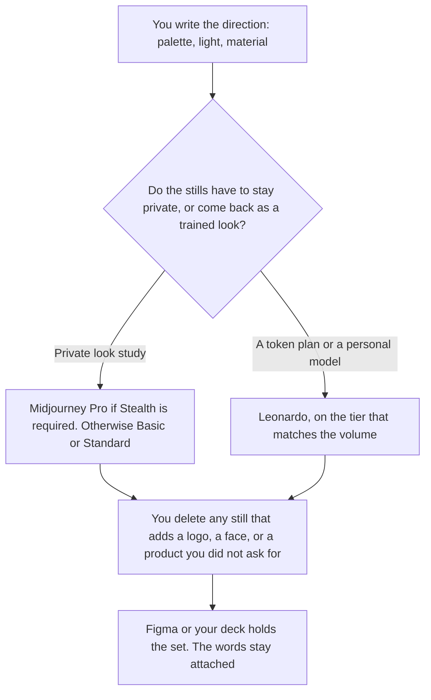

**Use Midjourney when the moodboard is a look study and you accept the plan's privacy rules. Use Leonardo when you need a free starting point, a token plan, or a personal model you can call back for the next frame.** A moodboard is a set of stills that show a direction a person named: palette, light, material, mood. It is not a storyboard, and it is not an ad. The ordered frames for a shot list are [Midjourney vs Leonardo for storyboards](/blog/midjourney-vs-leonardo-for-storyboards-2026/). The general pair is [Midjourney vs Leonardo](/blog/midjourney-vs-leonardo-2026/).

Prices are from directory pages checked October 16, 2026. Midjourney's plan docs and leonardo.ai/pricing returned HTTP 403 on October 24, so this page stays on that record. Published October 24, 2026. We did not score taste or consistency. The Midjourney card says companies with more than $1,000,000 in gross annual revenue need Pro or Mega for commercial use.

## Which plan matches the board

| The board you are making | Start here | What you still do |
|---|---|---|
| A few stills to find a look, and public images are acceptable | [Midjourney](/tools/midjourney/) Basic at $10 a month, or $8 billed annually | You keep the direction words. You discard stills that add a logo or a product you did not describe |
| Many stills, with Relax image generation | Midjourney Standard at $30 a month, or $24 billed annually | Relax is unlimited images on Standard. It is still your direction |
| The board must stay private | Midjourney Pro at $60 a month, or $48 billed annually, for Stealth Mode | Mega is $120, or $96 billed annually, if you need more Fast time |
| A free or low-cost first pass | [Leonardo](/tools/leonardo-ai/) Free, then Essential at $12 a month | Essential lists 8,500 fast tokens a month on the card |
| The same look on the next round | Leonardo Premium at $30 a month | The card ties Premium to unlimited relaxed images on select models |
| The stills arranged for a review | [Figma](/tools/figma/) Professional Full seat at $16 a month billed annually | Figma places frames. It does not invent the look |

Midjourney has no free plan on the October 16 card. Images are public unless you are on Pro or Mega, which is where the card puts Stealth Mode. A client moodboard that must not be public does not start on Basic. Leonardo's free plan is for casual exploration, in the card's words. A client board that must match next month is Premium or a team plan, not a hope that the free tier remembers.

Leonardo Team Starter is $24 a seat, $72 a month, with private team generations, on that card. Prices on the card exclude tax. The ladder is [Leonardo pricing explained](/blog/leonardo-ai-pricing-explained-2026/). Midjourney's ladder is [Midjourney pricing explained](/blog/midjourney-pricing-explained-2026/).

## What a still is allowed to contain

The palette, light, and material you named. It is not a slogan, a trademark, or a real person's face. A moodboard that quietly becomes a campaign still has left this page. The social-ad comparison is a different job.

**Midjourney Basic at $10** is the entry paid row: 3.3 Fast hours on the card. Standard at $30 is the row the card ties to unlimited Relax images. The review path starts at the pricing article. V8 was in alpha on that card, and the card says Relax is not yet supported for V8. If you need Relax, stay on a model the plan still relaxes.

**Leonardo Essential at $12** is the entry paid row. Premium at $30 is the practical path for a long board, on the card's description of unlimited relaxed images for select models. The review is [Leonardo review](/blog/leonardo-ai-review-2026/).

**Figma's** free Starter includes up to 500 AI credits a month, on the directory card. Professional is the seat when the board is a shared file. The invoice is [Figma pricing explained](/blog/figma-pricing-explained-2026/). [Canva](/tools/canva/) Pro is $18 a month, or $180 a year, if the board is a presentation page rather than a design file. Do not buy both so a moodboard has two homes.

A prompt that holds the line:

"Generate stills from the palette, light, and material I named. Do not add a logo, readable text, or a product. Do not depict a real person. If I did not name a subject, use only the materials."

## What not to delegate

Do not ask which image is "on brand" if you did not paste the brand rules. Do not train a Leonardo model on images you do not have the right to use. Do not ship a Midjourney Basic image to a client who was promised privacy. Stealth is a plan feature on the card, not a prompt instruction.

## FAQ

### How is a moodboard different from a storyboard?

A moodboard shows a direction. A storyboard shows an ordered shot list. If the frames have to happen in sequence, use the storyboard article. If you are choosing a look before any sequence exists, you are here.

### Which one is more consistent?

We did not score that. Leonardo's card talks about personal models. Midjourney's card talks about style references and personalization. Consistency is the next still matching the words you saved, which you check by looking.

### Do I need a private plan?

If the images must not be public, Midjourney's card says Stealth is Pro or Mega. Leonardo's team card says private team generations on Team plans. Read the plan you are about to buy. A prompt that says "private" does not change the plan.

### Can the model write the direction for me?

It may rephrase words you already used. A direction it invented is a different board. Save the words next to the stills so the next person can see what you asked for.

## Last verified

October 16, 2026 for Midjourney, Leonardo, Figma, and Canva. A fetch of Midjourney's plan docs and leonardo.ai/pricing on October 24, 2026 returned HTTP 403. Published October 24, 2026.

**Sources:** [Midjourney plans](https://docs.midjourney.com/docs/plans), [Leonardo pricing](https://leonardo.ai/pricing/), [Figma pricing](https://www.figma.com/pricing/), [Canva pricing](https://www.canva.com/pricing/).

*Published by Andrew for [AI Tools Optimizer](https://aitoolsoptimizer.com).*

[Leonardo.Ai](/tools/leonardo-ai/) is in the [image generation directory](/tools/category/image-generation/). Directory pages may use affiliate links. A purchase through them may earn us a commission at no extra cost to you.
