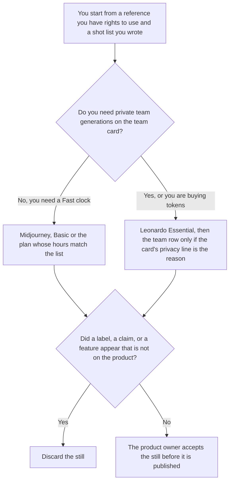

**Use Midjourney when you are steering a product still from a reference you have rights to use, and you can live with a Fast GPU clock. Use Leonardo when the stills need a token plan and, on the team cards, private team generations.** Neither tool may invent a label, a certification, or a feature the product does not have. A shot against Flux is a different page: [Midjourney vs Flux for product shots](/blog/midjourney-vs-flux-for-product-shots-2026/) and [Leonardo vs Flux for product shots](/blog/leonardo-vs-flux-for-product-shots-2026/). Characters and moodboards are [Midjourney vs Leonardo for characters](/blog/midjourney-vs-leonardo-for-characters-2026/) and [Midjourney vs Leonardo for moodboards](/blog/midjourney-vs-leonardo-for-moodboards-2026/).

The bills are [Midjourney pricing explained](/blog/midjourney-pricing-explained-2026/) and [Leonardo AI pricing explained](/blog/leonardo-ai-pricing-explained-2026/).

Prices are US list prices from directory pages checked October 16, 2026. Published October 24, 2026. We did not score images. A generated still is not a photograph of the unit you ship.

## Which still is in front of you

| The page | Start here | First paid step | The limit |
|---|---|---|---|
| A steered still, Fast hours | [Midjourney](/tools/midjourney/) | Basic is $10 a month, or $96 a year at $8 a month | No label the product does not carry |
| A token pool, with a free way to try | [Leonardo](/tools/leonardo-ai/) | Essential is $12 a month for 8,500 fast tokens | The October 16 card is monthly. This page does not invent an annual discount |
| A brand system that must stay inside Adobe's commercially licensed models | [Adobe Firefly](/tools/adobe-firefly/) | See the Firefly pricing article. This row does not copy a dollar from another vendor | A different license story |
| The shot list the next designer opens | [Notion AI](/tools/notion-ai/) | Business is $20 a seat a month | The list is the source. A gallery is not a new SKU |

A still that "cleans up" a warning label by removing it is a different product. If the shot list says the label must remain readable, a pretty frame that blurs it fails the list. Say so. Do not upscale your way past the list.

Midjourney Standard is $30 a month, or $24 a month billed annually, on the October 16 card, and that column lists unlimited Relax images. Basic does not list Relax. Pro at $60 a month, or $48 annual, is where that card lists Stealth Mode. Buy Stealth when privacy of the generation is the requirement you can point at, not because a product shot sounds premium. There is no free plan on that card.

Leonardo Premium is $30 a month for 25,000 fast tokens and unlimited relaxed images on select models. Team Starter is $24 a seat, $72 a month, and the card says private team generations. Read that line in the product before you treat a personal Essential login as a team studio. The review is [Leonardo review](/blog/leonardo-ai-review-2026/).

## What the still is allowed to show

The product you referenced, the angle on the shot list, and the background you named. A lifestyle scene with people requires rights you actually have. A competitor's packaging does not get "inspired." The Fast clock and the token pool are meters. They are not a quality score. We did not run a bake-off.

**Midjourney Basic** is the short list. Three and three-tenths Fast hours, which the card also prints as 200 minutes, and three concurrent Fast jobs. A long list of colorways belongs on a plan with Relax, after you have seen one accepted still.

**Leonardo Essential** is the token path, including a free plan for a casual try. Top-up tokens exist on that card. Use the top-up price in your account. This page does not print a per-token overage.

**Adobe Firefly** is the row when counsel already chose that license. The invoice is [Adobe Firefly pricing explained](/blog/adobe-firefly-pricing-explained-2026/).

**Notion Business** stores the shot list: SKU, angle, what must stay readable, who accepted the still.

A prompt that holds the line:

"Describe the product shot from the shot list and the reference I named. Keep every label I said must stay readable. Do not add a certification. Do not add a feature. If the reference is missing, write Reference not set."

## What not to delegate

Do not ask which image "will convert." Do not upload a customer's photo you do not have rights to use. Do not publish a still that changed the product's color, port, or warning text. The product owner accepts it. A sharp image is not a photograph of the unit.

## FAQ

### How is this different from the Flux pages?

Those pages compare each tool with Flux. This page is Midjourney against Leonardo for the same job: a product still from a reference you may use. The limit is the same. The meter is not. Midjourney sells Fast hours. Leonardo sells fast tokens.

### How is this different from characters or moodboards?

A character page is a figure you will reuse. A moodboard is a direction. A product shot is a specific SKU. A mood can inform the background. It cannot change the product. Keep the shot list, not the mood, as the acceptance test.

### Which one is more photoreal?

We did not measure that. Pick the meter and the privacy line you need, then accept or reject each still against the shot list. A plan name is not a realism tier.

### Who may publish the still?

The product owner, after the labels and the product match the unit you ship. A download is not acceptance. Stealth Mode is not a license to use someone else's product.

## Last verified

October 16, 2026 for Midjourney, Leonardo, Notion, and the Firefly pointer. Published October 24, 2026.

**Sources:** [Midjourney plans](https://docs.midjourney.com/docs/plans), [Leonardo pricing](https://leonardo.ai/pricing), [Notion pricing](https://www.notion.com/pricing), [Adobe Firefly](https://www.adobe.com/products/firefly.html).

*Published by Andrew for [AI Tools Optimizer](https://aitoolsoptimizer.com).*

[Leonardo](/tools/leonardo-ai/) is in the [image generation directory](/tools/category/image-generation/). Directory pages may use affiliate links. A purchase through them may earn us a commission at no extra cost to you.
