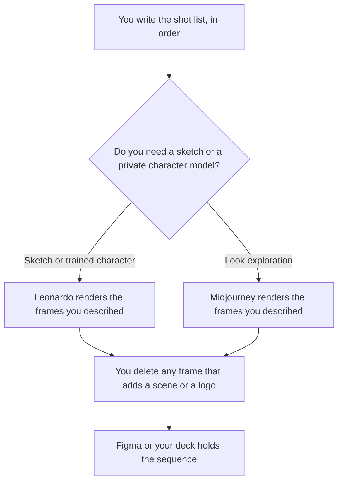

**Use Leonardo when the storyboard needs a recurring character or a sketch you push into a frame. Use Midjourney when you are exploring a look across still frames and you accept the plan's privacy rules.** A storyboard is an ordered set of frames for a shot list a person wrote. It is not a film. The model may render a frame you described. It may not invent a scene, a logo, or a line of dialogue.

A single recurring character, which is a narrower job, is [Midjourney vs Leonardo for characters](/blog/midjourney-vs-leonardo-for-characters-2026/). The general pair is [Midjourney vs Leonardo](/blog/midjourney-vs-leonardo-2026/). Readable type on a frame is a different problem: [Midjourney vs Ideogram for logos](/blog/midjourney-vs-ideogram-for-logos-2026/) is about marks, not sequences.

Prices are US list prices excluding tax from directory pages checked October 16, 2026. Published October 24, 2026. We did not score frame quality or consistency. Companies with more than $1,000,000 in gross annual revenue need Midjourney Pro or Mega for commercial use, on that card.

## Which plan matches the board

| The board you are actually making | Start here | What you still do |
|---|---|---|
| A few frames to find a look, and public images are acceptable | [Midjourney](/tools/midjourney/) Basic at $10 a month, or $8 billed annually | You keep the shot list. You discard frames that add a scene |
| Many frames, with Relax image generation | Midjourney Standard at $30 a month, or $24 billed annually | Relax is unlimited images on Standard. It is still your shot list |
| The board must stay private | Midjourney Pro at $60 a month, or $48 billed annually, for Stealth Mode | Mega is $120, or $96 billed annually, if you need more Fast time |
| A sketch you want turned into the next frame | [Leonardo](/tools/leonardo-ai/) Essential at $12 a month | Realtime Canvas is the sketch path on the directory card |
| The same character in every frame | Leonardo Premium at $30 a month, which adds unlimited relaxed images on select models | A personal model is trained on images you are allowed to use |
| The sequence has to be arranged for a review | [Figma](/tools/figma/) Professional Full seat at $16 a month billed annually | The frames are placed. Figma does not invent the shot |

Midjourney has no free plan on the directory card. Leonardo does, for casual exploration. A client storyboard is not the free tier if the images must stay private or the character must match. Leonardo Team Starter is $24 a seat, $72 a month, with private team generations, when more than one person must see the frames inside a team workspace.

## What a frame is allowed to contain

The action from that row of the shot list, the character notes you supplied, and the aspect you asked for. It is not allowed to contain a slogan, a trademark you did not provide, or the next scene because the model wanted a story. Number the frames yourself. A model that reorders the sequence has edited the board.

**Leonardo Essential at $12** is the entry paid row, with 8,500 fast tokens a month on the October 16 card. Premium at $30 is the row the card ties to unlimited relaxed images on select models, which is the practical path for a long board. The review is [Leonardo review](/blog/leonardo-ai-review-2026/). The ladder is [Leonardo pricing explained](/blog/leonardo-ai-pricing-explained-2026/).

**Midjourney Basic at $10** includes 3.3 hours of Fast GPU time. Standard at $30 adds unlimited Relax images. Stealth Mode, which keeps images private, is Pro and Mega only. Extra Fast GPU time is $4 an hour on every plan, on that card. The review is [Midjourney review](/blog/midjourney-review-2026/). The ladder is [Midjourney pricing explained](/blog/midjourney-pricing-explained-2026/).

**A rough pass on a smaller meter.** [Krea](/tools/krea/) Basic is $9 a month, or $5 billed yearly, with 5,000 compute units. Use it to explore a look, then move the chosen frames to the tool whose plan matches privacy and character needs. The invoice is [Krea pricing explained](/blog/krea-pricing-explained-2026/).

A prompt that holds the line:

"Render frame 4 only, from the shot line I pasted. Match the character notes I pasted. Do not add a caption, a logo, or a next scene. Wide shot, 16:9. If the shot line is ambiguous, make fewer choices, not more."

## What not to delegate

Do not ask the model to write the story. Do not accept a beautiful frame that changes the product. Do not put an unreleased campaign on a plan whose images are public. If the company is over the Midjourney revenue line on the card, Pro or Mega is the commercial row, not Basic.

## FAQ

### Which one keeps a character consistent?

We did not score consistency. Leonardo's card describes personal model training and Realtime Canvas, which are the tools you use when the same character must recur. Midjourney is the exploration path, with Stealth only on Pro and Mega. Test three frames of your character before you buy a month of either.

### Can we storyboard a real person?

Only with rights you already have to those images. A personal model trained on a person who did not agree is not a storyboard technique this page endorses. Use notes and a design you are allowed to render.

### Do storyboard frames need readable text?

Usually no. If a frame must show a headline, neither of these is the type tool. Put the words on in Figma, or use a generator whose strength is text. The logo comparison is the Ideogram article.

### Is a storyboard a video?

No. Video is a later render of frames you approved. Runway and Pika are that later job. This page stops at the still sequence.

## Last verified

October 16, 2026 for Midjourney, Leonardo, Figma, and Krea. Published October 24, 2026.

**Sources:** [Midjourney plans](https://docs.midjourney.com/hc/en-us/articles/27870484040333-Comparing-Midjourney-Plans), [Leonardo pricing](https://leonardo.ai/pricing/), [Figma pricing](https://www.figma.com/pricing/), [Krea pricing](https://www.krea.ai/pricing).

*Published by Andrew for [AI Tools Optimizer](https://aitoolsoptimizer.com).*

[Midjourney](/tools/midjourney/) is in the [image generation directory](/tools/category/image-generation/). Directory pages may use affiliate links. A purchase through them may earn us a commission at no extra cost to you.
