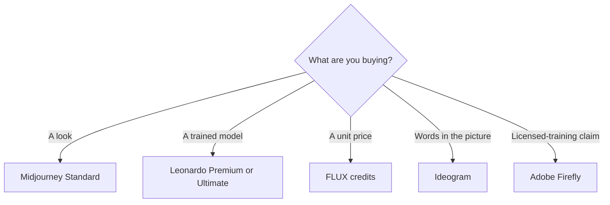

**Pick Midjourney when the job is a look. Pick Leonardo when the job is a model you train. Pick FLUX when the job is a price per image inside an app.** Those three products do not compete on one slider called quality. They sell different controls, and the bill is shaped by that control.

Prices are US list prices excluding tax, from each vendor's pricing page as checked October 16, 2026. This guide is published October 24, 2026. A live refetch of those pages on the publish date did not return pricing, so the tables keep the October 16 figures. Open the source before you subscribe. Nothing below is a blind test of the same prompt. The fit labels follow features the companies publish: GPU time, tokens, credits, privacy, and how you pay.

The wider field, including tools that are better at letters in the picture, is [best AI image generators](/blog/best-ai-image-generators-2026/). If Midjourney's Discord-and-subscription shape is the part you want to avoid, start with [Midjourney alternatives](/blog/midjourney-alternatives-2026/).

## Same job, different control

| Job | Lean toward | Why that control exists | First paid step |
|---|---|---|---|
| A stylized campaign still, with a repeatable art direction | [Midjourney](/tools/midjourney/) | Style references, moodboards, and personalization profiles | Standard, $30/month, or $24/month billed annually |
| A character or product look you train on your own images | [Leonardo.Ai](/tools/leonardo-ai/) | Personal AI models; Ultimate lists 50 of them | Premium, $30/month, for unlimited relaxed images on select models |
| Thousands of images inside your own product, priced per call | [FLUX](/tools/flux/) | Pay as you go. One credit is $0.01. No seat fee | FLUX 3 Klein from $0.008 an image at 768×768, up to $0.036 at 4K |
| Readable words in the image | None of the three first | [Ideogram](/tools/ideogram/) is the directory tool built around text | Ideogram Plus, $15/month on yearly billing |
| A commercial still you may need to defend as trained on licensed content | None of the three first | [Adobe Firefly](/tools/adobe-firefly/) states that path | Firefly Standard, $9.99/month |

## What each bill actually buys

| | Midjourney | Leonardo | FLUX |
|---|---|---|---|
| How you pay | Subscription by Fast GPU time | Subscription by fast tokens, plus a free plan for casual use | Credits. No subscription required |
| Entry | Basic $10/month, or $8/month annually. 3.3 Fast hours | Essential $12/month. 8,500 fast tokens, with a token bank up to 25,500 | Per image. FLUX 3 Klein from under a cent at 768×768 |
| The practical individual plan | Standard $30/month, or $24 annually. 15 Fast hours and unlimited Relax images | Premium $30/month. 25,000 fast tokens and unlimited relaxed images on select models | Keep paying per image. Volume is an enterprise conversation, not a higher seat |
| Top self-serve individual plan | Pro $60 / Mega $120 monthly. Annual is 20% off: $48 and $96 | Ultimate $60/month. 60,000 fast tokens, unlimited relaxed image and video on select models | Same meter at higher resolution or longer video |
| Privacy | Images are public unless Stealth is on. Stealth is Pro and Mega only | Team plans list private team generations | You call the API or playground. Open weights are a separate license |
| Commercial use | Subscribers may use outputs under Midjourney's terms. Companies over $1,000,000 gross annual revenue must be on Pro or Mega | Paid plans are the working path; confirm the current terms for a client deliverable | API use is the product. Open-weight licenses are not the same sentence as the API price |
| Team shape | The revenue rule is the company gate, not a per-seat price | Team Starter $24/seat ($72/month) and Growth $48/seat ($144/month), shared tokens | No seats. Cost scales with resolution, model, and volume |

Extra Midjourney Fast time is $4 an hour. Relax does not spend that clock, but V8 alpha does not offer Relax yet. If the look you want is V8, budget Fast hours, not "unlimited."

Leonardo unused fast tokens can bank up to about three times the monthly allowance. That is a buffer for a lumpy month. It is not a reason to buy Ultimate before you have measured one real brief.

FLUX video is priced per second, and the pricing page we used does not turn that into a flat "one clip costs X" number. Price a real clip length in the playground before you put FLUX video in a content calendar. Image work is the easier meter: a 4K FLUX 3 Klein still at $0.036 is a rounding error next to a Midjourney Standard seat, until you generate thousands of them.

## Who should buy which

**An art director or a solo designer who iterates on style.** Midjourney Standard. You are paying for references and for Relax once the prompt settles. Move to Pro only for Stealth, for the company-revenue rule, or because Fast hours actually ran out. The product review is [Midjourney review](/blog/midjourney-review-2026/). A first week of prompting is [Midjourney for beginners](/blog/midjourney-for-beginners-2026/).

**A small studio that needs the same character next month.** Leonardo Premium to learn the token meter, Ultimate when personal-model count or relaxed video is the constraint. Team Starter is the private shared pool, not a discount on Essential. See [Leonardo review](/blog/leonardo-ai-review-2026/).

**A developer shipping image generation inside a product.** FLUX. There is no seat to expense and no Discord step. Self-hosting open weights is a license and infrastructure project, not a free clone of the API. See [FLUX review](/blog/flux-review-2026/).

**A marketer who needs the product name spelled correctly.** Leave this comparison. Ideogram Plus is the text tool. Firefly is the licensed-training conversation. [Krea](/tools/krea/) is the app that wraps many models, including a free daily compute allowance, when you want a playground more than a model contract. Krea Pro is $21/month on yearly billing.

## Three bills for one month of stills

These are list-price sketches, not usage tests.

- **Forty art-directed stills, one person, public images are fine.** Midjourney Standard at $30, or Leonardo Premium at $30 if you also want a trained model. FLUX at a few cents an image is cheaper and gives you less of the style system.
- **A client who cannot have the images on a public gallery.** Midjourney Pro at $60 for Stealth, or Leonardo's team plan if the studio already shares tokens. Basic and Standard do not include Stealth.
- **A catalog of 2,000 packshots through an API.** FLUX. Two thousand FLUX 3 Klein images at $0.008 is $16. At $0.036 it is $72. A Midjourney seat does not become an API because you paid for Mega.

## What none of them do for you

- They do not check that a generated label matches the real product.
- They do not grant a trademark or a person's likeness.
- They do not make a public Basic-plan image private after the fact. Privacy is a plan feature, chosen before you generate the client work.

## FAQ

### Is Midjourney, Leonardo, or FLUX cheaper?

For a handful of images, FLUX is cheaper because you do not buy a month. For a month of art direction, Midjourney Standard and Leonardo Premium both list $30. FLUX becomes the expensive one when resolution and volume climb, because there is no flat cap.

### Which is best for realistic product photos?

Use the job, not a score. FLUX and Firefly are the clearer production paths for packshots at volume or for a licensed-training claim. Midjourney is the path when the photo has to feel art-directed. Leonardo is the path when you train on the product. A step-by-step version of that choice is [how to generate product photos with AI](/blog/how-to-generate-product-photos-with-ai-2026/).

### Can I try them free?

Leonardo has a free plan for casual use. FLUX has no subscription, and open weights can be run yourself under their licenses, but API calls are paid. Midjourney has no free plan.

### Do I need Pro on Midjourney for client work?

You need Pro or Mega if the company earns over $1,000,000 a year, or if the images must stay private. A smaller business can use Standard and still be inside the commercial-use terms Midjourney publishes. Privacy and the revenue rule are separate.

## Last verified

October 16, 2026 for the prices. Republished October 24, 2026 without a successful live refresh of the pricing pages.

**Sources:** [Comparing Midjourney plans](https://docs.midjourney.com/hc/en-us/articles/27870484040333-Comparing-Midjourney-Plans), [Leonardo pricing](https://leonardo.ai/pricing/), [Black Forest Labs pricing](https://bfl.ai/pricing), [FLUX API pricing](https://docs.bfl.ai/quick_start/pricing).

All three are in the [image generation directory](/tools/category/image-generation/). [Midjourney](/tools/midjourney/), [Leonardo](/tools/leonardo-ai/), and [FLUX](/tools/flux/) may use affiliate links. A purchase through them may earn us a commission at no extra cost to you.
