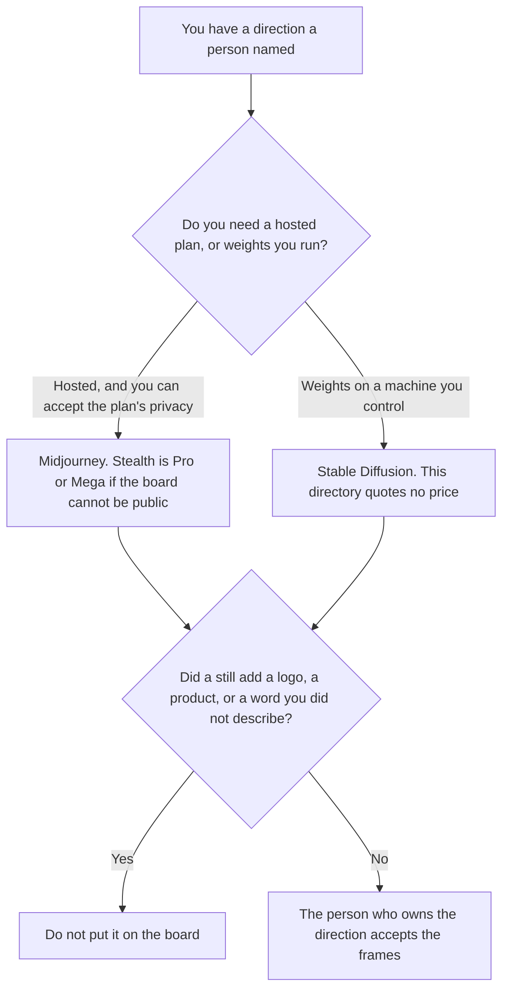

**Use Midjourney when the moodboard is a look study on a hosted GPU plan and you can live with that plan's privacy rules. Use a Stable Diffusion path when you need to run weights you chose, on a machine you control, and you accept that this directory has no Stable Diffusion card and therefore no price to quote.** A moodboard is a set of stills that show a direction a person named: palette, light, material, mood. It is not a product shot, and it is not an ad.

The hosted token-plan version of this job is [Midjourney vs Leonardo for moodboards](/blog/midjourney-vs-leonardo-for-moodboards-2026/). A per-image API that is a different model, not Stable Diffusion, is [FLUX pricing explained](/blog/flux-pricing-explained-2026/). Midjourney's bill is [Midjourney pricing explained](/blog/midjourney-pricing-explained-2026/).

Midjourney's prices below are US list prices from the directory card checked October 16, 2026. That card says companies with more than $1,000,000 in gross annual revenue need Pro or Mega for commercial use. This directory has no Stable Diffusion product page, so this article quotes no Stability AI price and no host price. Published October 24, 2026. We did not score images. We did not run a board.

## Which board you are making

| The board | Start here | First paid step | The limit |
|---|---|---|---|
| A few stills, and public images are acceptable | [Midjourney](/tools/midjourney/) | Basic is $10 a month, or $8 billed annually | Images are public unless you use Stealth |
| Many stills, with Relax image generation | Midjourney Standard | $30 a month, or $24 billed annually | Relax is unlimited images on that card. It is still your direction |
| The board must stay private on Midjourney | Midjourney Pro | $60 a month, or $48 billed annually, for Stealth | Mega is $120, or $96 billed annually, if you need more Fast time |
| Weights you run, with no directory price | Stable Diffusion, not a directory tool | No dollar on this site | Do not invent a GPU price. The machine and the license are yours to read |
| The stills arranged for a review | [Figma](/tools/figma/) | Professional Full seat is $16 a month billed annually | Figma places frames. It does not invent the look |

Midjourney's October 16 card lists Basic at $10 a month or $8 billed annually, Standard at $30 or $24, Pro at $60 or $48, and Mega at $120 or $96. Fast GPU time on that card is 3.3 hours on Basic, 15 on Standard, 30 on Pro, and 60 on Mega. Stealth Mode is only on Pro and Mega. An unreleased direction is public on Basic and Standard. If the board cannot be public, the card's answer is Stealth, not a hope that nobody looks.

Stable Diffusion is a weights family people run themselves or through a host. This site does not have a tool page for it, and it does not have a USD list price dated for this article. A host's hourly GPU charge, a checkpoint license, and a marketplace fee are three different bills. Quote the one you can open. Do not convert a euro host into dollars, and do not treat Midjourney's $10 as a stand-in.

[FLUX](/tools/flux/) is on the directory, from $0.008 an image on the October 16 card, with no seat. That is Black Forest Labs' API, explained in [FLUX pricing explained](/blog/flux-pricing-explained-2026/). It is not a Stable Diffusion price. Leonardo's token plan is the other moodboard article. Use that page when the question is a callback to a personal model on Leonardo's card.

Figma Professional at $16 a Full seat a month, billed annually, is where the accepted stills get arranged. The invoice is [Figma pricing explained](/blog/figma-pricing-explained-2026/). [Canva](/tools/canva/) Pro is $18 a month on the October 16 card if the board is a social layout rather than a file the design team will keep in Figma. The invoice is [Canva pricing explained](/blog/canva-pricing-explained-2026/).

## What the frame is allowed to show

The palette, the light, and the material you named. A logo you did not supply stays out. A product you did not describe stays out. A word on a sign stays out unless you pasted the word. Style is not a claim.

**Midjourney Basic** is the cheapest paid GPU clock for a public look. Pro is the first Stealth step on that card.

**A Stable Diffusion install** is the path when the weights and the machine are the point. This page stops at that sentence. It does not pick a checkpoint, a host, or a dollar.

**Figma Professional** places the frames a person already accepted.

A prompt that holds the line:

"Make a moodboard still from the palette, light, and material I pasted. If I did not name a product, do not add one. Do not add a logo. Do not add text."

## What not to delegate

Do not ask which still "looks more expensive." Do not put an unreleased direction on a public plan. Do not label a FLUX image or a Leonardo image as Stable Diffusion. The person who owns the direction accepts the frames.

## FAQ

### How is this different from the Leonardo moodboard page?

That page is a hosted GPU clock against a token plan and a personal model you can call back. This page is a hosted plan against weights this directory does not price. Leonardo stays on the other article.

### Does this site price Stable Diffusion?

No. There is no Stable Diffusion tool page in the directory. This article quotes no Stability price and no GPU-host price. Midjourney's dollars are the October 16 card. FLUX's per-image price is a different model.

### When is Stealth the Midjourney seat?

When the board cannot be public. On the October 16 card, Stealth is Pro or Mega. Basic and Standard are the wrong seats for an unreleased direction. The revenue line on that card, above $1,000,000 in gross annual revenue, still points those companies at Pro or Mega for commercial use.

### Who may put a still on the board?

The person who owns the direction, after they check that the frame did not add a logo, a product, or a word. A generated still is not approval to ship a product.

## Last verified

October 16, 2026 for Midjourney, Figma, Canva, and FLUX, via the directory cards and the posts cited above. Published October 24, 2026. No Stable Diffusion price is recorded in the directory. We did not score images.

**Sources:** [Midjourney plans](https://docs.midjourney.com/docs/plans), [Figma pricing](https://www.figma.com/pricing/), [Canva pricing](https://www.canva.com/pricing/), [FLUX](https://bfl.ai).

*Published by Andrew for [AI Tools Optimizer](https://aitoolsoptimizer.com).*

[Midjourney](/tools/midjourney/) is in the [image generation directory](/tools/category/image-generation/). Directory pages may use affiliate links. A purchase through them may earn us a commission at no extra cost to you.
