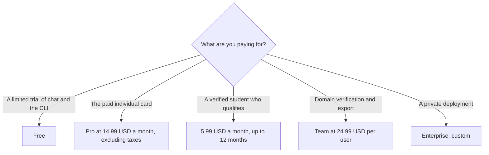

**Mistral Vibe Pro is $14.99 a month excluding taxes. Verified students pay $5.99 a month for up to 12 months. Team is $24.99 per user a month. Enterprise is custom.** Those figures are from the directory page checked October 16, 2026. Free is limited access to chat, search, creation, and Vibe for code. A live fetch of mistral.ai/pricing on October 24, 2026 returned HTTP 401, so this page does not replace the directory with a newer card it could not read.

Le Chat is the old name. The directory says conversations, settings, and plans carried over when the product became Vibe. The product page is [Mistral Vibe](/tools/mistral-vibe/). A general chat seat with a published $20 price is [ChatGPT review](/blog/chatgpt-review-2026/). The assistant in Gmail and Docs is [Gemini pricing explained](/blog/gemini-pricing-explained-2026/).

Published October 24, 2026. We did not score answers. Usage is subject to fair-use limits, in the directory's words.

## The cards the directory recorded

| Plan | Price on the October 16 record | What the record listed |
|---|---|---|
| Free | $0 | Limited chat, search, creation, and Vibe for code in the terminal |
| Pro | $14.99 a month, excluding taxes | Up to 6x messages, 5x web searches, 40x image generations, 15 GB libraries, 1,000 project folders, full coding access |
| Pro for verified students | $5.99 a month | Up to 12 months, for students who have not used Vibe or Le Chat before, at accredited institutions |
| Team | $24.99 per user a month | Higher limits, domain verification, and data export |
| Enterprise | Custom | Private deployments, custom models, and the directory's line on on-premises and data residency |

The directory says paid plans include chat and email support and can extend usage past plan limits with pay-as-you-go credits at API rates. It does not print a second, discounted annual price for Pro or Team. This page does not invent one. If checkout shows a yearly toggle, checkout wins.

The student price is not a coupon you apply to an existing account. The directory limits it to verified students at accredited higher-education institutions who have not used Vibe or Le Chat before, for up to 12 months.

## What you are comparing it with

**ChatGPT Plus** is $20 a month. Go is $8. Business is $20 a user a month billed annually, with a monthly figure of $25 on the directory card, and it wants at least two users. Vibe Pro at $14.99 is a lower individual sticker than Plus on these records. It is not the same product. Codex and ChatGPT projects are OpenAI's. Vibe for code is Mistral's CLI and IDE path. Do not quote $14.99 as if it included Plus.

**Claude Pro** is $20 a month, or $17 billed annually, and includes Claude Code on the directory card. A team that already lives in Claude projects should read [Claude review](/blog/claude-review-2026/) before adding a second assistant. The $3 gap between Claude's annual Pro price and Vibe Pro is not a reason to merge the bills in one sentence.

**Google AI Pro** is $19.99 a month and is the card that names Gemini in Gmail and Docs. If the work lives in Google's apps, the Gemini article is the one to price. Vibe's directory note is the European deployment story: Enterprise can run on-premises, in a private cloud, or on Mistral Cloud. That is a sales conversation. It is not a line on the Pro card.

## What not to assume

Do not add tax and then call $14.99 the out-the-door price. The directory says excluding taxes. Do not treat "up to 6x messages" as a number you can put in a budget. The baseline is Free, and the directory does not print Free's message cap. Do not assume Team includes a private deployment. That language is on Enterprise. Do not paste customer data into a personal Pro account your company has not approved.

## FAQ

### How much does Mistral Vibe cost?

On the October 16, 2026 directory record, Pro is $14.99 a month excluding taxes, the student price is $5.99 a month for up to 12 months, and Team is $24.99 per user a month. Enterprise is custom. Free exists, with limits.

### Is Le Chat a different bill?

The directory says Le Chat is now Vibe and that plans carried over. Price the Vibe card. If an old invoice still says Le Chat, confirm at checkout that it is the same subscription before you buy a second one.

### Does Pro include the coding agent?

The directory says Pro includes full coding access, and Free includes limited Vibe for code in the terminal. The CLI, and the VS Code, JetBrains, and Zed path, are features on the product page. A seat does not review the diff for you.

### What if the October 24 page shows a different number?

Use checkout. This page could not read mistral.ai/pricing that day because the fetch returned HTTP 401. The figures above are the October 16 directory record, not a live quote.

## Last verified

October 16, 2026, from the Mistral Vibe directory page, which cites Mistral's product and pricing pages. A live fetch on October 24, 2026 returned HTTP 401. Published October 24, 2026.

**Sources:** [Mistral Vibe](https://mistral.ai/products/vibe/), [Mistral pricing](https://mistral.ai/pricing/).

*Published by Andrew for [AI Tools Optimizer](https://aitoolsoptimizer.com).*

[Mistral Vibe](/tools/mistral-vibe/) is in the [chatbots and assistants directory](/tools/category/chatbots-assistants/). Directory pages may use affiliate links. A purchase through them may earn us a commission at no extra cost to you.
