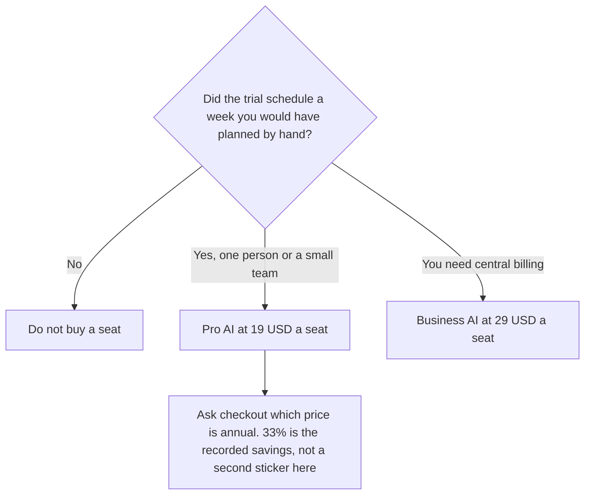

**Motion pricing is a paid seat after a free trial. Pro AI is $19 per seat per month with 7,500 AI credits. Business AI is $29 per seat per month with 15,000 credits.** There is no free plan on the directory card. Motion says annual billing saves 33%. The card also says to confirm which billing period the listed price applies to, so this page quotes $19 and $29 as listed and does not print a discounted dollar the card did not show.

Motion is the AI calendar and project tool at usemotion.com, the product in our directory. This article is that invoice. The task wiki, if you do not want auto-scheduling, is [Notion AI pricing explained](/blog/notion-ai-pricing-explained-2026/). A meeting note tool is a different job: [Granola vs Fathom](/blog/granola-vs-fathom-2026/).

Prices are US list prices excluding tax from Motion's pricing page as recorded in the directory on October 16, 2026. A direct fetch on October 24, 2026 returned 401, so the directory card remains the source. Published October 24, 2026. We did not score scheduling quality. Motion's marketing claim that projects finish faster is not a result we measured.

## The seats

| Plan | Listed price | AI credits | What the card adds |
|---|---|---|---|
| Trial | $0 to start, then it ends | The card does not print a trial credit amount | Cancel anytime. This is not a free plan |
| Pro AI | $19 per seat per month | 7,500 per seat per month | Unlimited storage, and iOS, Android, and desktop apps |
| Business AI | $29 per seat per month | 15,000 per seat per month | Everything in Pro AI, plus central billing and priority support |

Five Pro AI seats at the listed rate are 5 × $19 = $95 a month. Five Business AI seats are 5 × $29 = $145 a month. A year of five Pro seats at that listed rate, if it were billed every month, is $95 × 12 = $1,140. Apply the 33% annual savings only after checkout shows it. The directory warned that the listed price's billing period needed a look at the page. A wrong period would invent $376 of "savings." This page refuses that invention.

Extra credits are listed at 25 cents per 100 credits on Pro AI and 19 cents per 100 on Business AI. One hundred credits is the unit on that sentence. A 7,500-credit seat is the allowance. Watch the meter for a week before you buy packs.

## What else you might already pay for

**A wiki with tasks, not an auto-planned calendar.** [Notion AI](/tools/notion-ai/) Business is $20 a seat a month for full Notion AI. Plus at $10 is not that tier. Notion will not reshuffle your day when a meeting moves, which is Motion's pitch. If you will not live on the calendar Motion builds, the $20 Notion seat is the more honest system of record.

**You already run ClickUp.** [ClickUp Brain](/tools/clickup-brain/) lists Brain² AI from $9 a user a month, with unlimited Brain² conversations and 1,500 AI Super Credits. Everything AI is $28 a user a month. ClickUp's own plans are separate: Unlimited is $7 a user a month billed yearly, and Business is $12, on the directory card. Confirm whether Brain is an add-on at checkout. Do not add Motion until you know you will leave ClickUp's calendar behind.

**Notes from the meeting Motion scheduled.** [Granola](/tools/granola/) Business is $14 a user a month for unlimited history. Basic is free with 30 days of history. Granola does not join as a bot. It also does not plan the day. The no-bot notes are [Granola review](/blog/granola-review-2026/).

The team that lives in docs and status, rather than an AI calendar, is [best AI tools for ops teams](/blog/best-ai-tools-for-ops-teams-2026/).

## FAQ

### Is there a free plan?

No. There is a free trial you can cancel. Budget a seat before the trial ends if the calendar is now the place work lives.

### Does annual billing change the $19?

Motion says annual billing saves 33%. The directory did not print the discounted monthly or yearly sticker, and it flagged the billing period of the listed price. Use $19 and $29 as the figures we can cite. Use checkout for the annual contract.

### What is a credit?

The card says AI credits power Motion's AI features, with a monthly allowance per seat. It does not list a menu of "this reschedule costs this many credits." Read one week of usage. Additional credits are 25 cents per 100 on Pro AI and 19 cents per 100 on Business AI.

### Is Motion the same as an ad-creative tool with a similar name?

Not on this site. The directory entry is the AI planner at usemotion.com. If a quote is for a different Motion product, it is a different purchase.

## Last verified

October 16, 2026 for Motion, Notion, ClickUp Brain, and Granola. A direct Motion pricing fetch on October 24, 2026 returned 401. Published October 24, 2026.

**Sources:** [Motion pricing](https://www.usemotion.com/pricing), [Notion pricing](https://www.notion.com/pricing), [ClickUp Brain](https://clickup.com/brain).

*Published by Andrew for [AI Tools Optimizer](https://aitoolsoptimizer.com).*

[Motion](/tools/motion/) is in the [productivity and notes directory](/tools/category/productivity-notes/). Directory pages may use affiliate links. A purchase through them may earn us a commission at no extra cost to you.
