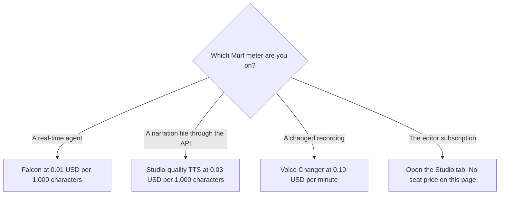

**On October 24, 2026, murf.ai/pricing showed Falcon text-to-speech at $0.01 per 1,000 characters and studio-quality text-to-speech at $0.03 per 1,000 characters.** Voice Changer was $0.10 per minute. Translation was $0.02 per 1,000 characters. The free API trial was $10 of credit. Studio subscription prices did not appear in that extract, so this article does not print a Studio seat price.

The character arithmetic, from the October 16 directory record of the same API rates, is [Murf pricing explained](/blog/murf-pricing-explained-2026/). A narrated explainer compared with another voice product is [ElevenLabs vs Murf for explainers](/blog/elevenlabs-vs-murf-for-explainers-2026/). [ElevenLabs](/tools/elevenlabs/)' own sticker is [ElevenLabs pricing explained](/blog/elevenlabs-pricing-explained-2026/).

Published October 24, 2026. Prices below are the USD figures on that Murf page. We did not score voices. We did not see a tax line.

## What the October 24 API tab showed

| Line | Price on the page | Unit the extract printed |
|---|---|---|
| Text to speech, Falcon, real-time | $0.01 | Per 1,000 characters |
| Text to speech, studio quality | $0.03 | Per 1,000 characters |
| Speech to Text, beta | $0.24 | No unit in the extract. This article does not invent one |
| Voice Changer | $0.10 | Per minute |
| Translation | $0.02 | Per 1,000 characters |

The page said purchased API credit never expires. The free-trial card listed up to 5 concurrent requests for text-to-speech and up to 5 for speech-to-text. The pay-as-you-go card listed up to 5 concurrent text-to-speech requests and up to 150 concurrent speech-to-text requests. Enterprise, on that page, is a sales conversation: on-premise deployment, higher concurrency, professional voice cloning, an SLA, and an MSA. No enterprise dollar was printed.

Speech to Text is the line to treat carefully. The extract placed $0.24 next to the beta row and did not place "/ minute" or "/ 1,000 characters" on that row. The "/ minute" line belonged to Voice Changer. Do not copy $0.24 onto a purchase order until the unit is on the screen in front of you.

## What this page will not quote

**Studio plans.** The October 16 directory check also could not read Studio subscription prices, because that tab did not render. The October 24 extract was the API tab. A free Studio workspace with 10 minutes of voice generation, and no downloads, is the Help Center note on the directory card. That is not a paid Studio price. Open murf.ai/pricing and read the Studio tab before you write a seat into a budget.

**A minute rate for Falcon.** The published Falcon price is per 1,000 characters. The page's calculator may show a rough duration. A duration sketch is not the invoice. The worked examples, including what $10 of credit covers if the credit applies the way simple division suggests, are in the earlier Murf pricing article. Confirm the debit on one call.

**ElevenLabs Starter** is $6 a month on the October 16 card, if you need a voice seat with a published plan while Murf Studio is blank. Creator is $22 on that card. That is a different product, not a Murf discount. [Speechify](/tools/speechify/) is a listening product. Do not put its price on a Murf purchase order. [Descript](/tools/descript/) Hobbyist is $16 a person a month billed annually on that card, if the job is editing a recording you already have.

## What not to assume

Do not add the Falcon rate and the studio-quality rate for the same characters and call the sum the price. You are on one endpoint or the other. Do not treat the $10 credit as a Studio download allowance. Do not convert a character count into minutes and then into a seat.

## FAQ

### How much is Murf's API?

On murf.ai/pricing fetched October 24, 2026, Falcon text-to-speech was $0.01 per 1,000 characters and studio-quality text-to-speech was $0.03 per 1,000 characters. Voice Changer was $0.10 per minute. Translation was $0.02 per 1,000 characters. New API users were offered $10 of credit.

### How much is Murf Studio?

This article does not have a Studio subscription price. The Studio tab did not yield seat dollars on October 24, and it did not on the October 16 directory check. Read the live Studio tab.

### What does the $0.24 speech-to-text line mean?

The October 24 extract showed $0.24 beside Speech to Text beta and did not show a unit. Do not assume it is per minute. The per-minute words on that page were attached to Voice Changer.

### Does API credit expire?

The October 24 page said purchased credit never expires. Confirm that the credit applies to the endpoint you are about to call. A credit that does not debit against Falcon is not a Falcon allowance, even if the balance still shows $10.

## Last verified

October 24, 2026, from murf.ai/pricing, API tab. Studio seat prices were not in that extract. The free Studio workspace note is the October 16 directory record of Murf's Help Center. Published October 24, 2026.

**Sources:** [Murf pricing](https://murf.ai/pricing), [Murf Help Center](https://help.murf.ai/what-is-a-workspace), [ElevenLabs pricing](https://elevenlabs.io/pricing).

*Published by Andrew for [AI Tools Optimizer](https://aitoolsoptimizer.com).*

[Murf AI](/tools/murf-ai/) is in the [audio, voice, and music directory](/tools/category/audio-voice-music/). Directory pages may use affiliate links. A purchase through them may earn us a commission at no extra cost to you.
