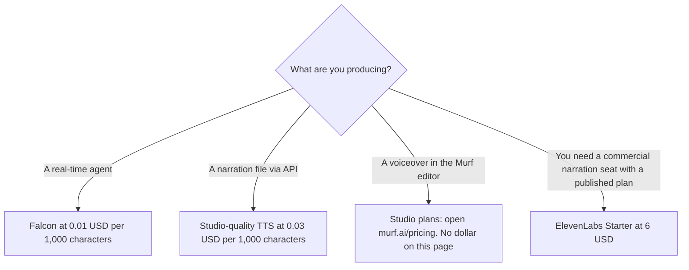

**Murf's published API price, on the directory card, is a character rate: Falcon text-to-speech is $0.01 per 1,000 characters, and studio-quality TTS is $0.03 per 1,000 characters.** Voice Changer is $0.10 per minute. Translation is $0.02 per 1,000 characters. New API users get $10 of credit, and purchased API credit does not expire. Studio subscription prices are a separate product, and this page does not print them, because that part of the pricing page did not render during the October 16 check.

The voice comparison is [Murf vs ElevenLabs](/blog/murf-vs-elevenlabs-2026/). The three-way with listening software is [ElevenLabs vs Murf vs Speechify](/blog/elevenlabs-vs-murf-vs-speechify-2026/). ElevenLabs' own bill is [ElevenLabs pricing explained](/blog/elevenlabs-pricing-explained-2026/).

Prices are US list prices excluding tax from Murf's pricing page and Help Center as recorded in the directory on October 16, 2026. A direct fetch on October 24, 2026 returned 401, so this article does not fill the Studio gap from memory. Published October 24, 2026. We did not score voices.

## The API, which we can quote

| Endpoint | Recorded price |
|---|---|
| Text to speech, Falcon, real-time | $0.01 per 1,000 characters |
| Text to speech, studio quality | $0.03 per 1,000 characters |
| Voice Changer | $0.10 per minute |
| Translation | $0.02 per 1,000 characters |

API plans on the card include the $10 credit, 5 concurrent requests, and chat support. Enterprise API adds on-premise deployment, higher concurrency, professional voice cloning, an SLA, and an MSA. Those are sales lines. This page does not invent the enterprise dollar.

## A sketch, labeled as arithmetic

Ten thousand characters on Falcon are 10 × $0.01 = $0.10. The same length at the studio-quality rate is 10 × $0.03 = $0.30. One hour of Voice Changer is 60 × $0.10 = $6. The $10 credit covers 1,000,000 characters on Falcon (10 ÷ 0.01 × 1,000) before you pay more, if the credit applies to that endpoint the way a simple division suggests. Confirm the debit on one call. A character rate is not a minute rate. The unit, when a model also bills tokens, is a different meter: [what AI tokens are](/blog/what-are-ai-tokens-explained-2026/).

## Studio, stated as a gap

A free Studio workspace includes 10 minutes of voice generation, and downloads are not available on that free workspace, per the Help Center note in the directory. **Current Studio subscription prices were not verified.** Check [Murf's pricing page](https://murf.ai/pricing) before you budget a narrator seat. Do not copy a third-party blog's Studio number into a purchase order.

Until that dollar is on a page you opened, compare products that do have one:

| Need | A price we can cite | Why it is not Murf Studio |
|---|---|---|
| A narration plan with a commercial-use step | [ElevenLabs](/tools/elevenlabs/) Starter at $6 a month. Creator at $22 is the first plan with Professional Voice Cloning on that card | A different vendor and a credit pool, not Murf's editor |
| Software that reads to you | [Speechify](/tools/speechify/) Premium at $29 a month billed monthly | Listening, not a production voiceover |
| Edit a human recording | [Descript](/tools/descript/) Hobbyist at $16 a person a month billed annually | A transcript editor |

The voice shelf is [best AI voice generators](/blog/best-ai-voice-generators/). If the audio is an avatar's mouth, the video bills are [HeyGen pricing explained](/blog/heygen-pricing-explained-2026/) and [Synthesia pricing explained](/blog/synthesia-pricing-explained-2026/).

## FAQ

### How much is Murf Studio?

This site does not know, from the check on October 16, 2026. The Studio tab did not render. The free workspace is 10 minutes without downloads. Ask the pricing page for the paid Studio tiers.

### Does API credit expire?

The directory says purchased API credit does not expire. The $10 new-user credit should be confirmed in the account so a trial clock is not confused with that rule.

### Is $0.01 per 1,000 characters the voiceover price?

It is the Falcon real-time API price on the card. Studio-quality TTS on the API is $0.03 per 1,000 characters. The editor subscription is a third number, and it is the one we are not printing.

### Can I budget Murf against ElevenLabs Starter at $6?

Only for the job. Starter is a monthly seat with a license step ElevenLabs documents. Murf's API is a meter. A short agent can cost less than $6. A daily narration practice might not. Compare invoices after one real script, not the headlines.

## Last verified

October 16, 2026 for the API rates, the $10 credit, and the free Studio minutes. Studio subscription prices were not available on that check. ElevenLabs, Speechify, and Descript use the same date. A direct Murf fetch on October 24, 2026 returned 401. Published October 24, 2026.

**Sources:** [Murf pricing](https://murf.ai/pricing), [ElevenLabs pricing](https://elevenlabs.io/pricing), [Speechify pricing](https://speechify.com/pricing/).

*Published by Andrew for [AI Tools Optimizer](https://aitoolsoptimizer.com).*

[Murf AI](/tools/murf-ai/) is in the [audio, voice, and music directory](/tools/category/audio-voice-music/). Directory pages may use affiliate links. A purchase through them may earn us a commission at no extra cost to you.
