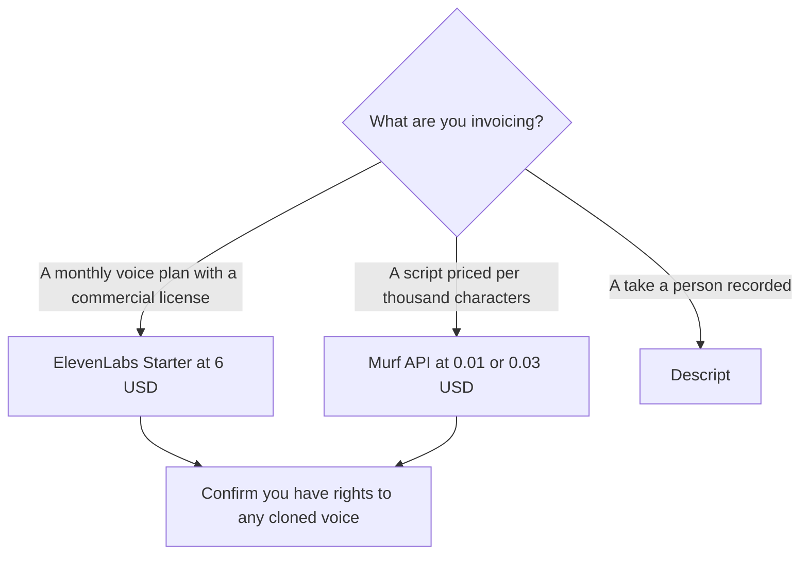

**Choose ElevenLabs to generate a voiceover on a credit plan you can subscribe to. Choose Murf when the invoice has to be a published price per 1,000 characters.** Both make speech. ElevenLabs sells monthly credit bundles, starting with a commercial license at $6. Murf publishes API rates at $0.01 and $0.03 per 1,000 characters, and its Studio subscription prices did not render for us. This page does not pick a voice by ear.

The wider switch list, including listening and video, is [ElevenLabs alternatives](/blog/elevenlabs-alternatives-2026/). The three-way that adds a reading app is [ElevenLabs vs Murf vs Speechify](/blog/elevenlabs-vs-murf-vs-speechify-2026/). Prices are US list prices excluding tax from directory pages checked October 16, 2026. Published October 24, 2026.

## The price you can actually compute

| | [ElevenLabs](/tools/elevenlabs/) | [Murf](/tools/murf-ai/) |
|---|---|---|
| What you can budget before a generation | A monthly credit allotment. A minute rate was not on the card | An API rate: $0.01 or $0.03 per 1,000 characters |
| Free | 10,000 credits a month. No commercial license | Studio: 10 minutes of generation, no downloads. API: $10 credit for a new account |
| First paid step we could price | Starter $6/month, 30,000 credits, commercial license | The API rates above. Studio plan dollars were not on the page we could record |
| The clone tier | Creator $22/month, Professional Voice Cloning, 121,000 credits | Professional voice cloning on the API was listed at enterprise, not on the self-serve rate card |
| Volume | Pro $99 (600,000 credits), Scale $299 (1.8 million), Business $990 (6 million) | Pay as you go. Purchased API credit does not expire, per the plan note we checked |
| A recording you already made | A weak fit | A weak fit. Use [Descript](/tools/descript/) |

ElevenLabs' credit ladder is [ElevenLabs pricing explained](/blog/elevenlabs-pricing-explained-2026/). The product page is [ElevenLabs review](/blog/elevenlabs-review-2026/).

## ElevenLabs, when the output is a subscription

Use ElevenLabs when the script is yours and the output is narration, a dub, or a clone you have the right to make. Free is a listening test of the product: 10,000 credits and no commercial license. Starter at $6 is the first plan that includes the commercial license. Creator at $22 is the plan for Professional Voice Cloning.

Pro at $99, Scale at $299, and Business at $990 are volume. Scale includes three professional voice clones and Business includes ten, on the card recorded October 16, 2026. A podcast that needs one host clone is a Creator question, and a rights question, before it is a Scale question. The clone steps, for a voice you are allowed to clone, are [how to clone a voice with ElevenLabs](/blog/how-to-clone-a-voice-with-elevenlabs/).

You cannot turn ElevenLabs credits into a dollar-per-minute figure from the public card we used. Budget the seat. Watch the credit meter on a real script before you promise a monthly volume.

## Murf, when the output is arithmetic

Murf's API card, recorded October 16, 2026, is specific:

| API | Published price |
|---|---|
| Falcon text to speech, real time | $0.01 per 1,000 characters |
| Studio-quality text to speech | $0.03 per 1,000 characters |
| Voice changer | $0.10 per minute |
| Translation | $0.02 per 1,000 characters |

A 1,000-character script at the studio rate is $0.03. That is multiplication of the card, and it is a measured quote from the rate table. New API accounts were described with $10 in credit. Concurrent requests on that new-account note were five. Professional cloning stayed on the enterprise API line.

**Murf Studio subscription prices did not render** on the day we checked. Do not treat ElevenLabs Starter at $6 as cheaper than a Studio seat we could not see. Use the API when you need the rate. Use ElevenLabs when you want a content plan with a commercial license and a price on the card. The free Studio workspace, 10 minutes and no downloads, is a preview.

Murf Dub, for translating video and audio into 20+ languages, is a localization product beside the API. Video localization as a workflow is [how to localize video with AI](/blog/how-to-localize-video-with-ai-2026/).

## What neither one is

[Speechify](/tools/speechify/) Premium at $29 a month billed monthly is for listening to documents. It is the wrong substitute for either vendor when the file will be published as a voiceover. [Descript](/tools/descript/) Hobbyist at $16 per person per month billed annually edits a recording a person made. A noisy interview is a Descript job. A script with no microphone is an ElevenLabs or Murf job.

The voice category is [best AI voice generators](/blog/best-ai-voice-generators/). A podcast production stack that starts from a recording is [best AI tools for podcasters](/blog/best-ai-tools-for-podcasters-2026/) and [how to edit podcasts with Descript](/blog/how-to-edit-podcasts-with-descript-2026/).

## FAQ

### Is Murf cheaper than ElevenLabs?

On the API, you can compute it: $0.03 per 1,000 characters at the studio rate. ElevenLabs Starter is $6 a month for 30,000 credits, and the card does not convert credits to characters in the source we used. Compare them on your own script's credit usage inside ElevenLabs, against the character count times Murf's rate. A Studio subscription comparison waits on a Murf price we can read.

### Which plan includes a commercial license?

ElevenLabs Starter and above. Murf's API rates are published usage prices. Confirm commercial terms on the Murf plan you check out, especially for Studio, because that subscription price was not visible to us.

### Can I clone my own voice on the cheaper plan?

On ElevenLabs, Professional Voice Cloning starts at Creator, $22. On Murf's self-serve API card, professional cloning was an enterprise item. Rights come before the plan. Clone a voice you have permission to clone.

### Does this replace a podcast editor?

No. Both products generate speech. Descript edits the episode. Use a generator for a scripted read or an allowed clone. Use an editor for the conversation you recorded.

## Last verified

October 16, 2026. Murf Studio subscription prices were omitted because that part of the pricing page did not render. Published October 24, 2026.

**Sources:** [ElevenLabs pricing](https://elevenlabs.io/pricing), [Murf pricing](https://murf.ai/pricing).

*Published by Andrew for [AI Tools Optimizer](https://aitoolsoptimizer.com).*

[ElevenLabs](/tools/elevenlabs/) and [Murf](/tools/murf-ai/) are in the [audio directory](/tools/category/audio-voice-music/). Directory pages may use affiliate links. A purchase through them may earn us a commission at no extra cost to you.
