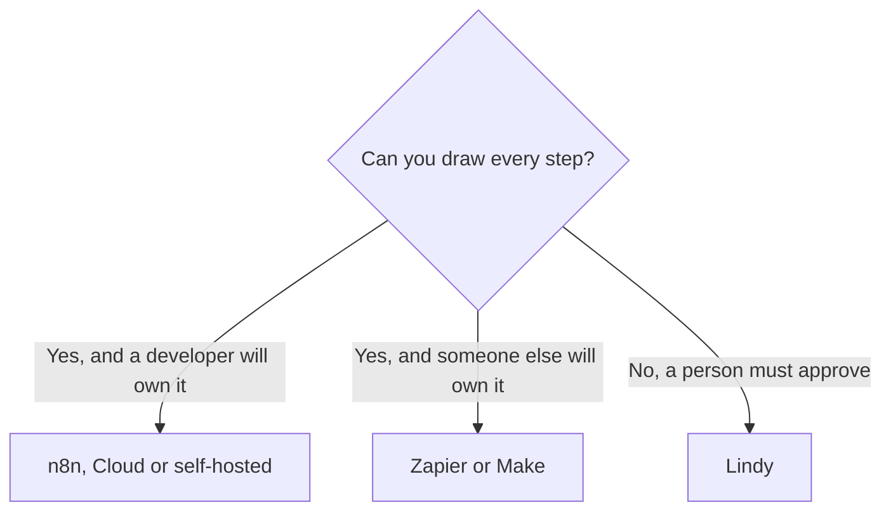

**Leave n8n when the person who will maintain the workflow is not going to operate executions, a euro invoice, or a server.** Stay when a full run of a many-step workflow should count once, users are unlimited, and someone on the team can own the scenario. Zapier and Make are the hosted alternatives in dollars. Lindy is the alternative when the step needs judgment and a person will approve the send.

The three-way that includes n8n is [Zapier vs Make vs n8n](/blog/zapier-vs-make-vs-n8n/). The product page is [n8n Cloud review](/blog/n8n-cloud-review-2026/). The agent shelf beside a diagram is [Zapier alternatives for AI workflows](/blog/zapier-alternatives-for-ai-workflows-2026/).

n8n prices below are in euros because that is what the pricing page showed on October 16, 2026. This article does not convert them. Zapier, Make, and Lindy figures are USD. Lindy's were read on lindy.ai/pricing on October 24, 2026. The others are from directory pages checked October 16, 2026. Published October 24, 2026. We did not score workflow reliability.

## Where to go

| The constraint | Open this | Price that matters |
|---|---|---|
| Hosted n8n, billed per full run, unlimited users | Stay on [n8n](/tools/n8n/) Cloud | Starter €20 a month billed annually, 2,500 executions. Pro €50 a month annually, 10,000 |
| The data stays on your server | n8n Community Edition | Free. You patch, back up, and watch the disk |
| A non-developer will maintain it, in dollars, on a long app list | [Zapier](/tools/zapier/) | Professional $19.99 a month annually, 750 tasks, after a 14-day trial. Free is 100 tasks |
| A branchy scenario and a lower entry price | [Make](/tools/make/) | Core from $9 a month annually for 10,000 credits. Free is 1,000 credits |
| The step cannot be drawn, and a person approves the send | [Lindy](/tools/lindy/) | $50 in trial credits for 7 days. Paid use starts at $49.99 per user per month for 5,000 credits, pooled |
| A research agent with its own credit pack | [Manus](/tools/manus/) | Pro is $20 a month for 4,000 credits on the October 16 card |

## What you give up when you leave

n8n counts one full workflow run as one execution, however many AI nodes sit inside it. That is the reason a technical team picks it for a fat scenario. Starter's 2,500 executions are 2,500 runs. A poll every five minutes is 8,640 runs and does not fit. Unlimited users and unlimited workflows are on every plan in the October 16 table. You do not pay per seat to add a teammate.

The Business row at €667 a month was listed as self-hosted, not as the next cloud tier. Do not "upgrade" from Pro to Business expecting another cloud invoice. Annual billing on the cloud plans was described as 17% off. The trial was described as card-free.

Zapier Professional at $19.99 annually is the default when the apps are on Zapier's list and 750 tasks cover the month. Filters and Formatter do not count as tasks, on the card the ops roundup used. A 12-step Zap can be many tasks. The same shape on n8n can be one execution. Compare them on one workflow you already run, for a week, on the free tiers.

Make Core from $9 is the canvas when the scenario branches. A credit is not a Zapier task and not an n8n execution. Some AI modules cost more than one credit. The review is [Make.com review](/blog/make-com-review-2026/). The setup steps are [how to automate work with Zapier and Make](/blog/how-to-automate-work-with-zapier-and-make/).

## When the alternative is an agent

Lindy's pricing page, read October 24, 2026, says anything with outside impact waits for approval, and that running out of credits pauses the work rather than overaging the card. Monthly credits do not roll over. Top-ups are $10 per 1,000 credits. Every active user is billed, and each seat's credits join one pool. Use Lindy on the step you cannot draw. Keep n8n, Zapier, or Make on the path that must be the same every time. The invoice detail is [Lindy pricing explained](/blog/lindy-pricing-explained-2026/). The single-agent definition is [what an AI agent is](/blog/what-is-an-ai-agent-2026/).

Ops teams picking among these for a weekly path should start from [best AI tools for ops teams](/blog/best-ai-tools-for-ops-teams-2026/). A routing step that enriches a lead before the CRM is [best AI tools for RevOps](/blog/best-ai-tools-for-revops-2026/).

## FAQ

### Is Zapier cheaper than n8n?

They are in different currencies and different units. n8n Starter is €20 a month annually for 2,500 full runs. Zapier Professional is $19.99 a month annually for 750 tasks. A short Zap can be cheaper on Zapier. A long one can be cheaper on n8n. Run both on the same payload before you decide.

### Should I self-host to avoid the euro price?

Only if someone will own updates and backups. Community Edition is free because you supply the server and the labor. A forgotten upgrade is more expensive than Starter.

### Does Make replace n8n for AI nodes?

Make can call AI modules, and some of them cost extra credits. n8n includes AI nodes on the plans in the October 16 table, with a separate Assistant-credit allowance. The maintenance question still decides it: canvas for a non-developer, executions for a developer.

### Is Lindy an n8n replacement?

It replaces the step that needs a judgment and an approval. It does not replace a webhook that must do the same twelve steps every time.

## Last verified

October 16, 2026 for n8n, Zapier, Make, and Manus. October 24, 2026 for Lindy's $49.99 starting line, the shared pool, and the approval sentence, from lindy.ai/pricing. Published October 24, 2026.

**Sources:** [n8n pricing](https://n8n.io/pricing/), [Zapier pricing](https://zapier.com/pricing), [Make pricing](https://www.make.com/en/pricing), [Lindy pricing](https://www.lindy.ai/pricing).

*Published by Andrew for [AI Tools Optimizer](https://aitoolsoptimizer.com).*

[n8n](/tools/n8n/) and [Zapier](/tools/zapier/) are in the [automation directory](/tools/category/automation-agents/). Directory pages may use affiliate links. A purchase through them may earn us a commission at no extra cost to you.
