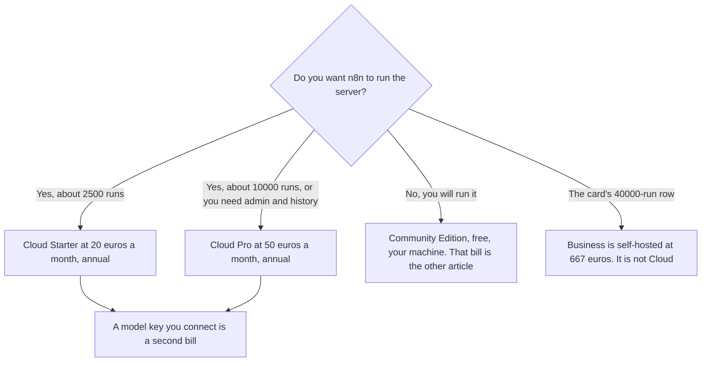

**n8n Cloud, the hosted product, is Starter at €20 a month billed annually for 2,500 workflow executions, or Pro at €50 a month billed annually for 10,000.** Those are the cloud rows on the directory card checked October 16, 2026. The Community Edition is free because you host it. Business at €667 a month annually for 40,000 executions is listed as self-hosted. It is not the next Cloud invoice. This page does not convert euros to dollars. The full ladder, including the self-hosted rows, is [n8n pricing explained](/blog/n8n-pricing-explained-2026/). The product walkthrough is [n8n cloud review](/blog/n8n-cloud-review-2026/).

A live fetch of n8n.io/pricing returned HTTP 401 on October 24, 2026. The figures stay on the October 16 card. Published October 24, 2026. We did not score uptime. Annual billing saves 17% off the monthly euro price, on that card. The card does not print the monthly euro amount, so this page does not invent one.

## The rows that are Cloud

| Plan | Annual price on the October 16 card | Executions | Hosted by n8n? |
|---|---|---|---|
| Starter | €20 a month | 2,500 | Yes. 1 shared project, 5 concurrent executions, 1,600 Assistant credits. Trial, no card |
| Pro | €50 a month | 10,000 | Yes. 3 shared projects, up to 50 concurrent executions, 7 days of insights, up to 9,600 Assistant credits, admin roles, workflow history |
| Business | €667 a month | 40,000 | No. The card says self-hosted. 6 shared projects |
| Enterprise | Custom | Custom | The card says n8n-hosted or self-hosted. Unlimited projects, 200+ concurrent, 365 days of insights, SLA |

A year of Cloud Starter at the recorded annual rate is 12 × €20 = €240. A year of Cloud Pro is 12 × €50 = €600. Those are euro totals. Your checkout may show another currency. Quote the charge you see. Do not multiply by an exchange rate on this page.

All plans on the card include unlimited users, unlimited workflows, and every integration. Cloud does not add a seat fee the card forgot to mention. You pay when executions run out, or when you need Pro's admin roles, history, and longer concurrency.

## What you are paying Cloud for

**Someone else runs the server.** Starter and Pro are that invoice. The trial does not require a card, on the recorded FAQ. It is not a permanent free cloud plan. When the trial ends, the cloud price is Starter or Pro, or you leave.

**Executions, not steps.** One full run counts once, however many nodes it has. A poll every five minutes is 8,640 runs in a 30-day month. That does not fit Starter or Pro. The review walks through that arithmetic. This page's job is to keep that volume on the cloud rows, not on the €667 self-hosted line.

**Assistant credits on the cloud plans.** Starter includes 1,600 a month. Pro goes up to 9,600. Agents, MCP, and AI nodes are on all plans, on the card. If you connect your own model key, that vendor bills you. [Claude](/tools/claude/) Pro at $17 a month billed annually, or $20 monthly, is a chat seat. It is not included in the €20.

## What this page will not quote as Cloud

**Community Edition.** Free, your hardware. The labor is the price. That choice is the pricing article, not a Cloud discount.

**Business at €667.** The hosting line says self-hosted. Moving from Pro to Business changes who runs the server. It is not "Cloud, but larger." Startups under 20 employees may get 50% off Business, on the directory notes. That note, if it applies, applies to the self-hosted commercial tier. It does not turn Business into Cloud Starter.

**Make and Zapier, as if the meters matched.** [Make](/tools/make/) Core starts at $9 a month billed annually for 10,000 credits. [Zapier](/tools/zapier/) Professional is $19.99 a month billed annually for 750 tasks. A credit is not an execution. A task is not an execution. The invoices are [Make pricing explained](/blog/make-pricing-explained-2026/) and [Zapier pricing explained](/blog/zapier-pricing-explained-2026/).

## FAQ

### Is n8n Cloud the same price as n8n?

The Cloud rows are Starter and Pro, in euros, on the October 16 card. The pricing article also lists Community Edition and self-hosted Business. People say "n8n" for all of them. The invoice for hosting is only the Cloud rows. Enterprise can be n8n-hosted, and it is custom. Do not copy €50 onto Enterprise.

### Why are the prices in euros?

The pricing page showed euros on the October 16 check. A live fetch on October 24 returned HTTP 401, so this page does not claim a new currency. Checkout may differ. This article does not convert.

### Does Pro include a seat for each editor?

The card says unlimited users on all plans. Pro's extra lines are projects, concurrency, insights, Assistant credits, admin roles, and history. You do not buy Pro to add a person. You buy Pro when 2,500 executions are not enough or you need those admin lines.

### What happens at 2,500 executions?

The card prices Starter at 2,500 and Pro at 10,000. It does not print an overage rate on the lines we recorded. Confirm that on the current pricing page before you leave a poll running. Do not assume the next euro is the Business price. Business is a different hosting model.

## Last verified

October 16, 2026, from the n8n directory card. A live fetch of n8n.io/pricing returned HTTP 401 on October 24, 2026. Make, Zapier, and the Claude monthly comparison are from the same directory pass, with Claude's $17 annual figure from the October 24 pricing article. Published October 24, 2026. No USD conversion is provided.

**Sources:** [n8n pricing](https://n8n.io/pricing/), [Make pricing](https://www.make.com/en/pricing), [Zapier pricing](https://zapier.com/pricing).

*Published by Andrew for [AI Tools Optimizer](https://aitoolsoptimizer.com).*

[n8n](/tools/n8n/) is in the [automation and agents directory](/tools/category/automation-agents/). Directory pages may use affiliate links. A purchase through them may earn us a commission at no extra cost to you.
