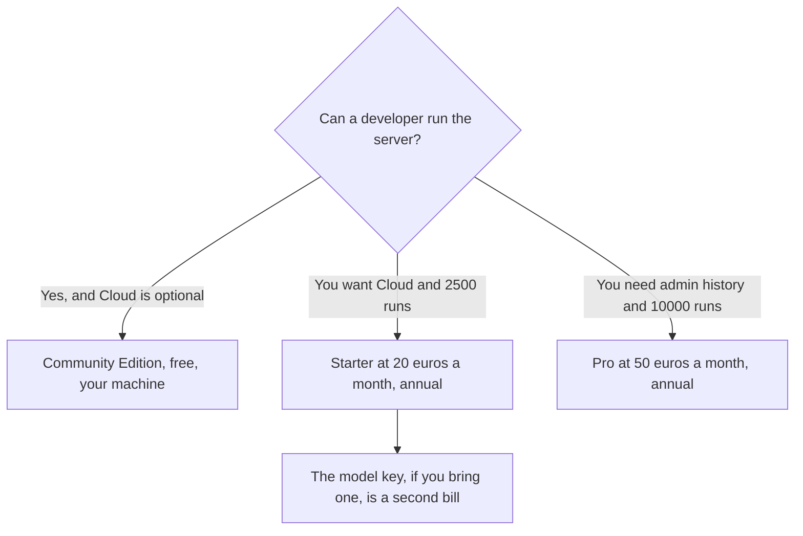

**n8n prices a full workflow execution, not each step, and the cloud card we recorded was in euros.** Starter is €20 a month billed annually for 2,500 executions. Pro is €50 a month annually for 10,000 executions. Business is €667 a month annually for 40,000 executions on the self-hosted commercial tier. Enterprise is custom. The Community Edition is free if you self-host it. This page does not convert euros to dollars. Check n8n.io/pricing for the currency you will be charged.

The comparison against Make's credit meter is [Make vs n8n for AI](/blog/make-vs-n8n-for-ai-2026/). Make's own ladder is [Make pricing explained](/blog/make-pricing-explained-2026/). The three-way is [Zapier vs Make vs n8n](/blog/zapier-vs-make-vs-n8n/).

Prices were shown in euros on the directory pass of October 16, 2026. Annual billing saves 17% off the monthly euro price. Published October 24, 2026. We did not score uptime or support.

## The plans we could read

| Plan | Annual price we saw | Executions | What the card adds |
|---|---|---|---|
| Community Edition | Free, self-hosted | Your hardware | You pay in Docker, upgrades, and backups |
| Starter | €20 a month | 2,500 | 1 shared project, 5 concurrent executions, 1,600 Assistant credits. Cloud trial, no card |
| Pro | €50 a month | 10,000 | 3 shared projects, up to 50 concurrent, 7 days of insights, up to 9,600 Assistant credits, admin roles, history |
| Business | €667 a month | 40,000 | Self-hosted, 6 shared projects |
| Enterprise | Custom | Custom | Unlimited projects, 200+ concurrent, 365 days of insights, SLA |

All of those plans include unlimited users, unlimited workflows, and every integration, on the directory card. You do not buy a seat to add a teammate. You buy executions. A 30-step workflow costs the same execution as a two-step workflow. That is the point of the meter, and it is why a fat scenario can look cheaper here than on a per-step tool, if you staff it.

Starter for a year at the recorded annual rate is 12 × €20 = €240. Pro is 12 × €50 = €600. Business is 12 × €667 = €8,004. The jump from Pro to Business is the number to notice before you "upgrade to be safe." Forecast executions. The product page for the hosted service is [n8n cloud review](/blog/n8n-cloud-review-2026/). The wider set is [n8n alternatives](/blog/n8n-alternatives-2026/).

## What an execution is not

An execution is one run from start to finish. It is not a user, and it is not a step. One hundred runs of a five-node workflow are 100 executions. That is 100 / 2,500 of a Starter month, or 4%. The same shape on Make, if each module costs one credit, is 500 credits. The meters are not convertible. Read [what an API for AI tools is](/blog/what-is-an-api-for-ai-tools-2026/) before you add a model node and assume it is inside the €20.

Assistant credits are a separate counter: 1,600 a month on Starter and up to 9,600 on Pro. All plans include agents, MCP, and AI nodes, plus AI models without your own keys, on the recorded FAQ. If you connect your own key anyway, that vendor still bills you. [Claude](/tools/claude/) Pro at $20 is a chat seat, not an n8n allowance.

Startups under 20 employees may get 50% off Business, on the directory notes. Confirm it. Do not apply that percent to Starter in a spreadsheet unless the page says so.

## The USD tools people compare it with

[Make](/tools/make/) Core starts at $9 a month billed annually for 10,000 credits. That is a USD credit price for a visual scenario. [Zapier](/tools/zapier/) Professional is $19.99 a month billed annually for 750 tasks. [Lindy](/tools/lindy/) Team starts at $49.99 a month for 5,000 credits when the product you want is an agent, not a diagram. The how-to for the drawn path is [how to automate work with Zapier and Make](/blog/how-to-automate-work-with-zapier-and-make/).

Cloud's free trial does not require a card, on the recorded FAQ. It is not a permanent free cloud plan. The permanent free path in the table is self-hosting.

## FAQ

### Why are the prices in euros?

The pricing page showed euros on the October 16, 2026 check. Your checkout may display another currency. This article does not multiply by an exchange rate. Quote the charge you see.

### Is Business €667 the next step after Pro for a small team?

It is the next commercial tier we recorded, and it is an order of magnitude above €50. Most teams that outgrow Starter should look at Pro, or at self-hosting, before they look at €667. Unlimited users does not mean you need Business to add a person.

### Does self-hosting include the same SLA?

The SLA line on the card is Enterprise. Community Edition is free software you operate. Budget upgrades and backups as the cost. Do not describe it as the €20 cloud plan with the invoice removed.

### Do failed runs count?

The directory defines an execution as one full run from start to finish. It does not spell out a failed-run exception on the lines we recorded. Confirm that on the current pricing page before you promise a finance partner a free retry.

## Last verified

October 16, 2026 for n8n's euro prices, Make, Zapier, Lindy, and Claude. No USD conversion is provided. Published October 24, 2026.

**Sources:** [n8n pricing](https://n8n.io/pricing/), [Make pricing](https://www.make.com/en/pricing), [Zapier pricing](https://zapier.com/pricing).

*Published by Andrew for [AI Tools Optimizer](https://aitoolsoptimizer.com).*

[n8n](/tools/n8n/) is in the [automation and agents directory](/tools/category/automation-agents/). Directory pages may use affiliate links. A purchase through them may earn us a commission at no extra cost to you.
