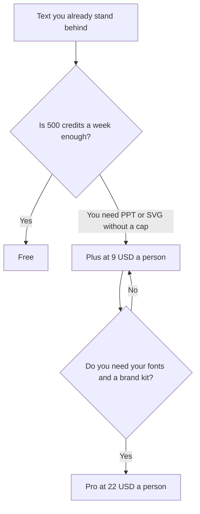

**Napkin AI pricing is a per-person credit plan for turning text into diagrams.** Free is $0 with 500 AI credits a week and unlimited visual editing. Plus is $9 per person per month with 10,000 credits a month and unlimited PPT and SVG export. Pro is $22 per person per month with 30,000 credits, custom branding, your own fonts, and credit top-ups. Yearly billing saves 25% compared with monthly. Enterprise is sales.

The product page is [Napkin AI review](/blog/napkin-ai-review-2026/). A full editor is [Canva Magic Studio pricing explained](/blog/canva-magic-studio-pricing-explained-2026/). A design-system file is [Figma AI pricing explained](/blog/figma-ai-pricing-explained-2026/). Slides that are mostly generated cards are [Gamma pricing explained](/blog/gamma-pricing-explained-2026/).

Prices are US list prices excluding tax from Napkin's pricing page as recorded in the directory on October 16, 2026. A direct fetch on October 24, 2026 returned 401, so this article keeps the directory figures. Published October 24, 2026. We did not score diagrams.

## The plans

| Plan | Price on the card | AI credits | What you gain |
|---|---|---|---|
| Free | $0 | 500 a week | Unlimited visual editing. Colors can be changed on any plan |
| Plus | $9 per person per month | 10,000 a month | Unlimited PPT and SVG export |
| Pro | $22 per person per month | 30,000 a month | Exclusive designs, unlimited custom branding, font upload, top-ups |
| Enterprise | Contact sales | Custom | A quote, not a sticker |

Plus for one person at the monthly rate is 12 × $9 = $108 a year. The recorded yearly savings is 25% versus monthly, so the arithmetic discount is 0.25 × $108 = $27, or $81 a year, if checkout applies 25% to this $9 rate. Pro monthly is 12 × $22 = $264 a year, and the same 25% arithmetic is $66 off, or $198 a year. The pricing page's yearly toggle is the contract. The directory did not print a separate yearly sticker, so treat $81 and $198 as arithmetic, not as a second price we saw.

Napkin says roughly one credit is charged per word you select, and that this may change for more complex features. Select the sentences you mean. A 400-word paste is not a 10-credit experiment under that rule of thumb.

## What the other design seats are for

[Canva](/tools/canva/) Pro is $18 a month or $180 a year for one person, with a broader template library and a larger AI allowance. Use Canva when the job is a social size or a brand kit you will resize all week. Use Napkin when the job is "this paragraph should become one diagram." [Figma](/tools/figma/) Professional Full is $16 a month billed annually when the diagram has to live in a component file. [Gamma](/tools/gamma/) Plus is $9 a seat a month when you need a deck, not a single visual.

Five people on Napkin Plus at $9 are $45 a month. Five people on Canva cannot share Pro, because Pro is one person. Five on Canva Business annual are 5 × $250 = $1,250 a year. The cheap diagram seat and the team design seat solve different meetings.

The directory says Napkin does not currently offer student or nonprofit discounts. The free plan is the recorded concession. Do not budget a discount you would have to request from a policy that says there isn't one.

A diagram that invents a step the paragraph did not contain is a false process map. The check is [how to fact-check AI writing](/blog/how-to-fact-check-ai-writing-2026/). The designer shelf is [best AI tools for designers](/blog/best-ai-tools-for-designers-2026/).

## FAQ

### Is Plus a team price?

It is per person. Five editors are five times $9 at the monthly rate. Enterprise is the sales path when you need a company agreement. The card does not say Plus includes shared brand controls. Those start on Pro.

### Do weekly free credits roll into a bank?

The card says 500 credits per week on Free, and 10,000 per month on Plus. It does not say unused weekly credits accumulate. Plan on the week resetting.

### Can I export a PowerPoint on Free?

Unlimited PPT and SVG export is a Plus line on the card. Free includes editing. Confirm the export button in the product before you promise a deck.

### How do credits relate to words?

Approximately one credit per word selected for generation, with a note that complex features may differ. Your history is the receipt. A diagram you then edit by hand does not, on that sentence, keep spending credits.

## Last verified

October 16, 2026 for Napkin, Canva, Figma, and Gamma. A direct Napkin fetch on October 24, 2026 returned 401. The yearly dollar figures in this article are arithmetic on the recorded monthly rates and the recorded 25% savings. Published October 24, 2026.

**Sources:** [Napkin AI pricing](https://www.napkin.ai/pricing/), [Canva pricing](https://www.canva.com/pricing/), [Figma pricing](https://www.figma.com/pricing/).

*Published by Andrew for [AI Tools Optimizer](https://aitoolsoptimizer.com).*

[Napkin AI](/tools/napkin-ai/) is in the [design directory](/tools/category/design/). Directory pages may use affiliate links. A purchase through them may earn us a commission at no extra cost to you.
