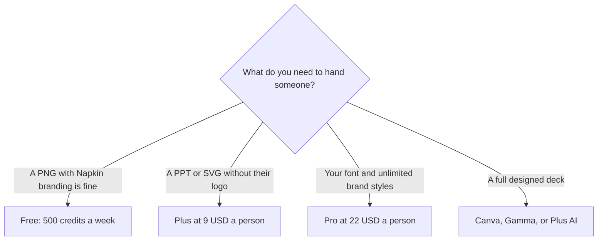

**[Napkin AI](/tools/napkin-ai/) turns a passage of text into a diagram.** You select words, it proposes visuals, and you edit layout, icons, and color. On October 24, 2026 the pricing page showed Free at **$0** with **500 AI credits a week**, Plus at **$9 per person per month** with **10,000 credits a month**, and Pro at **$22 per person per month** with **30,000 credits**. A yearly control is labeled **save 25%**. Enterprise is contact sales.

We did not grade the pictures. The useful question is whether you need a diagram inside a document you already wrote, or a full design suite. Napkin is the first of those.

## How a credit gets spent

Napkin says a credit is about **one credit per word** you select for generation, and that the rate can change for more complex outputs. Five hundred weekly credits are on the order of a few short paragraphs, not a textbook chapter, if that one-per-word rule holds. The free grant resets weekly. Plus and Pro move you to a monthly pool that is larger than four free weeks (500 × 4 = 2,000, against Plus's 10,000). You are not only paying to remove a logo. You are paying for about five times the free monthly volume, plus export rights.

| Plan | Price printed | Credits | Export and brand |
|---|---|---|---|
| Free | $0 | 500 a week | Unlimited PNG and PDF, Napkin branding on the visual. Unlimited editing. Import PPT, DOC, PDF, HTML, and Markdown |
| Plus | $9 per person / month | 10,000 a month | Premium image models, unlimited PPT and SVG, 3 brand styles, Napkin branding removed, team billing |
| Pro | $22 per person / month | 30,000 a month | Exclusive designs, unlimited custom branding, upload your own fonts, credit top-ups |
| Enterprise | Custom | Custom | Ask sales |

The credit math is [Napkin AI pricing explained](/blog/napkin-ai-pricing-explained-2026/).

Yearly billing is marked 25% off. We read the $9 and $22 figures on the monthly presentation of the cards. A 25% discount would put Plus near **$6.75** and Pro near **$16.50** per person if the label applies cleanly to those prices. Open the yearly toggle and read the charge. Do not send the calculated figure as if Napkin had printed it.

## What the tool is for

Napkin fits writers, teachers, and operators who already have the sentences and need a structure someone can see: a process, a comparison, a hierarchy. You import a document or paste text. You do not start from a blank artboard unless you want to. Free includes editing, built-in styles, and PNG and PDF export, with Napkin's branding on the visual. That is a reasonable classroom or draft setting. It is a poor client deliverable.

Plus is the client line. Unlimited PowerPoint and SVG export, branding removed, three brand styles, and team management. SVG matters if a designer will rebuild the figure in a proper file. PPT matters if the figure has to land in a deck without a screenshot. Pro is the brand line: your fonts, unlimited custom branding, exclusive designs, and the ability to buy more credits. If you only needed the logo gone, Pro is $13 a person more than Plus for a font and a larger pool. Buy it when the font is a requirement, not when the tier sounds more professional.

[Canva](/tools/canva/) is the general design suite, reviewed through [Canva Magic Studio](/blog/canva-magic-studio-review-2026/). [Gamma](/tools/gamma/) and [Plus AI](/tools/plus-ai/) build decks. Napkin does not replace them. A practical stack is Napkin for the diagram and Plus or Gamma for the deck around it. Paying for Canva, Napkin, and a deck generator is justified only when each file type is actually used. Students comparing tools for papers and slides should start with [best AI tools for students](/blog/best-ai-tools-for-students-2026/) and add Napkin only if diagrams are the gap.

## A small team, as arithmetic

Four people on monthly Plus are **$36 a month**, **$432 a year**. The same four on a true 25% yearly discount would be less. Four on Pro monthly are **$88 a month**, **$1,056 a year**. Free costs nothing and brands the image. For an internal wiki, free can be the correct plan indefinitely. For a sales leave-behind, the $9 is the price of not explaining a watermark.

Credits at roughly one per word mean a 120-word paragraph is about 120 credits. Plus's 10,000 credits are on the order of 80 such paragraphs a month, per person, if you generate once and stop. Regenerating because the first layout was wrong spends the paragraph again. The free weekly cap trains that habit cheaply. Use it.

## Who should pay

**Stay on free** for drafts, teaching examples, and anything that can wear Napkin's mark. **Pay for Plus** when the file must be PPT or SVG and the mark has to go. **Pay for Pro** when the brand font is non-negotiable or 10,000 credits are what ran out. **Ask about Enterprise** when procurement needs a contract. **Skip Napkin** when you need a poster, a photo, or a 20-slide narrative. It is a text-to-diagram tool. The surrounding design is a different subscription.

## FAQ

### How much does Napkin AI cost?

Free is $0 with 500 credits a week. Plus is $9 per person per month with 10,000 credits. Pro is $22 with 30,000 credits. Yearly billing is labeled save 25%. Checked October 24, 2026.

### What is a credit?

Napkin says generation costs about one credit per word you select, and that complex outputs may cost more later. Editing a visual is listed as unlimited on the free plan.

### Does free remove the branding?

No. Free includes Napkin branding on visuals. Plus removes it and adds PPT and SVG export.

### Can I upload my own font?

Font upload is on Pro, along with unlimited custom branding. Plus includes three brand styles, not the font upload line.

### Is there a team plan below Enterprise?

Plus and Pro both list team management and billing. Enterprise is the contact path. You do not have to call sales to put three people on Plus.

## Last verified

October 24, 2026, from Napkin's pricing page. The one-credit-per-word note is Napkin's, and the page says it may change. Recheck it if a large document is the reason you are choosing a plan.

**Sources:** [Napkin pricing](https://www.napkin.ai/pricing/), [Napkin](https://www.napkin.ai).

[Napkin AI](/tools/napkin-ai/) is in the [design directory](/tools/category/design/). Directory pages may use affiliate links. A purchase through them may earn us a commission at no extra cost to you.
