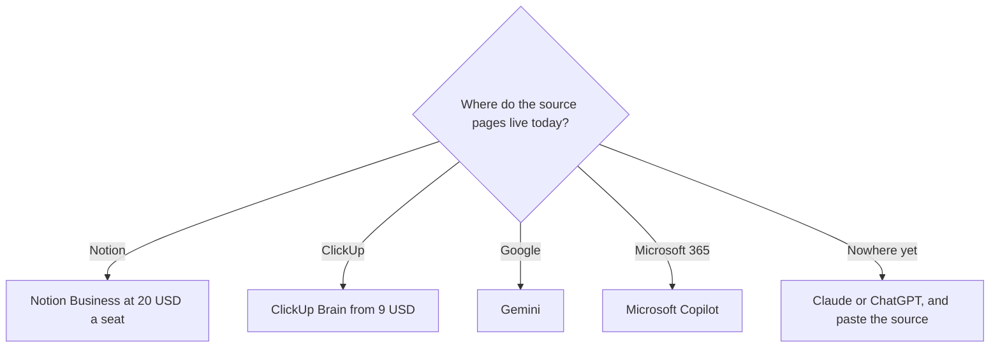

**Leave Notion AI when the pages it would read do not live in Notion.** Stay when the team already writes in Notion and the agent on those pages is the feature you lack. A second chatbot does not search a wiki you have not moved.

[Notion AI](/tools/notion-ai/) on the current list is a trial on the Free plan and the full agent on Business at $20 per seat per month. Custom Agent credits are $10 per 1,000 after a trial, and only on Business and Enterprise. The invoice is [Notion AI pricing explained](/blog/notion-ai-pricing-explained-2026/). The product page is [Notion AI review](/blog/notion-ai-review-2026/).

Prices are US list prices excluding tax from directory pages checked October 16, 2026. Published October 24, 2026. We did not score writing quality.

## Pick by where the work already sits

| The work lives in | Try | First paid step |
|---|---|---|
| Notion, and you want the agent and meeting notes | Stay on [Notion](/tools/notion-ai/) | Business $20/seat/month |
| ClickUp tasks, docs, and chat | [ClickUp Brain](/tools/clickup-brain/) | Brain² from $9/user/month, on top of a ClickUp plan |
| Google Docs, Gmail, and Drive | [Gemini](/tools/gemini/) | Google AI Plus is $4.99/month. Free needs a Google account |
| Microsoft 365 | [Microsoft Copilot](/tools/microsoft-copilot/) | Free with a Microsoft account. Microsoft 365 Personal is $9.99/month |
| A blank page, with the source pasted in | [Claude](/tools/claude/) or [ChatGPT](/tools/chatgpt/) | Claude Pro is $20/month or $17 annual. ChatGPT Plus is $20. Go is $8 |
| A slide, from notes you already trust | [Gamma](/tools/gamma/) | Plus is $9/seat/month |

The head-to-head with the ClickUp add-on is [Notion AI vs ClickUp Brain](/blog/notion-ai-vs-clickup-brain-2026/). The wider desk is [best AI productivity tools](/blog/best-ai-productivity-tools-2026/).

## What each alternative is paying for

**ClickUp Brain sees ClickUp.** Brain² starts at $9 per user per month and includes unlimited Brain² conversations plus 1,500 AI Super Credits. Everything AI at $28 per user per month adds Notetaker, AI Fields, Automations, and Super Agents. ClickUp Unlimited is $7 per user per month billed yearly, and Business is $12. The Brain line sits on top of one of those plans. Buy it when the tasks are already there. Moving a wiki in order to reach a $9 add-on is the expensive part.

**Gemini is the Google-suite switch.** Plus at $4.99 adds usage. Pro at $19.99 is the step when Plus limits block a workday, on the directory page. A team that drafts in Docs can stay in that window. Notion's agent will not see those Docs unless someone connects or copies them.

**Copilot is the Microsoft switch.** The free Copilot tier covers chat with usage limits. Personal at $9.99 a month is the Office-app step for an individual. Premium is $19.99. A company admin may list a different business SKU. Price the SKU your tenant actually shows before you buy Notion Business for a Word shop.

**Claude and ChatGPT are the blank-page switch.** They do not edit a Notion database. They draft from what you paste or attach. That is the better $20 when the pages are not in Notion yet. The instruction is [what prompt engineering is](/blog/what-is-prompt-engineering-2026/). The writing split is [ChatGPT vs Claude for writing](/blog/chatgpt-vs-claude-for-writing-2026/).

**Gamma is the leave-behind, not the wiki.** Plus at $9 is a deck or a one-pager. It is the wrong replacement if the complaint was "search our Notion." The deck category is [best AI presentation makers](/blog/best-ai-presentation-makers/).

## When to stay

Stay on Notion Business if the agent is answering from pages the team already maintains, and $20 a seat is less than the cost of moving those pages. Ten seats is $200 a month at the monthly list. Custom Agent credits are a second line, and only if an agent runs on a trigger while nobody is chatting. Skip the credits until that trigger exists.

A meeting bot is a different product. Notion lists AI Meeting Notes on Business. If the team refused a bot and the notes have to come from the laptop, the directory tool built for that is [Granola](/tools/granola/), at $14 per user per month for Business. That is a notetaker decision, covered in [best AI meeting notetakers](/blog/best-ai-meeting-notetakers/).

## FAQ

### What is the closest alternative to Notion AI?

ClickUp Brain, if the team lives in ClickUp. Gemini or Copilot, if the team lives in those suites. Claude or ChatGPT, if the job is a draft and the wiki is a paste. The closest tool is the one that can see the files.

### Is ChatGPT Plus cheaper than Notion Business?

Plus is $20 and Business is $20 at the monthly list. The prices match. The products do not. Plus is a chatbot. Business is a workspace seat with the agent on Notion pages.

### Do I need Notion AI if I only want meeting notes?

Only if the notes should land in Notion and you are already paying for Business. A dedicated notetaker is the other quote. Compare [Otter vs Fireflies vs Fathom](/blog/otter-vs-fireflies-vs-fathom-2026/) before you upgrade a whole workspace for transcripts.

### Can I use the free Notion AI trial instead of an alternative?

The free plan includes a trial of features such as doc generation. The agent, meeting notes, and connected search are on Business. Use the trial to see the product. Use an alternative if the documents will never move.

## Last verified

October 16, 2026. Published October 24, 2026.

**Sources:** [Notion pricing](https://www.notion.com/pricing), [ClickUp Brain](https://clickup.com/brain), [Google Gemini](https://gemini.google.com/).

*Published by Andrew for [AI Tools Optimizer](https://aitoolsoptimizer.com).*

[Notion AI](/tools/notion-ai/) and [ClickUp Brain](/tools/clickup-brain/) are in the [productivity directory](/tools/category/productivity-notes/). Directory pages may use affiliate links. A purchase through them may earn us a commission at no extra cost to you.
