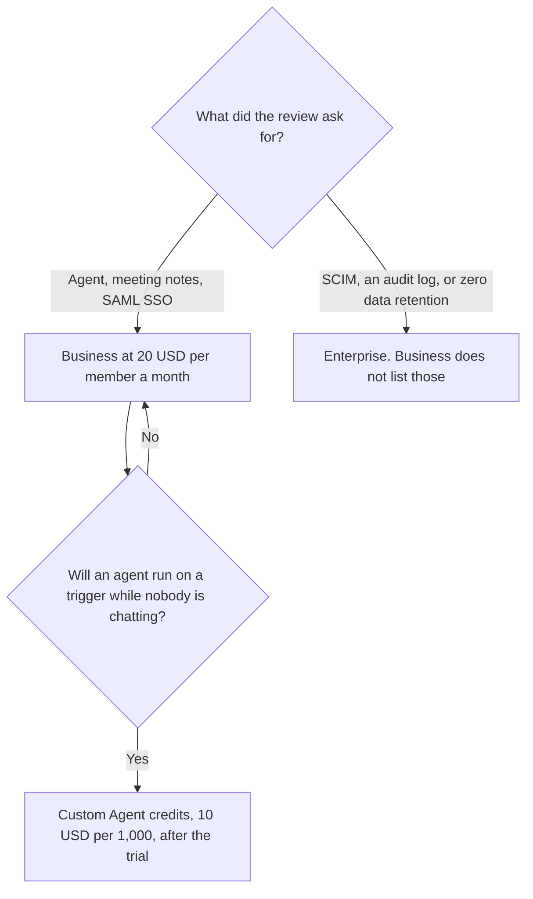

**Notion Business is $20 per member a month on notion.com/pricing fetched October 24, 2026, and that is the seat with the full Notion AI workspace: Notion Agent, AI Meeting Notes, and Enterprise Search, which the page marks beta.** The page says yearly billing saves up to 20 percent. It did not print a yearly dollar in the text we extracted, so this article does not compute one. The tour of Free, Plus, and credits together is [Notion AI pricing explained](/blog/notion-ai-pricing-explained-2026/). This page is only the Business row, and what a buyer still has to get from Enterprise.

Published October 24, 2026. Prices are USD, as the page states. We did not score the agent. If your workspace's yearly toggle shows a different checkout number, checkout wins.

## What $20 includes, and what it does not

| On Business, at $20 per member a month | On Enterprise, custom, as "everything in Business" plus |
|---|---|
| Notion Agent, AI Meeting Notes, Enterprise Search (beta) | Zero data retention with LLM providers, as the page words it |
| SAML SSO, domain verification, private teamspaces | SCIM user provisioning, audit log |
| Granular database permissions, verified pages | DLP and SIEM connections, domain management, a customer success manager |
| Premium connections such as GitHub and Asana | Advanced connections, and the security controls listed on that section |

Plus is $10 per member a month on the same page, and it is not this bundle. Free is $0 and includes a trial of AI, such as generating a doc or autofilling a database. The trial is not the agent. Custom Agents are a second line: free to try, then $10 per 1,000 Notion credits, and the page says they require a plan that has them. The October 24 page places that credit price next to the agent that runs while you are away. A person chatting with Notion Agent is the Business seat. A trigger on a schedule is the credit meter.

The page also lists a custom domain add-on, $8 a month per domain paid annually, or $10 a month. That is a site setting. It is not Notion AI. Do not add it to the AI forecast unless you are buying the domain.

## What the Business seat is for

**The agent on pages you already have.** If the work is not in Notion, Business at $20 does not become a general chatbot. [Claude](/tools/claude/) Pro is $17 a month billed annually, $200 up front, or $20 monthly, on claude.com/pricing fetched October 24, 2026, and it is a blank page. The review is [Claude review](/blog/claude-review-2026/).

**SAML SSO without pretending you bought Enterprise.** The October 24 pricing page lists SAML SSO, domain verification, private teamspaces, and granular database permissions on Business. An older summary that put every security control on Enterprise is too coarse for this page. SCIM, the audit log, zero data retention, and DLP or SIEM connections are the Enterprise lines on the fetch we used. A questionnaire that asks for SCIM is not answered by a $20 seat.

**A company chat seat that does not edit Notion.** [ChatGPT](/tools/chatgpt/) Business is $20 a user a month billed annually, or $25 monthly, for two or more users, on the October 16 directory card. The invoice is [ChatGPT Team pricing explained](/blog/chatgpt-team-pricing-explained-2026/). It does not replace Business if the pages are in Notion.

**Microsoft 365, if that is the suite.** [Microsoft Copilot](/tools/microsoft-copilot/) in the Office apps is a different bill. The work-seat article is [Microsoft 365 Copilot pricing explained](/blog/microsoft-365-copilot-pricing-explained-2026/).

## What not to assume

Do not stack a fictional "Notion AI add-on" on Plus. You change the seat to Business. Do not quote a yearly Business price this fetch did not print. "Up to 20 percent" is the page's words. It is not $16 until checkout says so. Do not buy credits before an agent has a trigger. Do not assume every contractor needs a Business member seat. Check Notion's current guest rules in the product. This article does not restate them, because the pricing page we read did not spell out a guest exception.

## FAQ

### How much is Notion AI Business?

$20 per member a month, on notion.com/pricing fetched October 24, 2026. That row includes Notion Agent, AI Meeting Notes, and Enterprise Search (beta), plus SAML SSO. Yearly billing is described as saving up to 20 percent. The yearly dollar was not in the text we extracted.

### Does Business include Custom Agents?

The agent that runs while you chat is the seat. Custom Agents, the ones on a trigger or a schedule, are the credit line at $10 per 1,000 credits after a trial. A Business workspace with no scheduled agent does not need that second line yet.

### Is SAML SSO on Business or Enterprise?

On the October 24 page, SAML SSO and domain verification are listed on Business. SCIM, the audit log, and zero data retention are listed on Enterprise. Read the questionnaire against that split, then confirm checkout, because plan pages move.

### Is Plus enough if we only write docs?

Plus is $10 and the page does not put the agent and meeting notes on it. If you do not need those, you may not need Business. If the pitch was "AI across the workspace," the pitch is the $20 seat, not a writing pass on Plus.

## Last verified

October 24, 2026, from notion.com/pricing. Claude's comparison price is claude.com/pricing that day. ChatGPT Business is the October 16 directory card. Published October 24, 2026.

**Sources:** [Notion pricing](https://www.notion.com/pricing), [Claude pricing](https://claude.com/pricing), [ChatGPT pricing](https://chatgpt.com/pricing/).

*Published by Andrew for [AI Tools Optimizer](https://aitoolsoptimizer.com).*

[Notion AI](/tools/notion-ai/) is in the [productivity and notes directory](/tools/category/productivity-notes/). Directory pages may use affiliate links. A purchase through them may earn us a commission at no extra cost to you.
