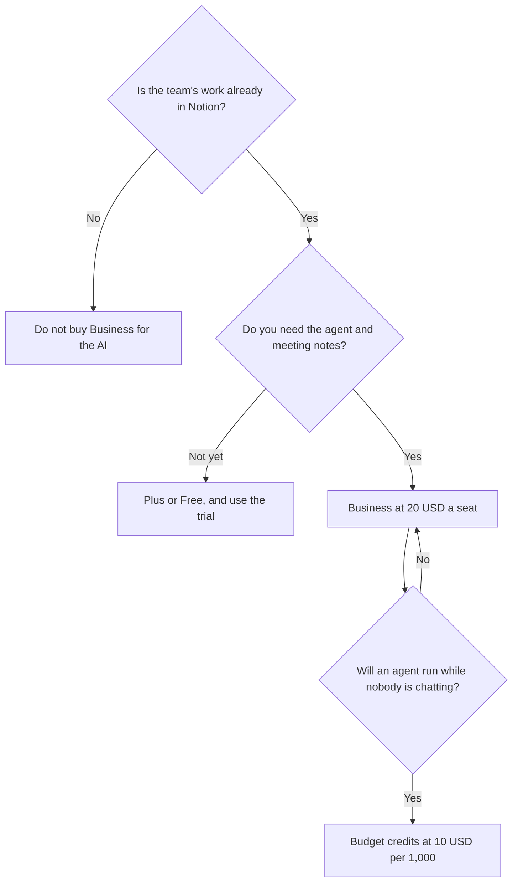

**Notion AI is not a separate $10 add-on in the current price list. It is a trial on the Free plan, a limited experience below Business, and the reason Business is $20 per seat.** The second bill, Custom Agent credits, starts only after you ask Notion to do work on a trigger while you are away.

Prices are US list prices excluding tax, from Notion's pricing and AI pages as checked October 16, 2026. This explainer is published October 24, 2026. A live refetch of those pages that day did not return numbers. The product review is [Notion AI review](/blog/notion-ai-review-2026/). The workspace comparison is [Notion AI vs ClickUp Brain](/blog/notion-ai-vs-clickup-brain-2026/).

## What each seat includes

| Plan | Price | The AI you actually get |
|---|---|---|
| Free | $0 | A trial of Notion AI, such as generating a doc or autofilling a database. Not the full agent |
| Plus | $10/seat/month | The small-team workspace plan. The full AI experience is not this row |
| Business | $20/seat/month | Notion Agent, AI Meeting Notes, and search across connected apps |
| Enterprise | Sales | Admin, security, and AI controls on top of the Business AI surface |
| Custom Agents | $10 per 1,000 Notion credits, after a trial | Only on Business and Enterprise. A trigger or a schedule, not a chat message |

Notion's pages describe Plus and Business as monthly seat prices. If a yearly toggle is in your workspace, the checkout number wins. This table is the monthly list we could cite. Do not invent a yearly discount that was not on the page.

## The two products people merge

**Notion Agent** is the in-the-room worker. You ask it to research, draft, or change pages and databases, using the workspace, connected apps, and the web. It is on Business. You do not buy a credit pack to have one conversation with it.

**Custom Agents** are the overnight workers. They answer a repeated question, route a task, or post an update on a trigger or a schedule. They run on credits. Notion says you can try them, then pay $10 per 1,000 credits. A Business seat with no agent on a schedule does not need that second line.

AI Meeting Notes are also a Business feature, and they are designed to work without a bot in the participant list. That is a product claim to verify against your own meeting tool before you promise a client that nobody will see a bot. It is not a reason to buy credits.

Search across Slack, GitHub, and the other connected apps is the same Business bundle. If the pitch you heard was "it can see our other tools," you are buying Business, not a connector add-on.

## A 10-person bill

Ten people on Plus, at the monthly list, is $100. That does not buy the agent. Ten people on Business is $200. The jump is $100 a month for the team, or $10 more per seat, which is the entire AI decision. It is still cheaper than ten ChatGPT Business seats if the only reason for the chatbot was to ask questions about docs that already live in Notion. [ChatGPT](/tools/chatgpt/) Business is $20 per user on annual billing, or $25 monthly, and it does not edit your Notion databases.

Custom Agents are the part that can outrun the seat. One credit price is public: $10 per 1,000. The page we checked does not say how many credits one Slack answer costs. Run one real agent for a week on the trial, read the debit, and then decide. Anyone who tells you a credit equals one message is guessing, unless they measured that agent.

Enterprise is the plan for the security review: admin controls, and the contractual AI terms a larger company asks for. Notion says customer data is not used to train its AI subprocessors' models. That sentence is a start for a security questionnaire. It is not a substitute for the Enterprise agreement if your counsel asked for one.

## Who should not buy Business yet

- A solo user who wants a writing partner. [Claude](/tools/claude/) Pro is $20 a month, or $17 on annual billing, and it is a better blank page. Notion Business is $20 and it is a workspace.
- A team that lives in ClickUp. [ClickUp Brain](/tools/clickup-brain/) starts at $9 per user on top of a ClickUp plan. Moving wikis to reach Notion's agent is the expensive part.
- A company on Microsoft 365 that wanted [Microsoft Copilot](/tools/microsoft-copilot/) in the Office apps. That product is the one in that window, including a free signed-in tier.
- Anyone who has not put the docs in Notion. The agent is only as useful as the pages it can see.

The broader desk is [best AI productivity tools](/blog/best-ai-productivity-tools-2026/).

## The mistakes

- **Adding a fictional "Notion AI $10" on top of Plus.** In the price list we used, you change plans to Business. You do not stack a second AI SKU on Plus.
- **Buying credits before the agent has a trigger.** Credits are for Custom Agents. Chat with Notion Agent is the seat.
- **Putting every contractor on Business.** Meeting notes and the agent are for the people whose pages the agent should touch. A guest who reads a wiki may not need the seat. Check Notion's guest rules before you take this as a license hack. It is a prompt to look, not a workaround.
- **Assuming the trial on Free is the agent.** It is a trial of AI features such as doc generation and database autofill.

## FAQ

### How much does Notion AI cost?

The full experience is Notion Business at $20 per seat per month, which includes Notion Agent, AI Meeting Notes, and connected search. Plus is $10 and is not that bundle. Custom Agents are an extra $10 per 1,000 credits on Business and Enterprise, after a trial. Enterprise is a sales quote.

### Is Notion AI included in the free plan?

As a trial. You can try features like generating a doc. The agent, meeting notes, and cross-app search are on Business.

### Do I need credits to use Notion Agent?

No. Credits are the Custom Agent meter, for work that runs on a trigger or a schedule. A person chatting with the agent is on the Business seat.

### Is Business worth it for one person?

Only if that person already works in Notion and wants the agent on those pages. At $20 it matches the price of a normal chatbot seat. The chatbot is the better purchase if the pages are not in Notion yet.

## Last verified

October 16, 2026. Published October 24, 2026. Notion's pricing pages did not return a fresh fetch that day. Confirm any annual toggle in your workspace before you multiply $20 by 12.

**Sources:** [Notion pricing](https://www.notion.com/pricing), [Notion AI](https://www.notion.com/product/ai).

[Notion AI](/tools/notion-ai/) is in the [productivity directory](/tools/category/productivity-notes/). Directory pages may use affiliate links. A purchase through them may earn us a commission at no extra cost to you.
