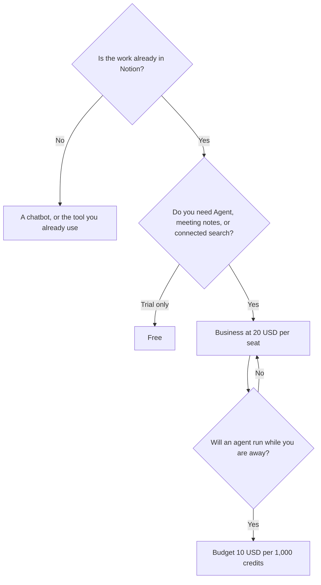

**[Notion AI](/tools/notion-ai/) is the AI layer on a Notion workspace.** The Free plan includes a trial of Notion AI, such as generating a doc or autofilling a database. Plus is listed at $10 per seat per month. Business is listed at $20 per seat per month and is where Notion puts Notion Agent, AI Meeting Notes, and search across connected apps. Custom Agents, which run on a trigger or a schedule, are free to try and then $10 per 1,000 Notion credits on Business and Enterprise.

Those seat prices are what Notion's pricing page showed in our directory check on October 16, 2026, in US dollars. Confirm on the live page whether the figure you see is the monthly charge or the annual per-month rate. Notion has displayed those differently over time, and tax depends on where you pay. We did not score answer quality against ChatGPT or Claude on a shared test.

If the team lives in ClickUp, read the [ClickUp Brain review](/blog/clickup-brain-review-2026/) instead of forcing a migration. Meeting bots are a different category: [best AI meeting notetakers](/blog/best-ai-meeting-notetakers/). Which general subscription to pay for is [which AI subscription is worth paying for](/blog/which-ai-subscription-is-worth-paying-for/).

## Two bills, if you use agents

| Item | Listed price | What you get |
|---|---|---|
| Free | $0 | A trial of Notion AI. Generate docs, autofill databases |
| Plus | $10/seat/month | The small-team Notion plan. Full Agent and meeting notes are not this tier |
| Business | $20/seat/month | Notion Agent, AI Meeting Notes, search across connected apps |
| Custom Agent credits | $10 per 1,000 credits | After a trial. Business and Enterprise. Recurring agents |
| Enterprise | Sales | Admin, security, and AI controls |

A 10-person Business workspace is 10 × $20 = $200 a month before agent credits, at the list seat price. Custom Agents are extra when they keep running. A team that only chats with Notion Agent inside pages is on the seat price. A team that wants a Slack answerer overnight is on the seat price plus credits.

## What Agent can see

Notion Agent takes multi-step work using pages, databases, connected apps, and the web, and it can create or edit pages and databases. That is useful when the answer depends on your wiki. It is ordinary when the question does not. A person who wants a general chatbot can stay on a chat subscription and skip the seat upgrade. The [writing assistants guide](/blog/best-ai-writing-assistants/) covers that job.

AI Meeting Notes on Business take notes and follow-ups without a bot joining the call. That overlaps [Granola](/tools/granola/), which is $14 per user per month on Business and is a notepad first. Use Notion's meeting notes when the note must become a Notion page. Use Granola when the team is not in Notion. Use [Otter](/tools/otter-ai/) when you want a bot and a published minute cap. The [Granola review](/blog/granola-review-2026/) is the bot-free path outside Notion.

Notion says customer data is not used to train its AI subprocessors' models, and it describes HIPAA support. Enterprise changes retention and admin controls. Read the current privacy terms for your region. This review is not a legal sign-off. Plans are not available on every workspace, so the pricing page can differ for an account that is on an older plan.

[Microsoft Copilot](/tools/microsoft-copilot/) is the comparable "AI inside the suite you already pay for" if the suite is Microsoft 365. [Motion](/tools/motion/) is the comparable buy if the pain is calendar scheduling rather than the wiki.

## Fit score

| Need | Free trial | Plus $10 | Business $20 | Agent credits |
|---|---|---|---|---|
| Generate a doc once | Yes | Yes | Yes | Not required |
| Notion Agent on your wiki | Trial limits | Not the full tier | Yes | Only if agents run on triggers |
| Meeting notes inside Notion | No | No | Yes | No |
| Search Slack or GitHub through Notion | No | No | Listed on Business | No |
| An agent that runs all night | No | No | The seat, plus credits | $10 / 1,000 |
| Useful if you do not use Notion | No | No | No | No |

The table follows Notion's plan split. It is not a quality score.

## FAQ

### Is Notion AI free?

The Free plan includes a trial: generating docs and autofilling databases. Notion Agent, AI Meeting Notes, and connected search are listed on Business.

### How much does Notion AI cost?

Plus is listed at $10 per seat per month and Business at $20. Confirm the billing period on the live pricing page. Custom Agents are $10 per 1,000 credits after a trial, on Business and Enterprise.

### Does Notion train on my data?

Notion says its AI subprocessors are contractually barred from training on customer data. Check the current policy, especially if you are outside the default region or you need a signed enterprise term.

### Can it take meeting notes?

AI Meeting Notes are on the Business plan and are designed to work without a bot in the participant list. Tell people notes are being taken. Local rules still apply.

## Last verified

October 16, 2026.

**Sources:** [Notion pricing](https://www.notion.com/pricing), [Notion AI](https://www.notion.com/product/ai).

[Notion AI](/tools/notion-ai/) is in the [productivity directory](/tools/category/productivity-notes/). Directory pages may use affiliate links. A purchase through them can earn us a commission at no extra cost to you.
