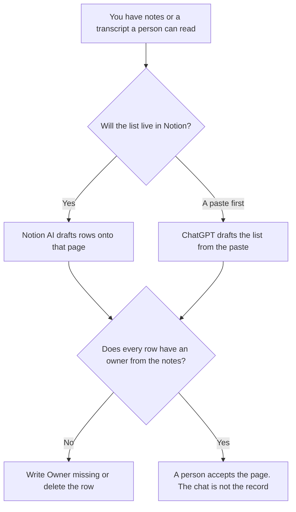

**Use Notion AI when the action has to land on the page the team already uses. Use ChatGPT when you paste the notes and need a list you will copy onto that page yourself.** The model may turn a spoken commitment into a row. It may not invent an owner, a date, or a task nobody said. A line without an owner says Owner missing.

The all-hands transcript, which is a longer meeting and a different tool choice, is [Otter vs Fireflies for all-hands](/blog/otter-vs-fireflies-for-all-hands-2026/). The customer-call note, which is another meeting type, is [Otter vs tl;dv for customer success calls](/blog/otter-vs-tl-dv-for-customer-success-calls-2026/).

Notion, ChatGPT, and Otter prices are from directory pages checked October 16, 2026. Claude's prices are from claude.com/pricing on October 24. chatgpt.com/pricing returned HTTP 403 that day. Published October 24, 2026. We did not score meeting notes.

## Which seat matches the list

| The notes in front of you | Start here | First paid step | The limit |
|---|---|---|---|
| The actions must live on the team page | [Notion AI](/tools/notion-ai/) | Business is $20 a seat a month, which the card ties to AI Meeting Notes | Plus at $10 is not the full AI tier. Free includes a trial of Notion AI |
| One list, from a paste | [ChatGPT](/tools/chatgpt/) | Plus is $20 a month | No task that was not in the paste |
| A transcript you still need | [Otter](/tools/otter-ai/) | Pro is $8.33 a user a month billed annually, or $16.99 monthly | The transcript is the source. The action list is a separate pass |
| A long set of notes that must match last week's verbs | [Claude](/tools/claude/) | Pro is $17 a month billed annually, or $20 monthly | Still no owner you did not paste |

The October 16 Notion card says Business includes Notion Agent, AI Meeting Notes, and search across connected apps. Custom Agents are an add-on at $10 per 1,000 credits on Business and Enterprise. A meeting action does not require that add-on. The invoice is [Notion AI pricing explained](/blog/notion-ai-pricing-explained-2026/).

ChatGPT Go is $8 a month and may include ads, on the October 16 card. Plus is the seat if you keep a template. The review is [ChatGPT review](/blog/chatgpt-review-2026/).

## What an action row is allowed to say

The task in the words the notes support, the owner if someone accepted it, and the date if someone said it. "We should probably" is not an action. "Alex will send the draft Friday" is an action, if Alex and Friday are in the notes. A model that assigns Alex because Alex usually owns drafts has invented an owner.

**Notion Business** is the page path. Draft on the meeting page. If Meeting Notes produced a row the transcript does not support, delete the row. The page the team opens next week is the record.

**ChatGPT Plus** is the paste path. Paste the notes. Ask for a table. Copy only the rows you accept. The chat will not remind anyone.

**Otter Pro** is how you get a transcript if you do not already have notes. Basic is 300 minutes a user a month and 30 minutes per conversation, on that card. An all-hands often exceeds 30 minutes. That limit is why the all-hands article exists. The invoice is [Otter AI pricing explained](/blog/otter-ai-pricing-explained-2026/).

**Claude Pro** is the path when the verbs have to match a Project full of older lists. It does not attend the meeting. The review is [Claude review](/blog/claude-review-2026/).

A prompt that holds the line:

"List action items from these notes. If the owner or the date is missing, write Owner missing or Date missing. Do not add a task. Do not assign the person who spoke most."

## What not to delegate

Do not ask the model what the team decided when the notes are ambiguous. Write Decision unclear. Do not paste a customer recording you are not allowed to move into a chat. Do not close the meeting page from the chat window.

## FAQ

### Which one captures actions more reliably?

We did not measure that. Notion fits a list that must remain on the team page, on the Business tier that includes AI Meeting Notes. ChatGPT fits a paste. The list is reliable when every owner and date is in the source.

### Do I need a notetaker too?

Only if you do not have notes. The notetaker makes a transcript. This page turns accepted lines into rows. A transcript with no human pass is not an action list.

### Can the model merge two people's versions?

Only by showing both rows when they conflict. A merged sentence that picks one date has made a decision. Leave both, and let the owner choose.

### Who may mark an action accepted?

The owner named on the row, or the meeting owner if your rule says so. A model checkbox is not acceptance.

## Last verified

October 24, 2026 for Claude. October 16, 2026 for Notion, ChatGPT, and Otter. Published October 24, 2026.

**Sources:** [Notion pricing](https://www.notion.com/pricing), [ChatGPT pricing](https://chatgpt.com/pricing/), [Otter pricing](https://otter.ai), [Claude pricing](https://claude.com/pricing).

*Published by Andrew for [AI Tools Optimizer](https://aitoolsoptimizer.com).*

[Notion AI](/tools/notion-ai/) is in the [productivity and notes directory](/tools/category/productivity-notes/). Directory pages may use affiliate links. A purchase through them may earn us a commission at no extra cost to you.
