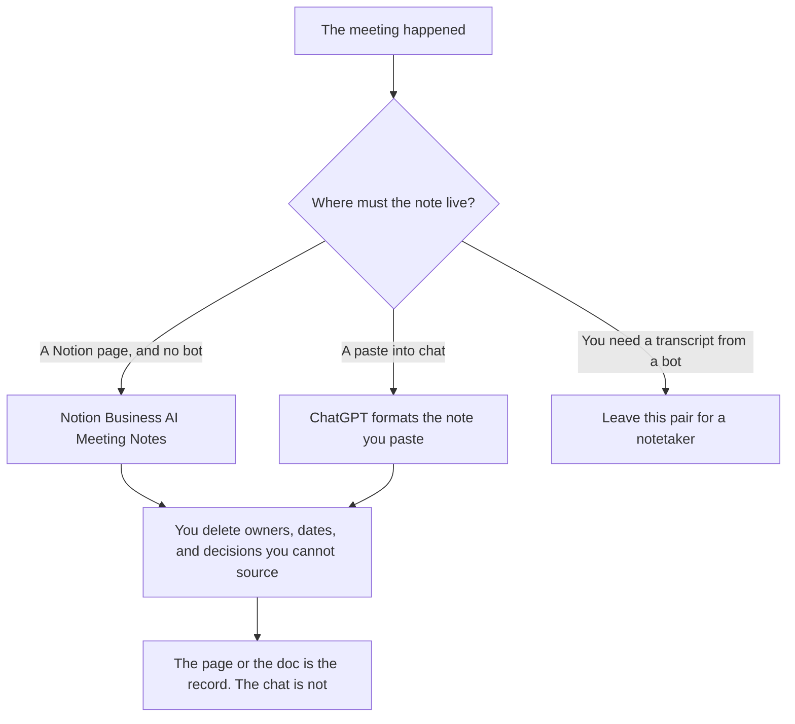

**Use Notion AI when the note should land in Notion and you are on Business, which includes AI Meeting Notes without a bot joining the call. Use ChatGPT when you will paste notes or a transcript you already have, and the note does not have to live in Notion.** A dedicated recorder is a third choice. This pair is where the words go after you have them, or Notion's no-bot notes on the Business plan.

The wiki decision, which is a different artifact, is [Notion AI vs ChatGPT for wikis](/blog/notion-ai-vs-chatgpt-for-wikis-2026/). Turning a transcript into decisions is [how to summarize meetings with AI](/blog/how-to-summarize-meetings-with-ai-2026/). The bot comparison, if you need a transcript first, is [Otter vs Fireflies vs Fathom](/blog/otter-vs-fireflies-vs-fathom-2026/).

Prices are US list prices excluding tax. Notion and ChatGPT figures are from directory pages checked October 16, 2026. Notion's directory page says AI Meeting Notes on Business automate notes and follow-ups without a bot joining the call. Published October 24, 2026. We did not score transcripts.

## Which seat matches the note

| The note you actually have | Start here | What you still do |
|---|---|---|
| A few lines you typed | [ChatGPT](/tools/chatgpt/) Free or [Notion](/tools/notion-ai/) Free's AI trial | You delete any decision you did not hear |
| The same note template, and the page can live anywhere | ChatGPT Plus at $20 a month | Paste only what you are allowed to paste |
| The note must be a Notion page, and no bot should join | Notion Business at $20 a seat a month | Business is the row that includes AI Meeting Notes |
| You need a bot on Zoom, Meet, or Teams | [Otter](/tools/otter-ai/) or [Fathom](/tools/fathom/) | This pair is the wrong shortlist. Pick a notetaker |
| An agent should post the note on a schedule | Notion Custom Agents, $10 per 1,000 credits, on Business or Enterprise | A trigger is a second bill. A chat message is not |

Notion Plus is $10 a seat a month. The pricing explainer says the full AI experience, including AI Meeting Notes, is the Business row, not Plus. Do not buy Plus and expect the meeting feature the Business card lists. ChatGPT Go is $8 a month and may include ads. A note that names customers is a poor fit for an ad you did not choose, and a poor fit for a personal account your company forbids. Business ChatGPT, at $20 a user a month billed annually for two or more users, is the row when the paste is confidential.

## What the note may contain

Decisions, owners, and dates that appear in the notes or transcript you supplied. It may say the owner is missing. It may not add a decision because meetings "usually" have one. A follow-up the model invented is the line you delete.

**Notion Business at $20** is the paid path when the workspace is already Notion and the no-bot note is the feature. The invoice is [Notion AI pricing explained](/blog/notion-ai-pricing-explained-2026/). The review is [Notion AI review](/blog/notion-ai-review-2026/).

**ChatGPT Plus at $20** is the paid path when the transcript came from somewhere else and you want a formatted note. The review is [ChatGPT review](/blog/chatgpt-review-2026/).

**Otter or Fathom** is the path when nobody took notes and a bot is allowed. Otter Basic caps a conversation at 30 minutes. Fathom's directory card lists unlimited recordings on Free. Those are different products from a Notion page.

A prompt that holds the line:

"Format meeting notes from the text I pasted. List decisions, owners, and dates only when they appear in the paste. If an owner is missing, write Owner missing. Do not add a decision."

## What not to delegate

Do not ask the model what the room "really meant." Do not send the note to people who were not allowed to see the meeting. Do not turn a note into a performance review. The person who was there signs the decisions.

## FAQ

### Does Notion record the meeting?

The directory, checked October 16, 2026, says AI Meeting Notes on Business automate notes and follow-ups without a bot joining the call. It does not say Notion is a bot like Otter. If your workspace does not show the feature, you do not have it yet. Paste notes into the page, or use a notetaker the room agreed to.

### Can ChatGPT join the call?

Not as the product this page is comparing. You paste. If you need a joiner, leave for Otter, Fireflies, or Fathom, then bring the transcript back if the note should still be a chat draft.

### Is Business worth it for one meeting a week?

Only if the rest of the seat is worth $20: the wiki, the tasks, the search. One meeting does not justify a workspace upgrade. Use Plus or Free chat, and file the note where the team already works.

### What if the notes are thin?

The formatted note stays thin. A model that adds owners and dates is writing fiction. Send the short version. Ask the person who spoke to fill the blank.

## Last verified

October 16, 2026 for Notion AI, ChatGPT, and the AI Meeting Notes description on the directory card. Published October 24, 2026.

**Sources:** [Notion pricing](https://www.notion.com/pricing), [Notion AI](https://www.notion.com/product/ai), [ChatGPT pricing](https://chatgpt.com/pricing/).

*Published by Andrew for [AI Tools Optimizer](https://aitoolsoptimizer.com).*

[Notion AI](/tools/notion-ai/) is in the [productivity and notes directory](/tools/category/productivity-notes/). Directory pages may use affiliate links. A purchase through them may earn us a commission at no extra cost to you.
