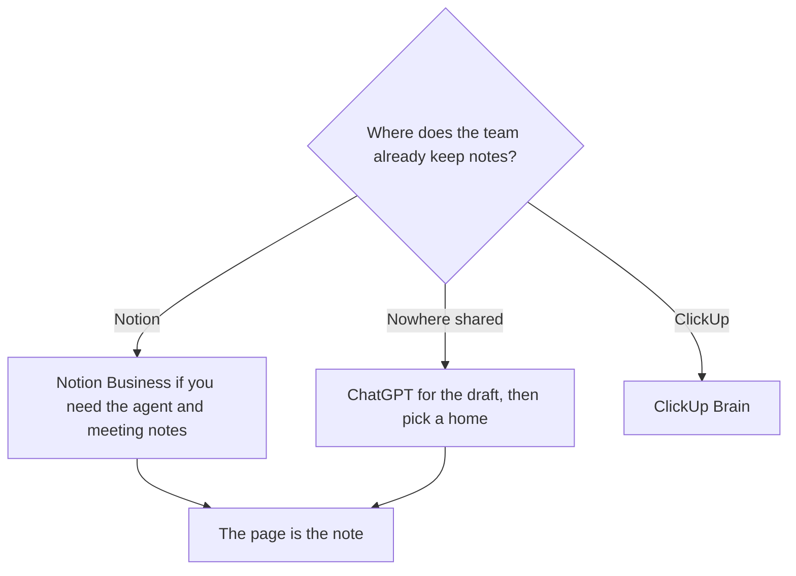

**Use Notion AI when the note should be a page in the workspace, tied to the database and the meeting you already keep there. Use ChatGPT when you are holding the raw text and you want a draft you will paste somewhere else.** Notion's advantage is location. ChatGPT's advantage is a strong blank page at a lower entry price. A brilliant summary in the wrong tool is a file nobody opens on Monday.

[Notion AI](/tools/notion-ai/) on the Business plan is $20 per seat per month and includes Notion Agent and AI Meeting Notes. The Free plan includes a trial of the AI features. [ChatGPT](/tools/chatgpt/) Plus is $20 a month. Go is $8. The seat math for Notion is [Notion AI pricing explained](/blog/notion-ai-pricing-explained-2026/). The other workspace is [Notion AI vs ClickUp Brain](/blog/notion-ai-vs-clickup-brain-2026/).

Prices are US list prices excluding tax from directory pages checked October 16, 2026. Published October 24, 2026. We did not score note quality.

## Where the note has to end up

| The note is | Use | What you pay | The limit |
|---|---|---|---|
| A page the team will find in the wiki | Notion AI on Business | $20/seat/month | The full agent and meeting notes are the Business reason. Plus at $10 is the small-team wiki without that full AI set |
| A rewrite of notes you paste | ChatGPT | Plus $20, or Go $8 | The thread is not the team's system of record unless you paste the result back |
| A meeting you refuse to put a bot in | [Granola](/tools/granola/), then file the kept lines | Business is $14/user/month for unlimited history | Granola is the capture. Notion or ChatGPT is the rewrite |
| A spec with tasks in ClickUp | [ClickUp Brain](/tools/clickup-brain/) | Brain² is $9/user/month | Switch if the work already lives in ClickUp, and the note would be a duplicate in Notion |
| A long draft in a voice | [Claude](/tools/claude/) | Pro is $20/month, or $17 billed annually | Claude is a writing seat. It does not host the wiki |

Meeting capture itself is [how to summarize meetings with AI](/blog/how-to-summarize-meetings-with-ai-2026/). If the notes are a customer call and the room rejects a bot, Granola's invoice is [Granola pricing explained](/blog/granola-pricing-explained-2026/).

## What Business buys that a chat thread does not

Notion's directory card, checked October 16, 2026, puts Notion Agent, AI Meeting Notes, and search across connected apps on Business. Custom Agents, which run on a trigger, bill credits at $10 per 1,000 after a trial, on Business and Enterprise. That second bill is easy to miss if you only compared the $20 seat to ChatGPT Plus at $20.

ChatGPT Plus at the same headline price gives you a personal thread, projects, and a place to paste a transcript. It does not file the result onto a team wiki. Business ChatGPT, at $20 per user per month billed annually with a two-user minimum, is a team chat plan. It is still a chat. Your notes system remains wherever you paste.

Plus on Notion, at $10 per seat per month, is the plan for a small team that wants the workspace and a lighter AI trial path. If the reason you are paying is "ask the wiki" and "meeting notes in the page," the card that lists those features is Business. Confirm the live plan grid, because the directory notes that plans may not be available on every workspace.

## A practical split

**The weekly staff note.** Capture with the notetaker the room allows. Ask for decisions, owners, and dates. File the kept lines as a Notion page if Notion is the wiki. Paste into ChatGPT only when you need a different shape, such as an email, and paste the email back out. Two homes for the same decision is how the owner changes between them.

**A personal scratch pad.** ChatGPT Go or Plus is enough. A Notion seat for one person who never shares pages is a $20 wiki with one reader. The Free Notion plan's AI trial is the way to learn the product before that seat.

**A database of meeting pages.** This is Notion's case. ChatGPT can summarize one transcript. It will not be the database your teammate filters by account. Notion Agent is useful here because the pages already exist. It is a weak reason to migrate a company onto Notion just to get the button.

## FAQ

### Is Notion AI included in every Notion plan?

The Free plan includes a trial of Notion AI, such as generating a doc. The directory card puts the full experience, including Notion Agent and AI Meeting Notes, on Business at $20 per seat per month. Read the plan you will be charged for.

### Can ChatGPT replace a notes app?

It can draft from notes you bring. It replaces a notes app only if your team agrees the thread is the archive. Most teams will not find last quarter's decision in a personal chat. Put the kept paragraph in the system you already search.

### What if we use both?

Use them in order. Notion holds the page. ChatGPT, or Claude, rewrites a section when you paste that section and ask for a format. Copy the result back. Do not let the chat become a second wiki.

### Which is cheaper for a team of five?

Five Notion Business seats are $100 a month at the $20 list. Five ChatGPT Plus seats are $100 a month and do not include a shared wiki. Five ChatGPT Business seats are $100 a month on annual billing at $20 per user, with a two-user minimum. The price tie means you are choosing the home of the notes, and the chat features are the tie-breaker only after the home is chosen.

## Last verified

October 16, 2026 for Notion, ChatGPT, Claude, ClickUp Brain, and Granola prices. Granola's $14 Business price was also on the pricing page read October 24, 2026. Published October 24, 2026.

**Sources:** [Notion pricing](https://www.notion.com/pricing), [Notion AI](https://www.notion.com/product/ai), [OpenAI ChatGPT pricing](https://openai.com/chatgpt/pricing/).

*Published by Andrew for [AI Tools Optimizer](https://aitoolsoptimizer.com).*

[Notion AI](/tools/notion-ai/) is in the [productivity directory](/tools/category/productivity-notes/). [ChatGPT](/tools/chatgpt/) is in the [chatbots directory](/tools/category/chatbots-assistants/). Directory pages may use affiliate links. A purchase through them may earn us a commission at no extra cost to you.
