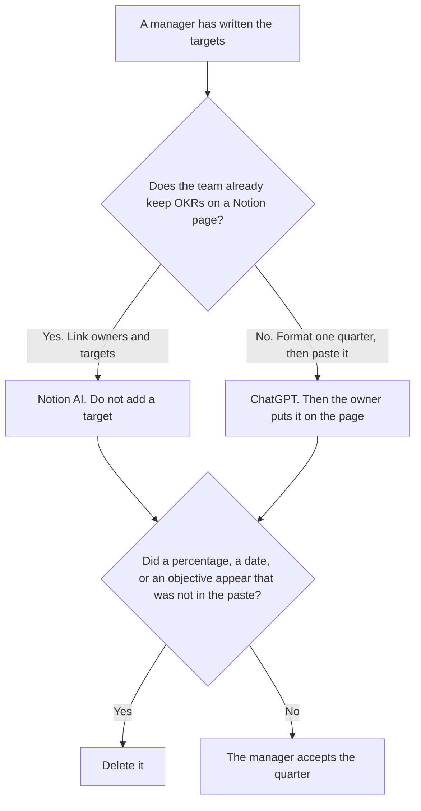

**Use Notion AI when the OKRs live on the page the team already opens, and the work is linking each key result to an owner and a target a person already wrote. Use ChatGPT when you are formatting one quarter from those targets before they land on that page.** The model may number the lines. It may not invent a target, a percentage, or a second objective.

The assistant cut, one team versus a sentence that must not drift, is [ChatGPT vs Claude for OKRs](/blog/chatgpt-vs-claude-for-okrs-2026/). The long-memo cut is [Claude vs ChatGPT for OKRs](/blog/claude-vs-chatgpt-for-okrs-2026/). The workflow is [how to write OKRs with AI](/blog/how-to-write-okrs-with-ai-2026/).

Notion is the October 16, 2026 directory card. ChatGPT's Plus price is the October 24 plan-page figure recorded in [ChatGPT pricing explained](/blog/chatgpt-pricing-explained-2026/). Claude's prices are the October 24 read of claude.com/pricing recorded in [Claude pricing explained](/blog/claude-pricing-explained-2026/). Grammarly is the October 16 card. A live fetch of Grammarly's plans URL returned HTTP 401 on October 24. Published October 24, 2026. We did not score goals.

## Where the quarter lives

| The job | Start here | First paid step | The limit |
|---|---|---|---|
| The page the team will open all quarter | [Notion AI](/tools/notion-ai/) | Business is $20 a seat a month | Plus at $10 is not the full AI tier. A target you did not write stays out |
| One quarter, formatted from targets already written | [ChatGPT](/tools/chatgpt/) | Plus is $20 a month | Paste the result into the page. The chat is not the system of record |
| A sentence that must stay identical across teams | [Claude](/tools/claude/) | Pro is $17 a month billed annually, or $20 monthly | Use the Claude comparison when drift is the risk |
| The sentence that leaves the company | [Grammarly](/tools/grammarly/) | Pro is $12 a member a month billed annually, or $30 monthly | Tone is not a new key result |

Notion Business at $20 a seat a month is the AI tier on the October 16 card. The page can hold the objective, the key result, the owner, and the target. Plus at $10 is a Notion plan. It is not that AI tier. A page full of headings with Target not set is an honest page. A page full of percentages the model hoped for is a fiction.

ChatGPT Plus at $20 is the draft when the targets are in a doc and the Notion page does not exist yet. The chat does not remember the quarter for the team. After the manager accepts the lines, they go on the page. Leaving them in a chat means the next check-in will invent a fresh set.

Claude is the seat when the same objective sentence must appear in several team files. That constraint is the other OKR article. This page is the system of record versus the one-time draft.

## What the line is allowed to say

The objective the manager wrote, the key result they wrote, the owner, and the target. A stretch goal the model added stays out. A date that was not in the paste stays out. If the target is missing, the line says Target not set.

**Notion Business** is the page. The invoice is [Notion AI pricing explained](/blog/notion-ai-pricing-explained-2026/). The business-tier cut of that invoice is [Notion AI Business pricing explained](/blog/notion-ai-business-pricing-explained-2026/).

**ChatGPT Plus** is the draft. The ladder is [ChatGPT pricing explained](/blog/chatgpt-pricing-explained-2026/).

**Grammarly Pro** is the external sentence, after the target is real. The invoice is [Grammarly pricing explained](/blog/grammarly-pricing-explained-2026/).

A prompt that holds the line:

"Format the OKRs from the objectives, key results, owners, and targets I pasted. If a target is missing, write Target not set. Do not add a percentage. Do not add an objective."

## What not to delegate

Do not ask for OKRs a team "should" have. Do not let Notion fill a blank target to make the database look complete. Do not treat a chat transcript as the quarter of record. The manager accepts the lines.

## FAQ

### How is this different from ChatGPT vs Claude for OKRs?

That page is one team's quarter against a sentence that must stay identical across teams. This page is the Notion page the team opens against a ChatGPT draft you will paste. Claude still matters when the wording must not drift. Link that article. Do not merge the jobs.

### Is Notion Plus enough?

Plus at $10 a seat a month is on the October 16 card, and the pricing articles treat it as short of the full AI tier. Business at $20 is the AI seat those articles quote for this kind of page. Confirm at checkout. This page does not invent a third AI price.

### Can the draft live in ChatGPT all quarter?

The draft can start there. The quarter the team shares has to live on a page they can open, with the owner and the target. A chat is a draft. Target not set on the page is more honest than a percentage that existed only in a thread.

### Who may change a target?

The manager who owns the objective. A check-in that rewrites the target has changed the OKR. The model may format the check-in. It may not move the number.

## Last verified

October 16, 2026 for Notion and Grammarly. October 24, 2026 for ChatGPT's plan page and for Claude. Published October 24, 2026. Grammarly's plans URL returned HTTP 401 on October 24.

**Sources:** [Notion pricing](https://www.notion.com/pricing), [ChatGPT and Codex pricing](https://learn.chatgpt.com/docs/pricing), [Claude pricing](https://claude.com/pricing), [Grammarly pricing](https://www.grammarly.com/plans).

*Published by Andrew for [AI Tools Optimizer](https://aitoolsoptimizer.com).*

[Notion AI](/tools/notion-ai/) is in the [productivity directory](/tools/category/productivity-notes/). Directory pages may use affiliate links. A purchase through them may earn us a commission at no extra cost to you.
