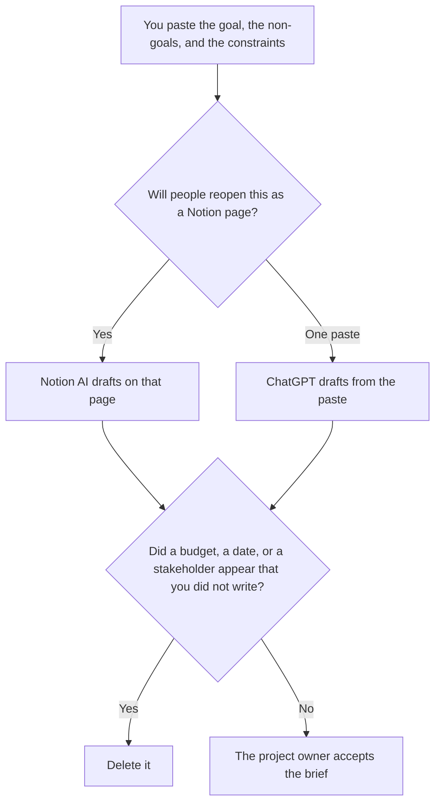

**Use Notion AI when the project brief is a page in the project database people will reopen. Use ChatGPT when the brief is one paste from notes that do not already live in Notion.** The brief may organize a goal, non-goals, an owner, a date, and constraints you already wrote. It may not invent a scope change, a budget, or a stakeholder. The action list after a meeting is a different page: [Notion AI vs ChatGPT for meeting actions](/blog/notion-ai-vs-chatgpt-for-meeting-actions-2026/). The seat math for Notion is [Notion AI pricing explained](/blog/notion-ai-pricing-explained-2026/).

Notion prices are from the directory page checked October 16, 2026. ChatGPT Plus and Business are from learn.chatgpt.com/docs/pricing on October 24, 2026. Claude is from claude.com/pricing that day. Gamma is from the October 16 card. Published October 24, 2026. We did not score briefs.

## Which brief you are writing

| Where the notes are | Start here | First paid step | The limit |
|---|---|---|---|
| The project page in Notion | [Notion AI](/tools/notion-ai/) | Business is $20 a seat a month | Plus at $10 is not the full AI tier on the October 16 card |
| A one-time paste | [ChatGPT](/tools/chatgpt/) | Plus is $20 a month | No scope line that was not in the paste |
| A long source the brief must match | [Claude](/tools/claude/) | Pro is $17 a month billed annually, or $20 monthly | The Project holds the headings |
| A deck after the brief is accepted | [Gamma](/tools/gamma/) | Plus is $9 a seat a month, $108 a year | The deck does not widen the brief |

A brief that "makes the project sound funded" has edited the project. If the paste does not name a budget, the line says Budget missing. Non-goals are part of the brief. A model that drops them has widened the work.

## What each seat keeps

**Notion Business** is the full AI tier on the October 16 card: Notion Agent, AI meeting notes, and search across connected apps. Free includes a trial of Notion AI on that card. Plus at $10 is the workspace plan, and the card does not treat it as the full AI tier. Custom Agents are an add-on at $10 per 1,000 credits on Business and Enterprise. A brief is a page, not a reason to turn on a scheduled agent. The review context is the pricing article above.

**ChatGPT Plus** is the paste path. Go is $8 a month on the October 24 page. Business is $20 a user a month billed annually for two or more users, or $25 monthly, when the brief is company data and a personal seat is against policy. The page says Business does not train on business data by default. The review is [ChatGPT review](/blog/chatgpt-review-2026/). The workspace invoice is [ChatGPT Team pricing explained](/blog/chatgpt-team-pricing-explained-2026/).

**Claude Pro** fits when the source is a long memo and the headings have to match the last brief. The review is [Claude review](/blog/claude-review-2026/).

**Gamma Plus** is optional, and only after the brief is accepted. A deck that adds a milestone the brief marked out of scope has broken the brief. The comparison for a quarterly deck is [Gamma vs Plus AI for QBR decks](/blog/gamma-vs-plus-ai-for-qbr-decks-2026/).

A prompt that holds the line:

"Draft a project brief with the headings I named. Use only the goal, non-goals, owner, date, and constraints I pasted. If a field is missing, write Missing. Do not add a budget. Do not add a stakeholder."

## What not to delegate

Do not let the model resolve a conflict between two stakeholders by picking one. Do not paste a customer's private data so the example looks specific. Do not file the brief because the prose is smooth. The project owner files it.

## FAQ

### Which one writes a tighter brief?

We did not measure that. Notion fits the page the team will reopen. ChatGPT fits one paste. The brief is usable when every scope line traces to the notes a person provided.

### Is Notion Plus enough?

The October 16 card prices Plus at $10 a seat a month and Business at $20, and it puts the full AI feature set on Business. If your workspace's AI trial covers the draft, say that. Do not describe Plus as the same AI tier.

### Can the brief assign the work?

It can copy an owner you already named. It cannot create an owner. A missing owner stays Owner missing. Assignment is a person writing a name.

### Who may change scope after the brief exists?

The project owner, in the brief, with a date. A chat that "clarifies" scope by adding a feature has started a different project. Put that feature in non-goals or in a new brief.

## Last verified

October 16, 2026 for Notion and Gamma. October 24, 2026 for ChatGPT Plus, Go, and Business, and for Claude. Published October 24, 2026.

**Sources:** [Notion pricing](https://www.notion.com/pricing), [ChatGPT and Codex pricing](https://learn.chatgpt.com/docs/pricing), [Claude pricing](https://claude.com/pricing), [Gamma pricing](https://gamma.app/pricing).

*Published by Andrew for [AI Tools Optimizer](https://aitoolsoptimizer.com).*

[Notion AI](/tools/notion-ai/) is in the [productivity and notes directory](/tools/category/productivity-notes/). Directory pages may use affiliate links. A purchase through them may earn us a commission at no extra cost to you.
