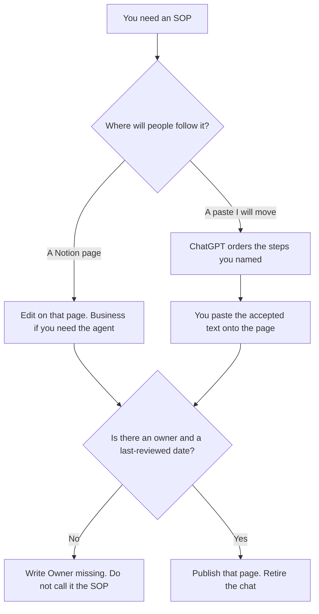

**Use Notion AI when the SOP is the page people already open, and the steps should be edited there. Use ChatGPT when you will draft from a paste of the real steps and then paste the accepted text into that page.** The model may order steps you name. It may not invent a step, an owner, or a tool permission. A wiki that explains the company is a different page: [Notion AI vs ChatGPT for wikis](/blog/notion-ai-vs-chatgpt-for-wikis-2026/). The onboarding set that points at the SOP is [how to create onboarding docs with AI](/blog/how-to-create-onboarding-docs-with-ai-2026/).

Prices are US list prices excluding tax from directory pages checked October 16, 2026. A live fetch of vendor pricing pages on October 24, 2026 returned HTTP 401, so this page stays on the directory record. Published October 24, 2026. We did not score procedures.

## Where the procedure should end up

| The material you have | Start here | First paid step | The limit |
|---|---|---|---|
| The SOP page the team already follows | [Notion AI](/tools/notion-ai/) | Business is $20 a seat a month | Plus at $10 is not the full AI tier |
| A paste of steps, owners, and the tool they use | [ChatGPT](/tools/chatgpt/) | Plus is $20 a month | No step that was not in the paste |
| A long procedure you will keep next to examples | [Claude](/tools/claude/) | Pro is $20 a month, or $17 billed annually | You still publish it on the page people open |
| The work tracker, if the SOP is really a task list | [ClickUp Brain](/tools/clickup-brain/) | Brain AI is $9 a user a month, on top of a workspace plan | The tracker is not the procedure unless people follow it there |

Notion's directory card, and the pricing article, put Notion Agent and AI Meeting Notes on Business at $20 a seat a month. Free can trial a generation. Plus at $10 is the small-team workspace, and the full AI experience is not that row. Custom Agents are a credit add-on at $10 per 1,000 credits, only after you want work to run while nobody is chatting. An SOP does not need that add-on. The invoice is [Notion AI pricing explained](/blog/notion-ai-pricing-explained-2026/).

ChatGPT Go is $8 a month and may include ads, on the directory card. A procedure is a poor fit for that plan. Plus is the seat when the draft lives in a project with last quarter's steps. The review is [ChatGPT review](/blog/chatgpt-review-2026/).

## What the SOP is allowed to contain

A trigger, the steps you already perform, the owner of the procedure, and the date you last checked it. A step called "use judgment" is how the procedure forks. If a tool permission is required, name the role that has it. The model does not grant the role.

**Notion Business** is the system of record. Generate into the page. A better draft in a private chat that nobody links from the handbook is a second procedure.

**ChatGPT Plus** is the paste path. Put the steps in the order they happen. Ask for headings and a missing-owner check. Delete any step added because a mature SOP "should include a RACI." If you need a RACI, that is [how to create a RACI chart with AI](/blog/how-to-create-a-raci-chart-with-ai-2026/), and it is a separate page.

**Claude** is the right seat when the procedure is long and the examples are easy to contradict. Do not run Claude and ChatGPT and merge them. **ClickUp Brain** belongs here only if the team follows the work in ClickUp. The workspace plan is a separate bill. The invoice is [ClickUp Brain pricing explained](/blog/clickup-brain-pricing-explained-2026/).

A prompt that holds the line:

"Order an SOP from the steps, the owner, and the trigger I pasted. Do not add a step. If the owner is missing, write Owner missing and stop."

## What not to delegate

Do not ask the model how the team should do the work. Do not leave the accepted text in the chat and the old text on the page. Do not include a customer's record as an example. Use a fake row, and say that it is fake. The pattern for fake rows is [how to create a test data plan with AI](/blog/how-to-create-a-test-data-plan-with-ai-2026/).

## FAQ

### Which one writes a better SOP?

We did not measure that. Notion fits the page people follow. ChatGPT fits a paste you will move onto that page. The SOP is better when a new person can find one page, one owner, and steps that match the work.

### Do I need Notion Business?

You need Business if you want Notion Agent on the SOP page, on the directory card checked October 16, 2026. You can keep the procedure as an ordinary page on a lower plan. The drafting can happen in ChatGPT. The page is still the SOP.

### How is this different from the wiki article?

A wiki explains. An SOP is a procedure: a trigger, an order, an owner, and a last-reviewed date. The same products can hold both. They should not be the same page if one of them changes weekly and the other should not.

### Can the model assign the owner?

Only by copying a name you pasted. An invented owner is a person who did not agree to keep the procedure current. Leave the line missing.

## Last verified

October 16, 2026 for Notion, ChatGPT, Claude, and ClickUp. The ClickUp credit detail used here is the October 24 pricing article where it goes beyond the directory. Published October 24, 2026.

**Sources:** [Notion pricing](https://www.notion.com/pricing), [ChatGPT pricing](https://chatgpt.com/pricing/), [Claude pricing](https://claude.com/pricing), [ClickUp Brain pricing](https://clickup.com/brain/pricing).

*Published by Andrew for [AI Tools Optimizer](https://aitoolsoptimizer.com).*

[Notion AI](/tools/notion-ai/) is in the [productivity and notes directory](/tools/category/productivity-notes/). Directory pages may use affiliate links. A purchase through them may earn us a commission at no extra cost to you.
