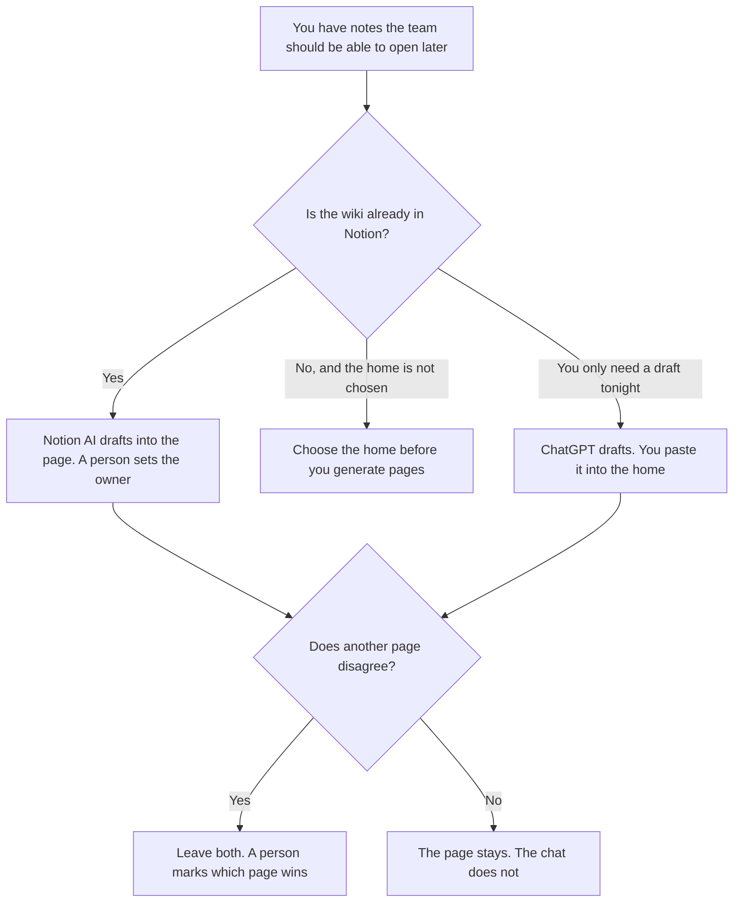

**Use Notion AI when the wiki page has to live in the workspace the team already opens, with an owner on the page. Use ChatGPT when you are holding a messy doc and you want a draft you will paste into that wiki yourself.** The wiki is the pages. A brilliant answer in a chat nobody can find on Monday is not a wiki. The build order, home first and then drafts, is [how to build an internal wiki with AI](/blog/how-to-build-an-internal-wiki-with-ai-2026/). The note that is not trying to be the company's memory is [Notion AI vs ChatGPT for notes](/blog/notion-ai-vs-chatgpt-for-notes-2026/).

Two docs that disagree need a person, not a smoother sentence. The place a fact is allowed to live is [what a system of record for AI is](/blog/what-is-a-system-of-record-for-ai-2026/). How long the prompt stays is [what an AI data retention policy is](/blog/what-is-ai-data-retention-policy-2026/).

Prices are US list prices excluding tax from directory pages checked October 16, 2026. Published October 24, 2026. We did not score findability.

## Which seat matches the page

| The page you actually need | Start here | What you still do |
|---|---|---|
| A draft from a paste, filed by hand | [ChatGPT](/tools/chatgpt/) Plus at $20 a month | You paste it into the wiki and name an owner |
| The page lives in Notion and must stay there | [Notion AI](/tools/notion-ai/) Business at $20 a seat a month | Full Agent and AI Meeting Notes are on Business. Plus at $10 is not that row |
| A trial inside an empty workspace | Notion Free, which includes a trial of Notion AI | A trial is not the company's wiki |
| The company forbids a personal chat account | ChatGPT Business at $20 a user a month billed annually, two-user minimum, or $25 monthly | The directory says Business does not train on business data by default. You still file the page |
| The work tracker is ClickUp, and the doc should sit on the task | [ClickUp Brain](/tools/clickup-brain/) from $9 a user a month, on top of a ClickUp plan | Brain answers from ClickUp. It does not replace a decision about where the wiki lives |

Notion Enterprise is a sales conversation. ChatGPT Pro starts at $100. A wiki page does not need Pro. Claude Pro at $20 a month, or $17 billed annually, is the drafting seat when the source is a long file and Notion is only where you paste the result. Do not pay for three drafters and zero owners.

## What the page should contain

A title someone would search, the answer in the first lines, the owner, and the date. The model may turn your notes into those headings. It may not merge two contradicting pages, invent a policy, or leave the owner as "the team." If the source does not say who owns the page, the draft says Owner missing.

**Notion Business** is the paid path when the wiki is Notion. The directory ties Notion Agent, AI Meeting Notes, and search across connected apps to that seat. Custom Agents are extra, at $10 per 1,000 credits, on Business and Enterprise. A wiki does not need an agent that edits pages while you sleep. The invoice is [Notion AI pricing explained](/blog/notion-ai-pricing-explained-2026/).

**ChatGPT Plus** is the paid path for the draft you will paste. Business is the path when the notes are company notes. Go at $8 may include ads, on the card. The company wiki is a poor fit for that plan. The review is [ChatGPT review](/blog/chatgpt-review-2026/).

**ClickUp Brain** is the paid path when the "wiki" is actually the doc on a task inside ClickUp. Everything AI is $28 a user a month on the directory. If people will not open ClickUp to read the policy, the policy is in the wrong home. The comparison with Notion on docs is [Notion AI vs ClickUp for docs](/blog/notion-ai-vs-clickup-for-docs-2026/).

A prompt that holds the line:

"Turn these notes into a wiki page with a title, a short answer, and the headings I used. Copy an owner only if I named one. If I did not, write Owner missing. Do not add policy I did not write. Do not delete a conflict. Mark it Conflict."

## What not to delegate

Do not ask the model which page is the source of truth. Do not publish a page with no owner because the prose looks finished. Do not point a chatbot at the wiki until the pages exist and someone owns them. The bot article is [how to build a knowledge-base chatbot](/blog/how-to-build-a-knowledge-base-chatbot-2026/). A bot on an ownerless wiki will answer with the stale page and sound sure.

## FAQ

### Which one is the better wiki?

We did not measure that. Notion is the wiki when the team already works there and Business is the seat you are willing to buy. ChatGPT is the draft. A wiki that lives in a chat history will not be maintained, because nobody can assign the page.

### Is Notion Plus enough?

Plus is $10 a seat a month on the card, and the full AI experience, including Agent and Meeting Notes, is Business at $20. If the only thing you needed was a human-written page, you may not need the AI add-on at all. This comparison is about drafting into the wiki, which is the Business row when you want Notion's AI to do it in place.

### Can both tools write the same page?

Yes, and then you have two pages. Pick one home. Use the other as a draft you throw away. Two current versions of "how we expense travel" is the failure this page is about.

### What if the notes contain a secret?

Leave the secret out of the prompt. A wiki page is a broad audience by default. The retention policy says whether the chat copy may exist at all. Do not paste credentials into either tool to "explain the setup."

## Last verified

October 16, 2026 for Notion AI, ChatGPT, Claude, and ClickUp Brain. Published October 24, 2026.

**Sources:** [Notion pricing](https://www.notion.com/pricing), [ChatGPT pricing](https://chatgpt.com/pricing/), [Claude pricing](https://claude.com/pricing), [ClickUp Brain](https://clickup.com/brain).

*Published by Andrew for [AI Tools Optimizer](https://aitoolsoptimizer.com).*

[Notion AI](/tools/notion-ai/) is in the [productivity and notes directory](/tools/category/productivity-notes/). Directory pages may use affiliate links. A purchase through them may earn us a commission at no extra cost to you.
