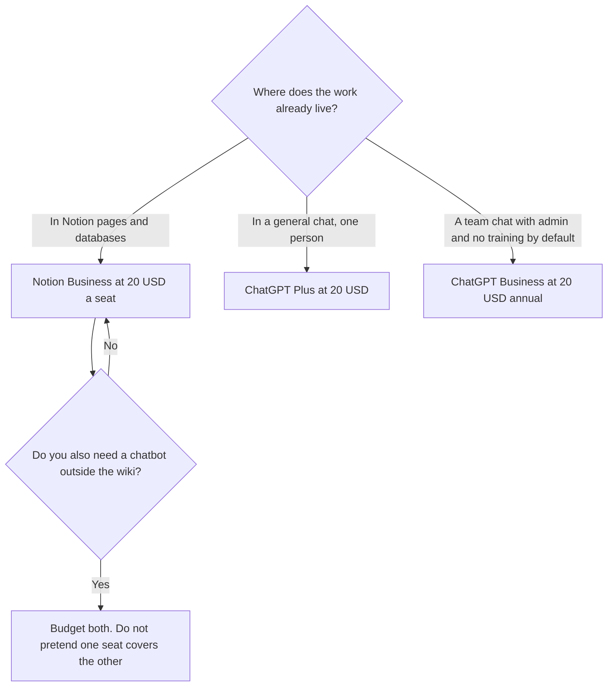

**Notion Business and ChatGPT Plus are both $20, and they buy different rooms.** Business is $20 a seat a month for the workspace, and it is the plan that includes Notion Agent, AI Meeting Notes, and search across connected apps. Plus is $20 a month for one person's ChatGPT. A team that needs the wiki pays Notion. A person who needs a general assistant pays Plus. Paying both is $40 a person before any add-on. Notion Plus at $10 does not replace ChatGPT Plus.

The Notion card is [Notion AI pricing explained](/blog/notion-ai-pricing-explained-2026/). The ChatGPT ladder is [ChatGPT Go vs Plus vs Pro](/blog/chatgpt-go-vs-plus-vs-pro-2026/). The writing split is [ChatGPT vs Notion AI for writing](/blog/chatgpt-vs-notion-ai-for-writing-2026/).

Prices are US list prices from directory pages checked October 16, 2026. The Notion card lists per-seat monthly figures and does not print a separate annual discount. Published October 24, 2026. We did not score writing.

## The seats, side by side

| | Notion | ChatGPT |
|---|---|---|
| Try it | Free includes a trial of Notion AI | Free includes text chat |
| Not the full AI tier | Plus is $10 a seat a month | Go is $8, and it may include ads |
| The $20 seat | Business, $20 a seat a month, full Notion AI | Plus, $20 a month, one person |
| A team with admin | Enterprise is sales. Business is the AI seat you can price | Business is $20 a user a month billed annually, or $25 monthly, for 2 or more users |
| The extra meter | Custom Agents: $10 per 1,000 credits after a trial, on Business and Enterprise | Pro from $100 if Plus runs out. Credits can extend Plus |

## Seat math for five people

Five Notion Business seats are 5 × $20 = $100 a month. That is the full AI tier on the workspace: Agent, meeting notes, and connected search, on the directory card. Five Notion Plus seats are 5 × $10 = $50, and Plus is not that AI tier. Buying Plus to "get Notion AI" and then pasting everything into ChatGPT is how teams pay twice by accident.

Five ChatGPT Plus seats are also 5 × $20 = $100 a month. They do not share an admin console. Five ChatGPT Business seats, billed annually, are 5 × $20 = $100 a month as well, with admin controls, SAML SSO, and no training on business data by default. Monthly Business is 5 × $25 = $125. If the reason you wanted five Plus seats was a company policy about training and SSO, Business is the seat with those controls at the same annual sticker as Plus. The directory says Business requires two or more users.

Five people who need the wiki and a separate chatbot are 5 × $20 + 5 × $20 = $200 a month before Custom Agent credits and before anyone upgrades to ChatGPT Pro. That is the honest number. Cut one of the products if the week does not use it.

Custom Agents are not included in the $20. They are $10 per 1,000 Notion credits after a trial, and they pause if the credits run out. A Slack bot that answers from the wiki all day can cost more than the seats. Watch it for a week before you call Business "the whole AI bill."

## What $20 does not include

Notion Business does not follow you into a blank chat about a topic that is not in the workspace. ChatGPT Plus does not edit the Notion database in place unless you connected something and you trust the write. The place a fact is allowed to live is [what a system of record for AI is](/blog/what-is-a-system-of-record-for-ai-2026/).

[Claude](/tools/claude/) Pro is the other $20 writing seat, or $17 billed annually. Pick it instead of Plus when the long document is the job, not as a third $20 "just in case." The email version of that choice is [ChatGPT vs Claude for email](/blog/chatgpt-vs-claude-for-email-2026/).

[Grammarly](/tools/grammarly/) Pro is $12 a member a month billed annually and edits a sentence. It is not a workspace and not a research chat. The card is [Grammarly pricing explained](/blog/grammarly-pricing-explained-2026/). The head-to-head with the wiki is [Notion AI vs Grammarly](/blog/notion-ai-vs-grammarly-2026/).

[ClickUp Brain](/tools/clickup-brain/) starts at $9 a user a month for Brain², on top of a ClickUp plan. If the tasks live in ClickUp, compare that add-on before you move the team to Notion to get AI. The comparison is [Notion AI vs ClickUp Brain](/blog/notion-ai-vs-clickup-brain-2026/).

## FAQ

### Is Notion Plus plus ChatGPT Go a cheaper full stack?

Notion Plus at $10 plus ChatGPT Go at $8 is $18 a person, and you still do not have Notion's full AI tier. Go may include ads. If the wiki AI is the requirement, Business at $20 is the Notion line. If chat is the requirement, Plus or Go is the ChatGPT line. The $18 pair is a compromise, not a substitute for Business.

### Does ChatGPT Plus include Notion AI?

No. They are different companies. A connection or a paste is not a bundle discount.

### What if we only have three people in Notion and ten in ChatGPT?

Price the seats you will assign. Three Business seats are $60. Ten ChatGPT Business seats at the annual rate are $200. Do not buy a Notion seat for someone who will never open the wiki. Guests on Notion are free, on the directory card. Members are billed.

### Which one should a founder buy first?

The tool the notes already live in. If that is Notion, start with one Business seat and use ChatGPT Free until a limit hurts. If the notes live in chat, start with Plus and keep the docs wherever they already are.

## Last verified

October 16, 2026 for Notion, ChatGPT, Claude, Grammarly, and ClickUp Brain prices named above. Published October 24, 2026.

**Sources:** [Notion pricing](https://www.notion.com/pricing), [ChatGPT pricing](https://chatgpt.com/pricing), [Claude pricing](https://claude.com/pricing).

*Published by Andrew for [AI Tools Optimizer](https://aitoolsoptimizer.com).*

[Notion AI](/tools/notion-ai/) is in the [productivity and notes directory](/tools/category/productivity-notes/). Directory pages may use affiliate links. A purchase through them may earn us a commission at no extra cost to you.
