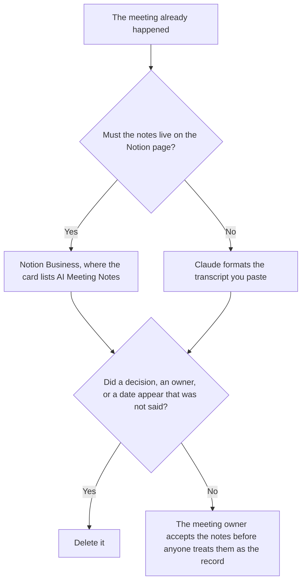

**Use Notion AI when the notes must live on the Notion page the team already uses, on the Business plan that lists AI Meeting Notes. Use Claude when you are formatting a transcript or a paste a person already has, and the notes are not required to live in Notion.** The model may group decisions, owners, and open questions that were said. It may not invent a decision, assign an owner who was not named, or add a task from silence.

The same job against ChatGPT is [Notion AI vs ChatGPT for meeting notes](/blog/notion-ai-vs-chatgpt-for-meeting-notes-2026/). A recorder, which is a different product, is the shelf in [best AI meeting notetakers](/blog/best-ai-meeting-notetakers/).

Notion's prices are from the directory page checked October 16, 2026. Claude's prices are from claude.com/pricing on October 24, 2026. ChatGPT Plus is $20 a month on learn.chatgpt.com/docs/pricing that day. Otter's price is from the directory checked October 16. Published October 24, 2026. We did not score transcription. The October 16 card lists AI Meeting Notes on Business. It does not print a word-error rate, so this page does not invent one.

## Where the notes have to live

| The page | Start here | First paid step | The limit |
|---|---|---|---|
| Notes on the Notion page | [Notion AI](/tools/notion-ai/) | Business is $20 a seat a month | Plus at $10 is not the full AI tier. The card does not put AI Meeting Notes on Plus |
| A transcript you paste | [Claude](/tools/claude/) | Pro is $17 a month billed annually, $200 up front, or $20 monthly | No decision that was not in the paste |
| One paste, no Project | [ChatGPT](/tools/chatgpt/) | Plus is $20 a month | Same limit. A different seat |
| A recording product | [Otter](/tools/otter-ai/) | Pro is $8.33 a user a month billed annually | This page does not claim Notion or Claude is the recorder |

A note that says the group "agreed" when the transcript says the group "will revisit" has changed the meeting. If an owner was not named, the line says Owner not named. It does not assign the person who spoke most.

Notion Free includes a trial of Notion AI on the October 16 card. Custom Agents are an add-on at $10 per 1,000 Notion credits for Business and Enterprise on that card. A meeting note does not require that add-on unless you are running an agent you already defined. The invoice is [Notion AI pricing explained](/blog/notion-ai-pricing-explained-2026/).

Claude Free can format a short paste. Pro is the seat with Projects, when every meeting of this series must use the same headings. The review is [Claude review](/blog/claude-review-2026/).

## What the notes are allowed to contain

Decisions that were stated, owners who were named, dates that were said, and open questions that were asked. A joke is not a decision. A slide that was not discussed is not a decision. The transcript, if you have one, stays the source. Do not edit the transcript to match a cleaner note.

**Notion Business** is the page path. The directory card lists AI Meeting Notes, Notion Agent, and search across connected apps on this tier. Confirm in the product that the meeting you care about is actually captured. A card line is not a recording of your call.

**Claude Pro** is the paste path. Put the headings in the Project: decided, deferred, owner not named. When a heading changes, change it once.

**ChatGPT Plus** is a one-note paste when you do not need the Project. The ladder is [ChatGPT pricing explained](/blog/chatgpt-pricing-explained-2026/).

**Otter Pro** is a recorder with its own invoice. Use it when the job is the recording. Then paste into Claude or file into Notion. Do not pay for three tools to produce one unreviewed note.

A prompt that holds the line:

"Format meeting notes from the transcript I pasted. If a decision was not stated, do not add one. If an owner was not named, write Owner not named. Do not add a task from a topic that was only mentioned."

## What not to delegate

Do not ask the model what the group meant. Do not paste a meeting you were not allowed to record. Do not file the note because the headings look complete. The meeting owner accepts it. A summary is not the minutes.

## FAQ

### How is this different from the ChatGPT comparison?

That page is Notion against ChatGPT for the same notes. This page is Notion against Claude, and the reason to pick Claude is a Project full of meetings that must share headings. The limit is the same: no decision that was not said.

### Does Business include a recorder?

The October 16 card lists AI Meeting Notes on Business. It does not describe a word-error rate or a bot that joins every call. Read the product for how capture works on your workspace. If you need a dedicated recorder, price Otter or another notetaker on its own page. Do not assume the $20 seat is that product.

### Which one writes safer notes?

We did not measure that. Notion fits the page the team reopens. Claude fits a paste and a shared heading set. The notes are safer when every decision traces to words that were said, and a missing owner says so.

### Who may call the notes final?

The meeting owner. A formatted page is not acceptance. A model that says the actions are clear has not attended the meeting.

## Last verified

October 16, 2026 for Notion, ChatGPT's comparison is the plan page fetched October 24, and Otter. October 24, 2026 for Claude. Published October 24, 2026.

**Sources:** [Notion pricing](https://www.notion.com/pricing), [Claude pricing](https://claude.com/pricing), [ChatGPT and Codex pricing](https://learn.chatgpt.com/docs/pricing), [Otter pricing](https://otter.ai/pricing).

*Published by Andrew for [AI Tools Optimizer](https://aitoolsoptimizer.com).*

[Notion AI](/tools/notion-ai/) is in the [productivity and notes directory](/tools/category/productivity-notes/). Directory pages may use affiliate links. A purchase through them may earn us a commission at no extra cost to you.
