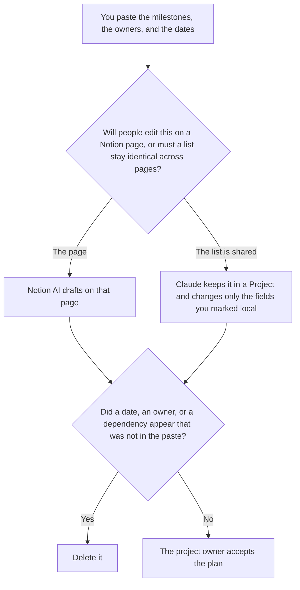

**Use Notion AI when the project plan is the page people already open, and the accepted dates should be edited there. Use Claude when a dependency list must stay word for word across several plan pages in a Project.** The model may order milestones, owners, and dates a person already wrote. It may not invent a date, an owner, or a dependency. The same schedule in a Google Doc or a one-time paste is [Gemini vs ChatGPT for project plans](/blog/gemini-vs-chatgpt-for-project-plans-2026/). A procedure, rather than a schedule, is [Notion AI vs Claude for SOPs](/blog/notion-ai-vs-claude-for-sops-2026/).

This week's movement, after the plan exists, is [Gemini vs ChatGPT for project updates](/blog/gemini-vs-chatgpt-for-project-updates-2026/). The coordinator who keeps the row is [best AI tools for project coordinators](/blog/best-ai-tools-for-project-coordinators-2026/).

Notion's prices are from the directory page checked October 16, 2026. Claude's prices are from claude.com/pricing on October 24, 2026. ChatGPT's Plus price is the October 24 plan-page figure recorded in [ChatGPT pricing explained](/blog/chatgpt-pricing-explained-2026/). Gemini's Pro price is the October 16 card recorded in [Gemini pricing explained](/blog/gemini-pricing-explained-2026/). Published October 24, 2026. We did not score plans. We did not mark a project on track.

## Where the plan should end up

| The plan | Start here | First paid step | The limit |
|---|---|---|---|
| The page the team already opens | [Notion AI](/tools/notion-ai/) | Business is $20 a seat a month | Plus at $10 is not the full AI tier. A date you did not write stays out |
| One dependency list copied across several plans | [Claude](/tools/claude/) | Pro is $17 a month billed annually, $200 up front, or $20 monthly | A page may not reword a dependency you marked shared |
| One paste you will move onto the page | [ChatGPT](/tools/chatgpt/) | Plus is $20 a month | The paste is the source. The chat is not the plan |
| A Google Doc the team already shares | [Gemini](/tools/gemini/) | Google AI Pro is $19.99 a month | That choice is the other project-plan page |

A plan that says a launch is "on track" has added a status. If you did not write the status, the line says Status not set. A dependency that is not on the list stays off every page. Claude's job is to keep the shared list identical. It is not to reconcile two dates by inventing a third.

The SOP page is steps a person follows. A project plan is milestones and dates. A step can point at a plan. It should not become the schedule. The Google Doc comparison is a different home for the file. If the team lives in Notion, this page is the one. Do not draft the plan in three tools and then ask a model which date wins.

## What the plan is allowed to contain

Milestones, owners, and dates from the paste. A risk nobody wrote stays out. A budget figure stays out unless you pasted it. The owner of the plan is a person. The page can name them. The model cannot assign them.

**Notion Business** is the page. The invoice is [Notion AI pricing explained](/blog/notion-ai-pricing-explained-2026/).

**Claude Pro** is the shared dependency list. Team standard seats are $20 a seat a month billed annually, or $25 monthly, when the plan is a company record, as recorded in [Claude Team pricing explained](/blog/claude-team-pricing-explained-2026/). The review is [Claude review](/blog/claude-review-2026/).

**ChatGPT Plus** is the one paste you will move. Go is $8 a month on the October 24 plan page. Plus is the seat for a saved draft. The review is [ChatGPT review](/blog/chatgpt-review-2026/).

**Gemini on AI Pro** is the Doc path, on the other article. Confirm the Doc is one that plan reaches before you treat it as the source of truth.

A prompt that holds the line:

"Draft the plan from the milestones, owners, and dates I pasted. If a date is missing, write Date not set. Do not add a dependency. Do not mark the project on track. Do not reword a line I marked shared."

## What not to delegate

Do not ask the model to pick a realistic date. Do not let two pages keep two versions of a shared dependency. Do not accept the plan because the headings look complete. The project owner accepts it.

## FAQ

### How is this different from Gemini vs ChatGPT for project plans?

That page is a Google Doc the team shares, or one paste. This page is the Notion page people already open, or a dependency list that must stay identical across several plans. A Doc and a Notion page can both exist. A person decides which one is the plan. The model does not merge the dates.

### How is this different from Notion AI vs Claude for SOPs?

The SOP page is the procedure people follow, including an exception list that must stay word for word. This page is the schedule: milestones, owners, and dates. A procedure can link to a milestone. It does not replace the date. If they disagree, a person fixes one of them.

### How is this different from a project update?

The update is what moved and what slipped since the last note. The plan is the dates you are still willing to stand behind. An update that changes a date is a plan edit, and it belongs to the owner of the plan. Draft the update on the update page. Do not let it silently rewrite this one.

### Who may accept the plan?

The project owner. Date not set stays unset. A shared dependency does not get a local rewrite. A formatted page is not a new schedule.

## Last verified

October 24, 2026 for Claude and for ChatGPT's plan page, via the posts cited above. October 16, 2026 for Notion and Gemini. Published October 24, 2026. No project was marked on track in this article.

**Sources:** [Notion pricing](https://www.notion.com/pricing), [Claude pricing](https://claude.com/pricing), [ChatGPT and Codex pricing](https://learn.chatgpt.com/docs/pricing), [Google AI subscriptions](https://gemini.google/subscriptions/).

*Published by Andrew for [AI Tools Optimizer](https://aitoolsoptimizer.com).*

[Notion AI](/tools/notion-ai/) is in the [productivity and notes directory](/tools/category/productivity-notes/). Directory pages may use affiliate links. A purchase through them may earn us a commission at no extra cost to you.
