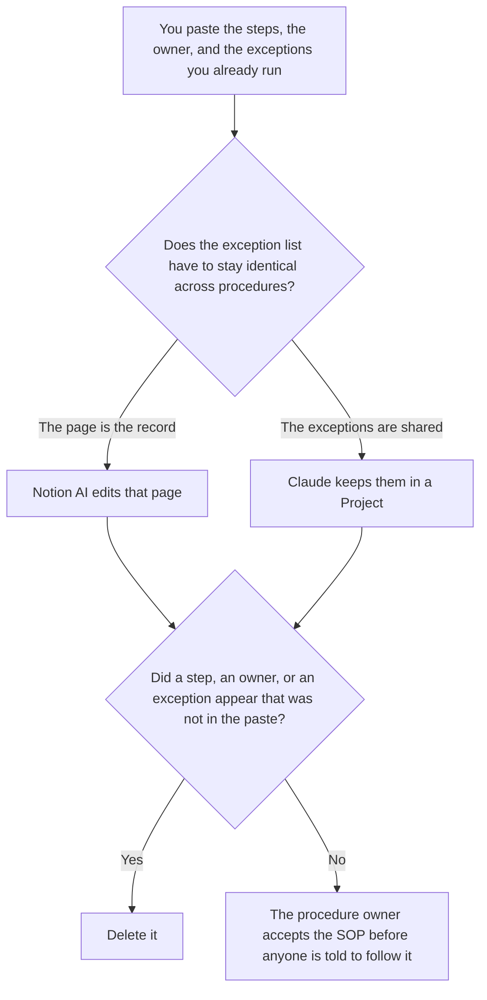

**Use Notion AI when the SOP is the page people already open, and the accepted steps should be edited there. Use Claude when a long exception list must stay word for word across several procedures in a Project.** The model may order steps you named. It may not invent a step, an owner, a tool permission, or an exception. The same job against ChatGPT, which is a paste you will move onto the page, is [Notion AI vs ChatGPT for SOPs](/blog/notion-ai-vs-chatgpt-for-sops-2026/). The onboarding set that points at the SOP is [how to create onboarding docs with AI](/blog/how-to-create-onboarding-docs-with-ai-2026/).

A permission grid for tools, which is not the procedure, is [how to create a tool permission matrix with AI](/blog/how-to-create-a-tool-permission-matrix-with-ai-2026/). A step that changes something outside the chat still needs [what an AI tool side-effect label is](/blog/what-is-ai-tool-side-effect-label-2026/).

Notion's prices are from the directory page checked October 16, 2026. Claude's prices are from claude.com/pricing on October 24, 2026. ChatGPT's Plus price is the October 24 plan-page figure recorded in [ChatGPT pricing explained](/blog/chatgpt-pricing-explained-2026/). Grammarly is the October 16 card. A live fetch of Grammarly's plans URL returned HTTP 401 on October 24, as the Business pricing article records. Published October 24, 2026. We did not score procedures. We did not watch a team follow either draft.

## Where the procedure should end up

| The file | Start here | First paid step | The limit |
|---|---|---|---|
| The page people already follow | [Notion AI](/tools/notion-ai/) | Business is $20 a seat a month | Plus at $10 is not the full AI tier. The help desk or the tool still has to match the page |
| An exception list that must read the same in several SOPs | [Claude](/tools/claude/) | Pro is $17 a month billed annually, $200 up front, or $20 monthly | The Project holds the exceptions. A procedure may not reword them |
| One short draft from a paste, before it has a home | [ChatGPT](/tools/chatgpt/) | Plus is $20 a month | That path is the other article. Do not treat it as the page of record |
| A clarity pass that must not add a step | [Grammarly](/tools/grammarly/) | Pro is $12 a member a month billed annually, or $30 monthly | Compare the steps before and after |

Notion Plus at $10 a seat is not the Business tier this page quotes. The October 16 card is the source for the $20 Business seat. If your workspace invoice says otherwise, the invoice wins. The pricing article is [Notion AI pricing explained](/blog/notion-ai-pricing-explained-2026/). The Business-only cut of that invoice is [Notion AI Business pricing explained](/blog/notion-ai-business-pricing-explained-2026/).

Claude Team standard seats are $20 a seat a month billed annually, or $25 monthly, when the SOP is a company record, as recorded in [Claude Team pricing explained](/blog/claude-team-pricing-explained-2026/). Pro is enough for one owner drafting into a Project. Team is the seat when several people share that Project as the record.

## What the SOP is allowed to contain

The steps you pasted, the owner you named, and the exceptions you listed. A tool the procedure uses stays as you named it. A permission you did not write stays as Permission not stated. The model does not grant it. If two procedures share an exception and they disagree, stop and fix the Project. Do not publish either.

**Notion Business** is the page. The review is [Notion AI review](/blog/notion-ai-review-2026/).

**Claude Pro** is the shared exception list. The review is [Claude review](/blog/claude-review-2026/).

**ChatGPT Plus** is the short paste on the sibling page. Go is $8 a month on the October 24 plan page. Use it when you do not need the Project and you do not need the Notion page yet.

**Grammarly Pro** is the pass after the steps are stable. Reject a suggestion that merges two steps or softens an exception. The invoice is [Grammarly pricing explained](/blog/grammarly-pricing-explained-2026/).

A prompt that holds the line:

"Draft the SOP from the steps, the owner, and the exceptions I pasted. If an owner is missing, write Owner not set. If a permission is missing, write Permission not stated. Do not add a step. Do not reword an exception I marked shared."

## What not to delegate

Do not ask which steps a team will "actually follow." Do not paste a vendor's help center and treat it as your procedure. Do not publish the page because the headings look complete. The procedure owner accepts it. A formatted page is not a step anyone has agreed to run.

## FAQ

### How is this different from Notion AI vs ChatGPT for SOPs?

That page chooses Notion when the page is the record, and ChatGPT when you draft from a paste and then paste the accepted text onto the page. This page chooses Notion for that same page, and Claude when an exception list must stay identical across several procedures. Both pages refuse an invented step. Use that page for a one-off paste. Use this page for shared exceptions.

### How is this different from onboarding docs?

Onboarding docs point a new hire at the checklist the team already runs. An SOP is the procedure itself. An onboarding page can link the SOP. It should not restate an exception in different words. If the two files disagree, a person fixes one of them.

### How is this different from a tool permission matrix?

The matrix says who may use which tool, and whether the call reads or changes something. The SOP says the steps a person follows. A step can name a tool. It does not grant the permission. Link the matrix. Do not let the draft add a column of access.

### Who may tell people to follow the SOP?

The procedure owner. A page that adds a step is not in force. An exception that was reworded in only one file is not in force. Owner not set stays not set until a person writes the name.

## Last verified

October 16, 2026 for Notion and Grammarly. October 24, 2026 for Claude and for ChatGPT's plan page. Published October 24, 2026. Grammarly's plans URL returned HTTP 401 on October 24.

**Sources:** [Notion pricing](https://www.notion.com/pricing), [Claude pricing](https://claude.com/pricing), [ChatGPT and Codex pricing](https://learn.chatgpt.com/docs/pricing), [Grammarly pricing](https://www.grammarly.com/plans).

*Published by Andrew for [AI Tools Optimizer](https://aitoolsoptimizer.com).*

[Notion AI](/tools/notion-ai/) is in the [productivity and notes directory](/tools/category/productivity-notes/). Directory pages may use affiliate links. A purchase through them may earn us a commission at no extra cost to you.
