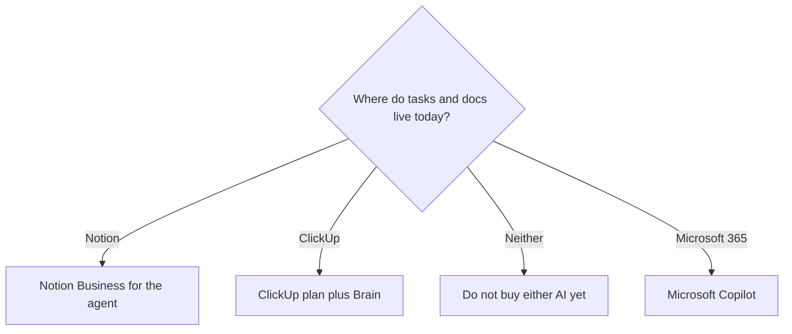

**Buy the AI that sits on top of the workspace you already run.** Notion AI is the expensive part of a Notion seat, not a separate writing app. ClickUp Brain is an add-on on a ClickUp plan. Moving the company wiki so you can buy the other AI is the cost that does not show up on either pricing page.

Prices are US list prices excluding tax, from vendor pages checked October 16, 2026, published here on October 24, 2026. A live refetch that day did not return pricing. Confirm the checkout, especially whether a ClickUp AI price is added to the workspace plan or bundled.

The product reviews are [Notion AI review](/blog/notion-ai-review-2026/) and [ClickUp Brain review](/blog/clickup-brain-review-2026/). A wider desk of notes and planning tools is [best AI productivity tools](/blog/best-ai-productivity-tools-2026/).

## Two bills, because the AI is not the workspace

| | Notion | ClickUp |
|---|---|---|
| Workspace, before the full AI pitch | Free includes a trial of Notion AI. Plus is $10/seat/month | Free Forever. Unlimited is $7/user/month billed yearly, or $10 monthly. Business is $12 yearly, or $19 monthly |
| Where the full AI shows up | Business at $20/seat/month: Notion Agent, AI Meeting Notes, and search across connected apps | Brain² AI from $9/user/month: unlimited Brain² conversations, premium models, 1,500 AI Super Credits |
| The heavier AI tier | Custom Agents, billed in credits at $10 per 1,000 after a trial, on Business and Enterprise | Everything AI at $28/user/month: Notetaker, AI Fields, Automations, and Super Agents |
| What you are really buying | An agent that can edit your pages and databases | An assistant that can see tasks, docs, and chat you already track in ClickUp |
| Model choice | Notion's own agent experience inside the workspace | Switch among models such as [ChatGPT](/tools/chatgpt/), [Claude](/tools/claude/), and [Gemini](/tools/gemini/) on the Brain subscription |
| Meeting notes | AI Meeting Notes on Business, without a bot joining the call | Notetaker is on Everything AI, not on the $9 Brain² tier |
| Privacy line the vendor states | Customer data is not used to train AI subprocessors' models, with a contractual bar | Data is not used to train third-party models. Brain surfaces what that user can already see |

A worked seat, using the yearly ClickUp workspace price plus the published AI price, is a sketch you must confirm at checkout:

| Team of 8, yearly workspace price where one exists | AI included in that number | Extra AI line | Sketch per user |
|---|---|---|---|
| Notion Plus at $10 | Trial-level AI, not the agent | Jump to Business rather than adding a second SKU | $20 on Business |
| Notion Business at $20 | Agent, meeting notes, connected search | Custom Agent credits only if something runs on a schedule | $20, then credits |
| ClickUp Unlimited at $7 yearly | The workspace, not Brain | Brain² at $9 | $16 if the add-on stacks |
| ClickUp Business at $12 yearly | The workspace | Everything AI at $28 | $40 if the add-on stacks |

Notion does not sell "Notion AI" as a $10 add-on on top of Plus in the pages we used. The full product is the Business seat. People who add $10 to a Plus seat in a spreadsheet are describing a plan that was not on the pricing page.

## When Notion is the right AI

Choose Notion Business when the system of record is pages, wikis, and databases, and you want an agent that can create and edit them. That is a different job from "summarize this task list." Notion Agent is the multi-step worker. Custom Agents are the always-on workers: a trigger or a schedule, then credits.

Buy Business for the agent and the meeting notes. Buy credits only after an agent has a job you can name, such as "answer the same Slack question from the wiki." A credit pack with no trigger is a second subscription you will not notice until the invoice.

Plus at $10 is a small-team Notion plan. It is the right plan if you want the workspace and you are still inside the AI trial. It is the wrong plan if the reason for the purchase was the agent.

The bill, including the credit trap, is [Notion AI pricing explained](/blog/notion-ai-pricing-explained-2026/).

## When ClickUp Brain is the right AI

Choose Brain when the questions are about work already in ClickUp: what is blocked, what changed, what the doc said. The $9 tier is the conversation layer, and those Brain² conversations are not supposed to spend Super Credits. Credits are for the heavier actions: Super Agents, AI automations, and AI fields.

That split matters. A team that asks status questions can stay on Brain². A team that wants the AI to write into fields, run automations, and take meeting notes is on Everything AI at $28, and still needs a ClickUp plan underneath if the pricing page treats AI as an add-on.

ClickUp also sells model switching inside that one subscription. If the reason you are comparing Notion and ClickUp is "we want Claude and GPT without two chat bills," that is a ClickUp feature, not a Notion one. It is still only valuable if the context those models should see is the ClickUp workspace. A general chatbot is cheaper for a person who does not live in either tool. [ChatGPT](/tools/chatgpt/) Plus is $20. [Claude](/tools/claude/) Pro is $20 monthly, or $17 on annual billing.

## When neither is the purchase

- The company runs on Microsoft 365. Start with [Microsoft Copilot](/tools/microsoft-copilot/), including the free signed-in assistant, before you migrate a wiki to reach an agent.
- The pain is the calendar, not the wiki. [Motion](/tools/motion/) Pro AI is $19/seat/month and schedules tasks. It is a planner, not a docs agent.
- The pain is notes from calls you will not paste into either workspace. [Granola](/tools/granola/) and the notetakers in [best AI meeting notetakers](/blog/best-ai-meeting-notetakers/) are the smaller product.

## FAQ

### Is ClickUp Brain cheaper than Notion AI?

The AI line is. Brain² is $9 per user. Notion's full AI seat is Business at $20. The honest comparison adds the workspace. Notion Business is one number. ClickUp is often a workspace plan plus an AI plan. An Unlimited yearly seat plus Brain² can land near $16, which is still under $20, if checkout adds them. Everything AI plus a workspace plan can land well above Notion Business.

### Can I use Notion AI on the free plan?

You can try it. Generating a doc or autofilling a database is inside the trial Notion describes on Free. Notion Agent, AI Meeting Notes, and connected-app search are Business features.

### Does either one join my Zoom?

Notion's meeting notes are designed not to put a bot in the participant list. ClickUp's Notetaker is a separate, more expensive AI tier. If a visible bot is unacceptable, read the current Notion meeting-note limits before you assume Business solves a compliance rule.

### Should a 3-person team buy this at all?

Only if the three of you already keep the work in that tool. A shared chatbot plus the free workspace is the smaller experiment. The agent is worth it when someone is already copying status out of the tool by hand every week.

## Last verified

October 16, 2026 for plan prices. Published October 24, 2026. The pricing pages did not return a fresh fetch that day. Confirm whether ClickUp adds Brain on top of the workspace price.

**Sources:** [Notion pricing](https://www.notion.com/pricing), [Notion AI](https://www.notion.com/product/ai), [ClickUp Brain](https://clickup.com/brain), [ClickUp Brain pricing](https://clickup.com/brain/pricing).

Both are in the [productivity directory](/tools/category/productivity-notes/). [Notion AI](/tools/notion-ai/) and [ClickUp Brain](/tools/clickup-brain/) may use affiliate links. A purchase through them may earn us a commission at no extra cost to you.
