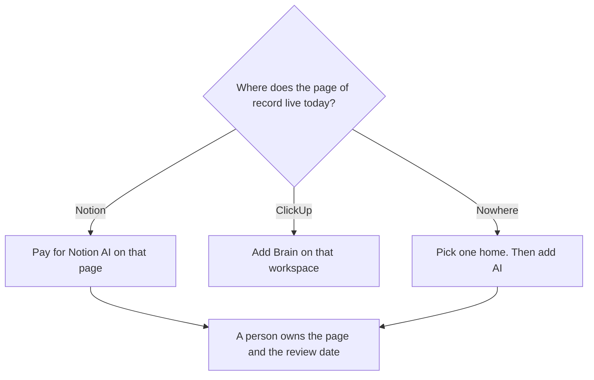

**Keep the doc in the workspace that already holds the page, and buy AI there.** Notion AI is the writing layer on a Notion page. ClickUp Brain is an add-on on a ClickUp workspace that also tracks tasks. Moving a wiki so you can try the other AI is the cost neither pricing page shows. We did not score which one writes clearer docs. The seat-level pair is [Notion AI vs ClickUp Brain](/blog/notion-ai-vs-clickup-brain-2026/).

The place a wiki should live is [how to build an internal wiki with AI](/blog/how-to-build-an-internal-wiki-with-ai-2026/). The invoice on the Notion side is [Notion AI pricing explained](/blog/notion-ai-pricing-explained-2026/). The record you are trying not to fork is [what a system of record for AI is](/blog/what-is-a-system-of-record-for-ai-2026/).

Prices are US list prices excluding tax from directory pages checked October 16, 2026. A live refetch of ClickUp's AI price on October 24, 2026 is not in this page. Confirm whether Brain is added on top of the workspace plan. Published October 24, 2026.

## Where the doc should stay

| The workflow you have | Keep the doc here | First AI price | Leave it when |
|---|---|---|---|
| Pages, a wiki, and decisions already in Notion | [Notion AI](/tools/notion-ai/) | Business is $20 a seat a month, the tier with the agent. Plus is $10 and is not that full AI tier | The team lives in tasks, and the doc is only a description on a ticket |
| Tasks, docs, and chat already in ClickUp | [ClickUp Brain](/tools/clickup-brain/) | Brain² from $9 a user a month, on top of a ClickUp plan | You would be moving a wiki of record into a project tool to get a sidebar |
| A long source PDF, not a team wiki | [Gemini Notebook](/tools/gemini-notebook/), free with a Google account | Higher limits ride Google AI plans, from $4.99 | The answer has to become a page other people edit |
| A draft you will paste into whichever wiki you already run | [Claude](/tools/claude/) Pro at $20 a month, or $17 billed annually | One editor, not a second system of record | |

ClickUp Unlimited is $7 a user a month billed yearly, or $10 monthly. Business is $12 yearly, or $19 monthly. Everything AI is $28 a user a month and adds Notetaker, AI Fields, Automations, and Super Agents, on the card. Add Brain²'s from-$9 only after you know it stacks on the plan you already pay. A docs team that does not need a task graph should not buy a task graph to unlock a paragraph.

## What "docs workflow" means here

**A decision log.** The page says what was decided, the date, and the owner. Notion Business is the row that includes Notion Agent, AI Meeting Notes, and search across connected apps. Custom Agents are an add-on at $10 per 1,000 Notion credits, for Business and Enterprise. A decision page does not need an agent that posts by itself. It needs an owner.

**A spec next to the work.** If the spec is a ClickUp Doc because the tasks are already there, draft in that Doc. Brain² includes premium models and 1,500 AI Super Credits at the from-$9 row. Super Credits are a meter. A doc that quietly spends them is still a doc you review. The review of the product is [ClickUp Brain review](/blog/clickup-brain-review-2026/).

**A source that is not the wiki.** Gemini Notebook answers from files you upload. Use it to read a contract or a research PDF. Paste the accepted summary into Notion or ClickUp. Do not let two wikis both claim to be current. Freshness of that page is [what retrieval freshness is](/blog/what-is-retrieval-freshness-2026/).

A prompt that holds the line:

"Turn these notes into a doc with a title, an owner, a date, and the decisions I listed. Do not add a decision I did not write. If a section has no source in the notes, write Missing. Do not assign tasks to people who are not in the notes."

## What not to delegate

Do not migrate the wiki to chase a trial. Do not let an AI field overwrite a status a person set. Do not keep the same policy in both tools and edit both with a model. One home. The other tool can link to it.

The Notion review is [Notion AI review](/blog/notion-ai-review-2026/). A person still accepts the page: [what human-in-the-loop AI is](/blog/what-is-human-in-the-loop-ai-2026/).

## FAQ

### Can we use both?

You can, if each page has one home. Using both as the place a policy is edited will fork the policy. Pay for AI in the home. Use the other product for its actual job, tasks or pages, and link out.

### Is Plus enough for Notion docs?

Plus at $10 a seat is the workspace tier the directory separates from Business. The full agent is on Business at $20. If you only need a person to write the page, you may not need the agent. Do not assume Plus includes the AI row this comparison is about. Read the checkout.

### Does ClickUp Brain replace the ClickUp plan?

No. Free Forever exists, and Brain² can be tried, on the card. The from-$9 figure is the AI add-on. Unlimited or Business is the workspace under it. Confirm the stack in your billing page before you quote a single number.

### What about meeting notes inside the doc?

Notion Business includes AI Meeting Notes on the card. ClickUp's Everything AI row adds Notetaker. A transcript is not a decision. Paste the decision into the doc, with the date. The notes workflow is [how to summarize meetings with AI](/blog/how-to-summarize-meetings-with-ai-2026/).

## Last verified

October 16, 2026 for Notion AI, ClickUp Brain, Claude, and Gemini Notebook. Published October 24, 2026. Confirm ClickUp's current add-on math at checkout.

**Sources:** [Notion pricing](https://www.notion.com/pricing), [ClickUp Brain](https://clickup.com/brain), [Claude pricing](https://claude.com/pricing).

*Published by Andrew for [AI Tools Optimizer](https://aitoolsoptimizer.com).*

[Notion AI](/tools/notion-ai/) is in the [productivity and notes directory](/tools/category/productivity-notes/). Directory pages may use affiliate links. A purchase through them may earn us a commission at no extra cost to you.
