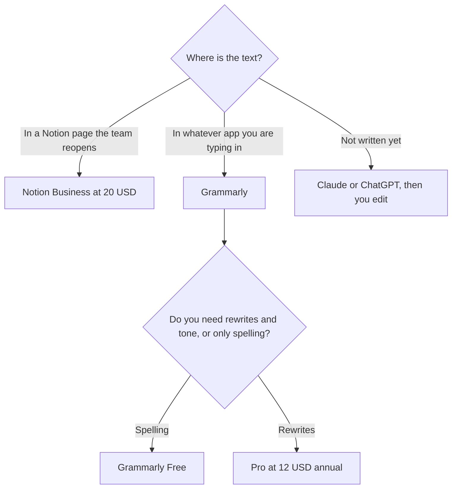

**Use Notion AI when the writing lives in Notion and you want the model on that page, that database, and that meeting note. Use Grammarly when the pain is the sentence, in the apps you already type in, and the facts are already yours.** Notion AI is a workspace feature. Grammarly is an editor that follows you. Buying both on day one is how a team pays $20 and $12 to fix one comma.

The chat comparison, which is a third product, is [ChatGPT vs Notion AI for writing](/blog/chatgpt-vs-notion-ai-for-writing-2026/). The editor comparison is [Grammarly vs ChatGPT for editing](/blog/grammarly-vs-chatgpt-for-editing-2026/). The Grammarly bill is [Grammarly pricing explained](/blog/grammarly-pricing-explained-2026/).

Prices are US list prices excluding tax from directory pages checked October 16, 2026. Published October 24, 2026. We did not score clarity or grammar.

## Two different jobs

| The situation | Start here | First paid step | Not this |
|---|---|---|---|
| The doc, the wiki, and the database are in Notion | [Notion AI](/tools/notion-ai/) | Business is $20 a seat a month for the full AI tier | Grammarly, as the place the page lives |
| You need a cleaner sentence in Gmail, Docs, and Slack | [Grammarly](/tools/grammarly/) | Pro is $12 a member a month billed annually, or $30 monthly | A $20 workspace seat for a comma |
| You are drafting from notes, and the page can live anywhere | [Claude](/tools/claude/) or [ChatGPT](/tools/chatgpt/) | Pro or Plus is $20. Claude Pro is $17 billed annually | Grammarly, as the drafter |
| You mainly need a paraphrase | [QuillBot](/tools/quillbot/) | Premium is $8.33 a month billed annually | Notion Business |
| Notion Free's AI trial was enough to see the button | Stay on Free until the trial blocks a real page | Plus at $10 is not the full AI tier | Pro Grammarly, if the blocker was the database |

## What the money buys

**Notion.** Free includes a trial of Notion AI, such as generating docs and autofilling databases. Plus is $10 a seat a month for small teams. Business is $20 a seat and adds Notion Agent, AI Meeting Notes, and search across connected apps. That is the full AI tier. Custom Agents run on credits: free to try, then $10 per 1,000 credits on Business and Enterprise. Enterprise is sales. The card is [Notion AI pricing explained](/blog/notion-ai-pricing-explained-2026/). The review is [Notion AI review](/blog/notion-ai-review-2026/).

Notion will draft a page that sounds finished and is missing the number you meant. Paste the source. Delete the sentence that adds a policy. A page in Notion is still a page you publish. The fact pass is [how to fact-check AI writing](/blog/how-to-fact-check-ai-writing-2026/).

**Grammarly.** Free covers grammar and spelling. Pro is $12 a member a month billed annually, which is $144 a year, or $60 per quarter, or $30 billed monthly. Pro adds full-sentence rewrites, tone adjustment, and 2,000 AI prompts. Enterprise, through Superhuman Go, adds unlimited AI prompts, roles, and data loss prevention. The directory does not print an Enterprise dollar. Pro replaces the old Business plan and supports up to 149 seats. Grammarly is part of Superhuman. The review is [Grammarly review](/blog/grammarly-review-2026/). Whether the annual seat is worth it is [is Grammarly Pro worth it](/blog/is-grammarly-pro-worth-it-2026/).

Grammarly will not know that the flag name is wrong, the discount is outdated, or the customer asked for the other tier. Run it after the facts are right. It is a poor place to ask for the first draft of a case study. That draft is a chat, from notes you paste. The method is [how to write a blog post with Claude](/blog/how-to-write-a-blog-post-with-claude-2026/).

## A sensible order

If the team already lives in Notion, try the Free AI trial on one real page. Move the people who publish to Business when the trial stops the work. Do not buy Plus and expect the agent. Leave Grammarly Free on for the sentence, including inside Notion if the extension runs there.

If the team does not live in Notion, do not adopt Notion to get a writing assistant. Grammarly Free, then Pro at $12 annual if rewrites are the weekly habit, is the smaller bet. A $20 chat seat is the bet when you are producing the draft, not polishing it. The writing aisle is [best AI writing assistants](/blog/best-ai-writing-assistants/).

Monthly Grammarly at $30 is $360 a year, against $144 annual. The directory's own verdict is to avoid monthly billing if you can. This page agrees with the arithmetic. It does not agree that everyone needs Pro.

## FAQ

### Does Notion Business include Grammarly?

No. Business includes Notion's AI on the workspace. Grammarly is a separate product that checks text where its extension or app runs. You can use both. You do not get one by paying for the other.

### Is Grammarly Pro enough for a wiki?

It is enough for the sentences in the wiki. It will not search your Notion workspace, autofill a database, or keep meeting notes on the page. That is the Business seat, if Notion is the system of record.

### Can I write the page in ChatGPT and edit it in Grammarly?

Yes. That is often the right pair when Notion is not where the page lives. Plus is $20. Grammarly Free may be enough after that. Pro is the rewrite seat, not a second drafter.

### Which one is better for students?

Grammarly Free on work you wrote yourself. Notion only if the school already uses it. A student stack that does not start with a workspace seat is [best AI tools for students](/blog/best-ai-tools-for-students-2026/). Your school's rules outrank either product.

## Last verified

October 16, 2026 for Notion, Grammarly, Claude, ChatGPT, and QuillBot prices named above. Published October 24, 2026.

**Sources:** [Notion pricing](https://www.notion.com/pricing), [Grammarly Pro cost](https://support.grammarly.com/hc/en-us/articles/115000090011-How-much-does-Grammarly-Pro-cost), [ChatGPT pricing](https://chatgpt.com/pricing).

*Published by Andrew for [AI Tools Optimizer](https://aitoolsoptimizer.com).*

[Notion AI](/tools/notion-ai/) is in the [productivity and notes directory](/tools/category/productivity-notes/). Directory pages may use affiliate links. A purchase through them may earn us a commission at no extra cost to you.
