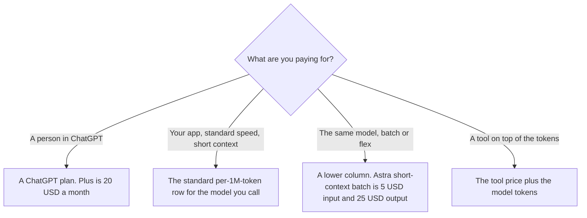

**The OpenAI API bills tokens, tool calls, and a few session meters. It does not bill a ChatGPT seat.** On the markdown form of the pricing page, fetched October 24, 2026 at developers.openai.com/api/docs/pricing.md, standard short-context prices per 1 million tokens include gpt-6-astra at $10 input and $50 output, gpt-6.1-sol at $2 and $10, and gpt-6-luna at $0.10 and $0.50. Cached input on those three rows is $1, $0.10, and $0.01. Short context on that page means 272,000 input tokens or fewer. Above that, a second set of columns applies.

A ChatGPT subscription is the other product. Plus is $20 a month on learn.chatgpt.com/docs/pricing the same day. The seat ladder is [ChatGPT pricing explained](/blog/chatgpt-pricing-explained-2026/). Image rows on the API page are walked in [DALL·E pricing explained](/blog/dall-e-pricing-explained-2026/). The idea of a key in front of a product is [what an API for AI tools is](/blog/what-is-an-api-for-ai-tools-2026/).

Published October 24, 2026. We did not run a bill. Prices below are the ones on that markdown page. The directory has no separate OpenAI API card, so the product link for the chat side of the company is [ChatGPT](/tools/chatgpt/).

## How to read one row

| What you pay | gpt-6-astra, standard, short context | gpt-6.1-sol, standard, short context | gpt-6-luna, standard, short context |
|---|---|---|---|
| Input, per 1M tokens | $10 | $2 | $0.10 |
| Output, per 1M tokens | $50 | $10 | $0.50 |
| Cached input, per 1M tokens | $1 | $0.10 | $0.01 |
| Cache write, 30 minutes / 12 hours, per 1M | $12.50 / $25 | $2.50 / $5 | $0.125 / $0.25 |

Long context, above 272,000 input tokens, is a different price. On the same standard table, gpt-6-astra long-context input is $20 per 1M tokens and long-context output is $75. Do not apply the $10 input price to a prompt that has crossed the line. The page also says regional processing endpoints charge a 10 percent uplift for models released on or after March 5, 2026, and that FedRAMP endpoints charge a 10 percent uplift. Priority processing was renamed Fast mode on July 30, 2026, on that page.

Batch and Flex, for gpt-6-astra short context, are $5 input, $25 output, and $0.50 cached input on that page. Fast for the same cell is $20 input, $100 output, and $2 cached input. Ultrafast is a further column. Quote the column you will actually call. A batch discount you hoped for is [what AI batch inference is](/blog/what-is-ai-batch-inference-2026/) only when you are on the batch column.

## Tools and seats that are not the token row

**Web search**, on that page, is $10 per 1,000 calls for the all-models line, plus search content tokens at model rates. The non-reasoning web-search preview line is $25 per 1,000 calls, and the page says search content tokens are free on that preview line. Read the line your request uses.

**File search** is $0.10 per GB per day after 1 GB free, and $2.50 per 1,000 tool calls, on that page. The page says the tool-call price applies to the Responses API.

**Containers** for Hosted Shell and Code Interpreter are listed as $0.03 for 1 GB, $0.12 for 4 GB, $0.48 for 16 GB, and $1.92 for 64 GB, per 20-minute session per container. The same page also says eligible container sessions are billed by the minute with a 5-minute minimum. Use both sentences when you forecast a session.

**A ChatGPT Business seat** is $20 a user a month billed annually, for two or more users, or $25 monthly. It is a workspace. It is not a prepaid token balance. The workspace article is [ChatGPT Team pricing explained](/blog/chatgpt-team-pricing-explained-2026/).

**A neighboring API**, so the shape of a token bill is not unique to OpenAI: [DeepSeek](/tools/deepseek/) Flash off-peak is $0.15 per million input tokens on a cache miss on the directory card. That is DeepSeek's meter. The invoice is [DeepSeek pricing explained](/blog/deepseek-pricing-explained-2026/).

**A coding seat** that can call models without you holding this key is [GitHub Copilot](/tools/github-copilot/) Pro at $10 a user a month on the October 16 card. Copilot credits are not this API price list. The company seat is [GitHub Copilot Business pricing explained](/blog/github-copilot-business-pricing-explained-2026/).

## What not to assume

Do not add a Plus seat and an API forecast and call the sum "ChatGPT." Do not price a call with only the input column. Output, cached input, and cache writes are on the same row. Do not treat a cached-input price as the price of the first call. The first call is the miss, until you have measured a hit. Do not copy an image price into a chat forecast. Image models are a separate table on the same page.

## FAQ

### How much is the OpenAI API?

There is no single price. On October 24, 2026, standard short-context gpt-6-luna was $0.10 per 1M input tokens and $0.50 per 1M output tokens. gpt-6.1-sol was $2 and $10. gpt-6-astra was $10 and $50. Your model and your speed column decide the row.

### Does ChatGPT Plus include the API?

Plus is $20 a month for the ChatGPT product. API usage bills on the API account. A person who has Plus and an API key has two bills. The Codex plan page says an API key pays API pricing.

### What is short context?

The pricing page says short context is 272,000 input tokens or fewer, and long context is above that. Astra's long-context standard input on that page is $20 per 1M tokens, not $10.

### Are Batch and Standard the same model at a discount?

They are different columns. Astra's short-context batch input is $5 per 1M tokens on the page we read, against $10 on standard. You get the batch price when the request is actually batch or flex, as that table defines it. A normal call does not inherit the batch cell.

## Last verified

October 24, 2026, from https://developers.openai.com/api/docs/pricing.md, the markdown form of the OpenAI API pricing page. ChatGPT seat prices in the comparison are from learn.chatgpt.com/docs/pricing that day. DeepSeek and GitHub Copilot comparisons use the October 16 directory cards. Published October 24, 2026.

**Sources:** [OpenAI API pricing](https://developers.openai.com/api/docs/pricing), [ChatGPT and Codex pricing](https://learn.chatgpt.com/docs/pricing), [DeepSeek API pricing](https://api-docs.deepseek.com/quick_start/pricing), [GitHub Copilot](https://github.com/features/copilot).

*Published by Andrew for [AI Tools Optimizer](https://aitoolsoptimizer.com).*

[ChatGPT](/tools/chatgpt/) is in the [chatbots and assistants directory](/tools/category/chatbots-assistants/). Directory pages may use affiliate links. A purchase through them may earn us a commission at no extra cost to you.
