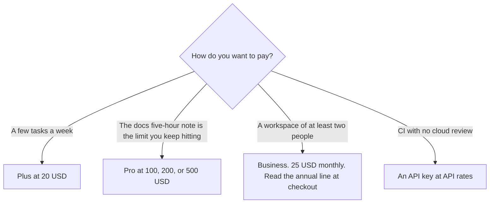

**Codex is included with ChatGPT plans: Free at $0, Go at $8 a month, Plus at $20 a month, and Pro at $100, $200, or $500 a month.** Business is $25 per user per month when billed monthly, for workspaces of 2 or more users, on the October 24, 2026 docs page. That page says Business is billed annually for those workspaces and does not print the annual per-user dollar in the text we captured. The directory page checked October 16, 2026 recorded the annual figure as $20 per user per month. Quote the annual checkout line, not a blend of the two dates.

The buying choice against the other coding agents is [Cursor vs Claude Code vs Codex](/blog/cursor-vs-claude-code-vs-codex-2026/). A local bugfix, which may not need Codex, is [Cursor vs Claude Code for bugfixes](/blog/cursor-vs-claude-code-for-bugfixes-2026/). Claude Code's seat is [Claude Code review](/blog/claude-code-review-2026/).

Published October 24, 2026. Prices below are US list prices from learn.chatgpt.com/docs/pricing on that date, except the annual Business dollar, which is marked as the October 16 directory record. We did not score pull requests.

## The plan cards

| Plan | Price on the October 24 docs | What the card says you get |
|---|---|---|
| Free | $0 | Quick coding tasks. GPT-6 Luna at Standard speed in the desktop app, subject to rollout |
| Go | $8 a month | Lightweight coding tasks, same model note as Free |
| Plus | $20 a month | Codex on the web, CLI, IDE extension, and iOS. Cloud integrations such as GitHub code review and Slack. GPT-6.1 Sol and GPT-6 Luna. Credits can extend usage |
| Pro | $100, $200, or $500 a month | Everything in Plus. The docs say Pro currently has no five-hour limit. Ultrafast mode is on Pro $500 |
| Business | $25 per user a month billed monthly. Annual billing for 2+ users. Annual per-user dollar not in the text we captured | Larger cloud VMs, admin controls, SAML SSO, MFA. No training on business data by default, in the vendor's words |
| Enterprise and Edu | Contact sales | SCIM, EKM, retention and residency controls, audit logs |
| API key | API rates, not the subscription | CLI, SDK, and IDE only. No cloud features such as GitHub code review or Slack |

The docs say ChatGPT Work and Codex share usage. They also say the estimates of local messages per five hours are not fixed limits and depend on model and task size. Check the usage dashboard or `/status` in the CLI. This page does not repeat those ranges as promises.

Fast mode uses included subscription usage at 2.5 times the Standard rate, on the same page. Ultrafast is 8 times for the models the table lists, and Ultrafast access is tied to Pro $500 and eligible Enterprise or Edu plans. Voice in Desktop uses the Codex usage budget at $0.05 a minute, on that page. That is a meter on top of the seat, not a cheaper Codex.

The docs page still describes GPT-5.5 retiring from Codex with ChatGPT sign-in on October 14, 2026, at noon PDT. API-key sessions were not affected, in that note. If your account already moved models, the models list in the docs wins over this sentence.

## What the seat does not include

An API key does not include cloud review, Slack, or the other cloud features the table marks off. Credit rates per million tokens are on the same docs page. They are not the subscription price, and this article does not copy that rate card. The vendor's own example says a typical GPT-5.6 Sol task may use 2 to 15 credits. That is their example, not a measurement we ran.

**Claude Code** comes with Claude Pro at $20 a month, or $17 billed annually, on the directory card checked October 16. It is a different subscription. The review is linked above. **Cursor** Plus is $8 a month, or $80 a year, when the fix should stay in an editor you control. The ladder is [Cursor pricing explained](/blog/cursor-pricing-explained-2026/). **GitHub Copilot** Pro is $10 a user a month for completions in GitHub's surfaces. The invoice is [GitHub Copilot pricing explained](/blog/github-copilot-pricing-explained-2026/).

## What not to assume

Do not quote Business at $20 a month unless you are looking at the October 16 directory record and your checkout still shows it. The October 24 page printed $25 for monthly billing. Do not treat "no five-hour limit" on Pro as permanent. The docs say "currently." Do not estimate a month of Codex from a public API token price. The docs say API token prices are separate from subscription usage.

## FAQ

### How much does Codex cost?

On October 24, 2026, Plus is $20 a month and Pro is $100, $200, or $500 a month. Free and Go at $8 cover lighter tasks. Business monthly is $25 per user. An API key bills API rates and drops the cloud features.

### Is Codex included with ChatGPT Plus?

Yes, on that docs page: web, CLI, IDE extension, iOS, and the cloud integrations listed for Plus. Usage still has a dashboard. Plus can buy credits when the included allowance runs out, in the docs' words.

### What is the Business annual price?

The October 24 page says workspaces of 2 or more users are billed annually and prints $25 per user per month for monthly billing. It does not print the annual per-user dollar in the text we captured. The October 16 directory recorded $20 per user per month billed annually. Read the annual line at checkout.

### Do Pro plans have a five-hour limit?

The October 24 docs say Pro plans currently have no five-hour limit, and that weekly limits may also apply to other plans. "Currently" is the vendor's word. Check the dashboard.

## Last verified

October 24, 2026, from the ChatGPT docs pricing page. The Business annual $20 figure is from the directory page checked October 16, 2026. Published October 24, 2026.

**Sources:** [Codex pricing](https://learn.chatgpt.com/docs/pricing), [OpenAI Codex](https://openai.com/codex).

*Published by Andrew for [AI Tools Optimizer](https://aitoolsoptimizer.com).*

[OpenAI Codex](/tools/openai-codex/) is in the [coding directory](/tools/category/coding/). Directory pages may use affiliate links. A purchase through them may earn us a commission at no extra cost to you.
